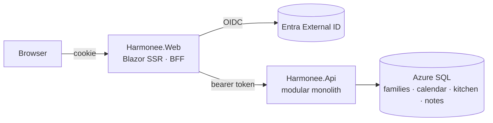

# Harmonee

Keep the whole family in tune: one shared place for the **family calendar, shopping lists, meal plans and notes**. Each family has one or more owners, and **custom roles** decide what each member can see and change. Platform administrators can find and fix any family's data, and everything they do is audit-logged.

Built on .NET 10, ASP.NET Core, Blazor, EF Core, Aspire and Microsoft Entra External ID, following the [engineering handbook](docs/handbook/README.md).

## Quick start

```bash
dotnet run --project src/Harmonee.AppHost
```

Open **https://localhost:7180** and sign in with any name (local development sign-in), or follow [Getting started](docs/getting-started.md) to use real accounts with Entra External ID.

Requirements: .NET SDK 10.0.400+, SQL Server LocalDB (or Docker), and a trusted dev certificate (`dotnet dev-certs https --trust`).

## How it fits together



- **Web app = Backend-for-Frontend.** Tokens stay on the server; the browser only holds an HTTP-only cookie.
- **API = modular monolith.** The Families, Calendar, Kitchen and Notes modules each own a database schema. Every family-scoped endpoint checks membership and the caller's role permission.
- **Aspire** runs everything locally with a dashboard for logs, traces and metrics, and models the Azure deployment.

Read more in [Architecture](docs/architecture.md) and the [decision records](docs/adr/). To run it in Azure, see [Deploying to Azure](docs/deployment.md).

## Repository layout

| Path | What's there |
|---|---|
| `src/Harmonee.AppHost` | Aspire app model: start here |
| `src/Harmonee.Api` | API host (auth, versioning, OpenAPI, problem details) |
| `src/Harmonee.Api.Contracts` | HTTP request/response types shared with clients |
| `src/Harmonee.Web` | Blazor web app and BFF |
| `src/Modules/*` | Families, Calendar, Kitchen, Notes modules |
| `src/Harmonee.MigrationService` | Applies database migrations, then exits |
| `src/Shared/*` | Shared kernel, ASP.NET Core plumbing, Aspire service defaults |
| `tests/*` | Unit, integration (real SQL Server), architecture, and component tests |
| `infra/` | Azure infrastructure (Bicep, Azure Verified Modules) with dev and prod parameters |
| `docs/` | Getting started, deployment, architecture, ADRs, roadmap, engineering handbook |

## Development

```bash
dotnet build Harmonee.slnx
```

```bash
dotnet test --solution Harmonee.slnx
```

```bash
dotnet format Harmonee.slnx --verify-no-changes
```

Add a migration for a module (example: Notes):

```bash
dotnet ef migrations add <Name> --project src/Modules/Notes/Harmonee.Notes --startup-project src/Modules/Notes/Harmonee.Notes --output-dir Infrastructure/Migrations
```

The API reference (Scalar) is at `https://localhost:7181/scalar` while the app runs in development.

Contributions follow trunk-based development: short-lived branches, pull requests using the [template](.github/pull_request_template.md), green CI. See the [roadmap](docs/roadmap.md) for what's next.

## License

[MIT](LICENSE)
