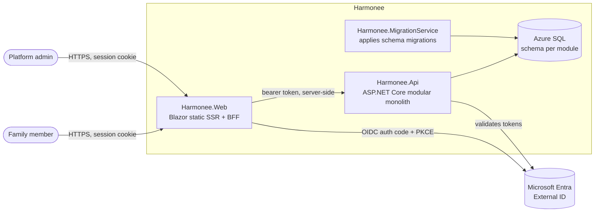

# Harmonee architecture

> Status: MVP foundation · Follows [the engineering handbook](handbook/README.md). Decisions are recorded in [ADRs](adr/).

## 1. Goals and constraints

- A family organiser: **families** (contexts) with one or more **owners**, **custom roles** controlling what each member can see and change, and shared **calendar events, shopping lists, meal plans and notes**.
- **Platform administrators** can find any family and correct its data, with audit logging.
- A foundation to build on: web first, mobile (.NET MAUI) next, hosted on Azure.
- Small team, so we keep it simple: one API deployable, one database, strong module boundaries.

## 2. Context and containers (C4 levels 1–2)



- **The browser never sees a token.** The web app is a confidential OIDC client. It keeps tokens in a server-side cache and gives the browser an HTTP-only `__Host-` cookie ([ADR 0003](adr/0003-blazor-static-ssr-as-bff.md)).
- **Static server-side rendering only.** Every API call happens on the server, inside a request. There are no WebAssembly downloads and no SignalR circuits.
- **One API deployable**, internally split into modules ([ADR 0002](adr/0002-modular-monolith.md)).

## 3. Modules

| Module | Owns (schema) | Responsibilities |
|---|---|---|
| **Families** | `families` | User profiles (provisioned on first sign-in), families, members, owners, custom roles, invite codes, **family access checks** used by every other module, admin family search |
| **Calendar** | `calendar` | Family calendar events |
| **Kitchen** | `kitchen` | Shopping lists and items, meal plan entries |
| **Notes** | `notes` | Shared family notes |

Rules (enforced by `tests/Harmonee.Architecture.Tests`):
- A module may use another module **only through its `*.Contracts` project**. Today only `Harmonee.Families.Contracts` exists, and it exposes `IFamilyAccessService` and `RequireFamilyPermission()`.
- Each module owns its schema and `DbContext`. There are no cross-schema joins or foreign keys.
- Module domains don't depend on EF Core or ASP.NET Core; module internals are `internal`.
- `Harmonee.Api.Contracts` holds the HTTP request/response types shared with clients and has no dependencies ([ADR 0005](adr/0005-shared-http-contracts.md)).

```
src/
  Harmonee.AppHost/              Aspire app model (local orchestration, Azure deployment model)
  Harmonee.Api/                  Host: auth, versioning, OpenAPI, problem details, rate limiting
  Harmonee.Api.Contracts/        HTTP DTOs, permissions, limits (shared with web/mobile)
  Harmonee.Web/                  Blazor web app + BFF
  Harmonee.MigrationService/     Runs every module's migrations, then exits
  Modules/<Module>/Harmonee.<Module>/          Domain/, Features/ (vertical slices), Infrastructure/ (DbContext, migrations)
  Modules/Families/Harmonee.Families.Contracts/ Family access contract used by other modules
  Shared/Harmonee.SharedKernel/                 Result/Error, keyset cursors (tiny, no business logic)
  Shared/Harmonee.SharedKernel.AspNetCore/      Problem details mapping, ETags, current user, audit log, module DB registration
  Shared/Harmonee.ServiceDefaults/              OpenTelemetry, health checks, service discovery, resilience
tests/
  Harmonee.Families.UnitTests/   Domain invariants
  Harmonee.Api.IntegrationTests/ Real HTTP pipeline + real SQL Server, OpenAPI contract snapshot
  Harmonee.Architecture.Tests/   Module boundary rules
  Harmonee.Web.Tests/            bUnit components, form models, time zones
```

## 4. Authorization model

The model has three layers, each enforced on the server:

1. **Authenticated + scope.** The API's fallback policy requires a signed-in user whose token carries the `Harmonee.Access` scope. Endpoints opt out explicitly (only health checks and the OpenAPI document do).
2. **Family membership + role permission.** Every endpoint under `/v1/families/{familyId}` declares `.RequireFamilyPermission(FamilyPermission.X)`. The filter resolves the caller's access:
   - **Not a member, and not an admin:** `404` (we don't reveal that the family exists).
   - **Member whose role lacks the permission:** `403`.
   - **Owner:** every permission.
   - **Platform admin (`Harmonee.Admin` app role):** every permission, flagged `IsAdminOverride`, and **audit-logged** on every request.
3. **Resource scoping.** Handlers always filter by the authorized `familyId` (and, for shopping items, by a list that belongs to that family), so an ID from another family can't be reached through your own family's route. Integration tests cover this.

Permissions (`FamilyPermission`): `View`/`Manage` × `Calendar`, `ShoppingLists`, `MealPlans`, `Notes`, plus `ManageMembers` and `ManageRoles`. Managing something implies viewing it. Owner-only actions are renaming the family, changing the default role, and granting or removing ownership. **No privilege escalation**: a non-owner can't change their own role or edit the role they hold, and can only assign or grant permissions they already have. A family **always has at least one owner**; the `Family` aggregate enforces this and a row version guards against concurrent changes.

The UI hides what you can't do, but that's cosmetic: the API is the authority.

## 5. Data and consistency

- One Azure SQL database, one schema per module, EF Core 10 code-first migrations per module (`Infrastructure/Migrations`).
- Migrations are applied by `Harmonee.MigrationService`, **never at API startup**. The API waits for it in the Aspire model.
- **Optimistic concurrency**: every content item has a `rowversion`, exposed as an `ETag`. Updates require `If-Match` (`428` if missing, `412` if stale). The web app posts back the ETag it rendered, so concurrent edits by two family members are detected instead of silently overwritten.
- **Pagination**: keyset cursors for notes, shopping lists and admin search; bounded date ranges for calendar (≤ 93 days) and meal plans (≤ 62 days).
- IDs are GUID v7 (time-ordered, index-friendly, non-guessable).

## 6. Cross-cutting concerns

| Concern | Implementation |
|---|---|
| Errors | RFC 9457 Problem Details everywhere, with a stable `code` and `type`. No internals leaked. Trace ID included. |
| Validation | .NET 10 built-in Minimal API validation (DataAnnotations on contracts) plus domain rules returning `Result` errors |
| Versioning | URL segment (`/v1`) via Asp.Versioning; OpenAPI 3.1 document per version; Scalar UI in development |
| Contract safety | The committed OpenAPI snapshot is compared in tests, so changes show up in PRs |
| Observability | OpenTelemetry (logs, traces, metrics) to the Aspire dashboard locally and Azure Monitor when `APPLICATIONINSIGHTS_CONNECTION_STRING` is set |
| Audit | `Harmonee.Audit` log category: admin overrides and all family membership/role changes |
| Resilience | Standard HTTP resilience handler on all `HttpClient`s; SQL retry-on-failure via Aspire |
| Rate limiting | Token bucket per user (or IP) on the API |
| Security headers | Strict CSP (no inline script/style), `X-Frame-Options`, `nosniff`, referrer policy, HSTS (web, non-dev) |
| Time zones | Stored in UTC; the browser reports its IANA time zone in a cookie; the web converts on display and input |

## 7. Request flow example: adding a shopping item

1. The browser posts the "Add item" form (Blazor enhanced form, with an antiforgery token) to the web app.
2. The web app binds the form and calls `POST /v1/families/{id}/shopping-lists/{listId}/items`. `UserAccessTokenHandler` attaches the user's access token from the server-side cache.
3. The API validates the token and scope, then `RequireFamilyPermission(ManageShoppingLists)` resolves membership and role.
4. The handler checks that the list belongs to the family, enforces the 500-item limit, saves, and returns `201` with the item and its ETag.
5. The web app redirects (Post/Redirect/Get) and the page re-renders with the new item.
6. The whole flow is one distributed trace in the Aspire dashboard / Application Insights.

## 8. Deployment (next step)

The Aspire AppHost already models Azure SQL. The planned target is Azure Container Apps (API, web, and migrations as a job) behind Azure Front Door, with managed identities, Key Vault and App Configuration, provisioned with `azd`/Bicep. See [the roadmap](roadmap.md). In production, the web app should use a **certificate or managed-identity federated credential** instead of a client secret, and **Data Protection keys** in Blob Storage protected by Key Vault (already supported via `DataProtection:BlobUri` / `DataProtection:KeyVaultKeyUri`).
