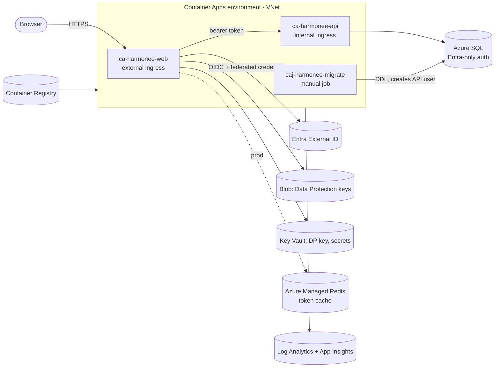

# Deploying to Azure

This guide covers what you create **once** so the [deploy workflow](../.github/workflows/deploy.yml) can provision and update Harmonee in Azure, and what the workflow does on each run. The infrastructure is Bicep in [`infra/`](../infra/), built on [Azure Verified Modules](https://aka.ms/avm). The decisions behind it are in [ADR 0008](adr/0008-azure-hosting-topology.md).

> Nothing in this repository creates subscriptions, identities, app registrations or GitHub settings. You create those using the steps below. After that, every change reaches Azure only through the pipeline.

---

## 1. What gets deployed

One resource group per environment (`dev`, `prod`), all resources tagged `workload`, `environment`, `owner`, `costCenter`, `dataClassification` and `createdBy`, and named using [CAF conventions](https://learn.microsoft.com/azure/cloud-adoption-framework/ready/azure-best-practices/resource-naming) (`<type>-harmonee-<env>-<region>`).



| Resource | Name (dev) | Notes |
|---|---|---|
| Container Apps environment | `cae-harmonee-dev-cus` | Workload profiles (Consumption), in `vnet-harmonee-dev-cus`. Zone-redundant in prod. Its platform-managed resource group is `rg-harmonee-dev-cus-cae`. |
| Web app | `ca-harmonee-web-dev-cus` | Public HTTPS. Authenticates to Entra External ID with a **managed identity federated credential** (or a Key Vault certificate, see §3.3). |
| API | `ca-harmonee-api-dev-cus` | **Internal ingress only**: reachable from the web app, not the internet. |
| Migrations job | `caj-harmonee-migrate-dev-cus` | Started by the pipeline before each API update. Applies EF Core migrations, then creates the API's database user. |
| Managed identities | `id-harmonee-{api,web,migrations}-dev-cus` | One per workload. Each one has only the roles it needs (AcrPull, plus the rows below). |
| Azure SQL | `sql-harmonee-dev-cus-01` / `sqldb-harmonee` | **Entra-only authentication.** The migrations identity is the server's Entra admin. The API identity gets `db_datareader` + `db_datawriter`. Serverless. In dev it uses the free offer and auto-pauses. |
| Key Vault | `kv-harmonee-dev-cus-01` | RBAC only. Holds the Data Protection key-wrapping key (`dataprotection`) and the Application Insights connection string. |
| Storage | `stharmoneedevcus01` | Container `dataprotection` (the web app's key ring). Shared-key access is disabled. |
| App Configuration | `appcs-harmonee-dev-cus-01` | Local auth is disabled, and the API and web identities can read it. The apps don't read it yet (see §7). |
| Container Registry | `crharmoneedevcus01` | Admin user disabled. The pipeline pushes; the apps pull with their identities. |
| Log Analytics / App Insights | `log-harmonee-dev-cus` / `appi-harmonee-dev-cus` | Workspace-based. The dev workspace has a 1 GB/day cap. |
| Azure Managed Redis | `amr-harmonee-prod-cus-01` (prod only) | Entra auth only. The web app's distributed token cache. |

**Dev and prod differ only in their parameter files.** [`main.dev.bicepparam`](../infra/main.dev.bicepparam) uses public endpoints with Entra-only auth (SQL allows Azure services only), scale to zero, no Redis and the smallest SKUs. [`main.prod.bicepparam`](../infra/main.prod.bicepparam) uses private endpoints for SQL, Key Vault, Storage, App Configuration and Redis (public access disabled), zone redundancy, Redis, and at least two replicas.

The region is `centralus` (`cus`) in both files. To use a different region, change `location` and `locationAbbreviation` before the first deployment.

---

## 2. One-time Azure setup (per environment)

Do this for `dev`, then repeat it for `prod`, ideally in a separate production subscription ([handbook 08 §4](handbook/08-azure-hosting-and-infrastructure.md#4-environments-and-subscriptions)). The commands use the Azure CLI, signed in to the **workforce tenant that owns the subscription**.

```bash
az login
```

### 2.1 Register resource providers

```bash
for ns in Microsoft.App Microsoft.ContainerRegistry Microsoft.Sql Microsoft.KeyVault Microsoft.Storage Microsoft.AppConfiguration Microsoft.Insights Microsoft.OperationalInsights Microsoft.ManagedIdentity Microsoft.Network Microsoft.Cache; do az provider register --namespace "$ns"; done
```

### 2.2 Create the workload resource group

```bash
az group create --name rg-harmonee-dev-cus --location centralus --tags workload=harmonee environment=dev owner=<you> costCenter=harmonee dataClassification=confidential createdBy=manual
```

### 2.3 Create the deployment identity and trust GitHub

Keep the deployment identity **outside** the workload resource group, so a deployment can never modify or delete it.

```bash
az group create --name rg-harmonee-dev-cus-deploy --location centralus --tags workload=harmonee environment=dev createdBy=manual
```

```bash
az identity create --name id-harmonee-deploy-dev-cus --resource-group rg-harmonee-dev-cus-deploy
```

Federated credential: GitHub's OIDC tokens for **this repository's `dev` environment only** (use `prod` for the prod identity):

```bash
az identity federated-credential create --identity-name id-harmonee-deploy-dev-cus --resource-group rg-harmonee-dev-cus-deploy --name github-dev --issuer https://token.actions.githubusercontent.com --subject repo:rnancedonaldson/harmonee:environment:dev --audiences api://AzureADTokenExchange
```

### 2.4 Give it least-privilege roles on the workload resource group

| Role | Why |
|---|---|
| **Contributor** | Create and update the resources, and start the migrations job. |
| **AcrPush** | Push images to the registry (data plane). |
| **Role Based Access Control Administrator**, *conditioned* | The templates assign roles to the app identities. The condition limits it to exactly those roles. |

```bash
principal=$(az identity show --name id-harmonee-deploy-dev-cus --resource-group rg-harmonee-dev-cus-deploy --query principalId --output tsv)
scope=$(az group show --name rg-harmonee-dev-cus --query id --output tsv)
```

```bash
az role assignment create --assignee-object-id "$principal" --assignee-principal-type ServicePrincipal --scope "$scope" --role Contributor
```

```bash
az role assignment create --assignee-object-id "$principal" --assignee-principal-type ServicePrincipal --scope "$scope" --role AcrPush
```

The condition allows assigning only AcrPull, App Configuration Data Reader, Key Vault Secrets User, Key Vault Certificate User, Key Vault Crypto Service Encryption User and Storage Blob Data Contributor:

```bash
roles="7f951dda-4ed3-4680-a7ca-43fe172d538d, 516239f1-63e1-4d78-a4de-a74fb236a071, 4633458b-17de-408a-b874-0445c86b69e6, db79e9a7-68ee-4b58-9aeb-b90e7c24fcba, e147488a-f6f5-4113-8e2d-b22465e65bf6, ba92f5b4-2d11-453d-a403-e96b0029c9fe"
condition="((!(ActionMatches{'Microsoft.Authorization/roleAssignments/write'})) OR (@Request[Microsoft.Authorization/roleAssignments:RoleDefinitionId] ForAnyOfAnyValues:GuidEquals {$roles})) AND ((!(ActionMatches{'Microsoft.Authorization/roleAssignments/delete'})) OR (@Resource[Microsoft.Authorization/roleAssignments:RoleDefinitionId] ForAnyOfAnyValues:GuidEquals {$roles}))"
az role assignment create --assignee-object-id "$principal" --assignee-principal-type ServicePrincipal --scope "$scope" --role "Role Based Access Control Administrator" --condition "$condition" --condition-version 2.0
```

> If you add a role assignment to the templates, add its role ID to this condition first, or the deployment fails with `AuthorizationFailed`.

### 2.5 Collect the values for GitHub

```bash
az identity show --name id-harmonee-deploy-dev-cus --resource-group rg-harmonee-dev-cus-deploy --query clientId --output tsv
```

```bash
az account show --query "{subscriptionId:id, tenantId:tenantId}"
```

---

## 3. Entra External ID setup (per environment)

Use **separate app registrations per environment** ("Harmonee API (dev)", "Harmonee Web (dev)", and so on), created exactly as in [Getting started §3](getting-started.md#3-use-real-accounts-microsoft-entra-external-id), **except**: don't create a client secret for the web app in Azure environments. Deployed web apps refuse to start with a client secret (`WebClientCredentials` allows them only in the `Development` environment).

### 3.1 Redirect URIs (after the first deployment)

The first pipeline run prints the web URL in the job summary, for example `https://ca-harmonee-web-dev-cus.<random>.centralus.azurecontainerapps.io`. You can also get it with:

```bash
az deployment group list --resource-group rg-harmonee-dev-cus --query "[?starts_with(name, 'harmonee-apps')] | [0].properties.outputs.webUrl.value" --output tsv
```

On the **Harmonee Web** registration, under **Authentication → Web**, add `<web-url>/signin-oidc` and `<web-url>/signout-callback-oidc` as redirect URIs, and set `<web-url>/signout-callback-oidc` as the **front-channel logout URL**. Also add the web app to the sign-up/sign-in user flow (Getting started §3.4).

### 3.2 Web app credential, option A: managed identity federated credential (default)

The web app's managed identity (`id-harmonee-web-<env>-cus`) is trusted as a credential of the Harmonee Web app registration. The app exchanges a managed identity token for its client assertion (`SignedAssertionFromManagedIdentity` in `AzureAd:ClientCredentials`). There's no secret or certificate to rotate.

> **Tenant requirement.** Microsoft's documentation requires the [app registration and the managed identity to be in the same tenant](https://learn.microsoft.com/entra/workload-id/workload-identity-federation-config-app-trust-managed-identity). A managed identity belongs to the directory of the subscription it's created in, while Harmonee's app registrations live in the **External ID tenant**. Option A therefore works only if the Harmonee subscription is associated with the external tenant. If your subscription belongs to your workforce tenant (the usual setup), the token exchange is rejected. Use option B.

If the tenants match, add the credential on the **Harmonee Web** registration: **Certificates & secrets → Federated credentials → Add credential → Managed Identity**. The values are:
- Issuer: `https://login.microsoftonline.com/<tenant-id>/v2.0`
- Subject: the web identity's **principal (object) ID**, from the `webIdentityPrincipalId` deployment output, or `az identity show --name id-harmonee-web-dev-cus --resource-group rg-harmonee-dev-cus --query principalId --output tsv`
- Audience: `api://AzureADTokenExchange`

### 3.3 Web app credential, option B: certificate in Key Vault

Set the GitHub environment variable `WEB_CLIENT_CREDENTIAL` to `KeyVaultCertificate`. The templates then configure the web app to load the certificate `harmonee-web-entra` from the environment's Key Vault with its managed identity. They also grant the web identity *Key Vault Certificate User* and *Key Vault Secrets User* on the vault.

After the first deployment, you need the *Key Vault Certificates Officer* role on the vault. Then:

```bash
az keyvault certificate create --vault-name kv-harmonee-dev-cus-01 --name harmonee-web-entra --policy "$(az keyvault certificate get-default-policy)"
```

```bash
az keyvault certificate download --vault-name kv-harmonee-dev-cus-01 --name harmonee-web-entra --file harmonee-web-entra.cer
```

Upload `harmonee-web-entra.cer` to the Harmonee Web registration under **Certificates & secrets → Certificates**. Key Vault renews the certificate automatically, but you must upload each renewed certificate before the old one expires. Entra accepts several certificates at once, so overlap is fine.

In **prod**, the vault has public network access disabled. Create the certificate from a machine inside the VNet, or enable public access for your IP temporarily (the next deployment turns it off again).

---

## 4. GitHub setup

### 4.1 Environments

**Settings → Environments → New environment**:

| Environment | Protection |
|---|---|
| `dev` | Deployment branches: `main` only. |
| `prod` | Deployment branches: `main` only. **Required reviewers**: at least one person other than the author. Optionally, a wait timer. |

### 4.2 Environment variables

These are variables, not secrets: none of them are credentials. Set them on **each** environment:

| Variable | Value |
|---|---|
| `AZURE_CLIENT_ID` | Client ID of `id-harmonee-deploy-<env>-cus` (§2.5) |
| `AZURE_TENANT_ID` | The subscription's tenant ID (§2.5) |
| `AZURE_SUBSCRIPTION_ID` | Subscription ID (§2.5) |
| `AZURE_RESOURCE_GROUP` | `rg-harmonee-<env>-cus` |
| `ENTRA_INSTANCE` | `https://<tenant-subdomain>.ciamlogin.com/` |
| `ENTRA_TENANT_ID` | External tenant ID |
| `ENTRA_API_CLIENT_ID` | Harmonee API (env) application ID |
| `ENTRA_WEB_CLIENT_ID` | Harmonee Web (env) application ID |
| `WEB_CLIENT_CREDENTIAL` | Optional. `ManagedIdentity` (default) or `KeyVaultCertificate` (§3) |

No repository or environment **secrets** are needed.

---

## 5. What a deployment does

[`deploy.yml`](../.github/workflows/deploy.yml) runs after each successful `ci` run on `main`, or manually (**Actions → deploy → Run workflow**).

1. **Build once.** `dotnet publish -t:PublishContainer` builds the `harmonee-api`, `harmonee-web` and `harmonee-migrations` images, tagged with the commit SHA, as archives. They're kept as a workflow artifact for 30 days.
2. **Per environment** ([`deploy-environment.yml`](../.github/workflows/deploy-environment.yml)), dev first and then prod after approval:
   1. `azure/login` with OIDC.
   2. **First run only:** if the resource group has no registry yet, it deploys the infrastructure without apps or the job.
   3. Pushes the images to the environment's registry.
   4. **What-if**, with the result in the job summary. The migrations job gets the new image, while the apps keep their current one.
   5. **Deploys** the infrastructure with the same parameters.
   6. **Runs the migrations job** and waits for it. A failure stops the deployment before the API changes.
   7. **Updates the container apps** to the new images (a second deployment of the same template).
   8. **Smoke test:** `GET <web-url>/health/ready`.

Migrations must stay backward compatible with the running API version (expand/contract, [handbook 04 §3.3](handbook/04-data-and-persistence.md)), because step 6 runs while the old version is still serving.

**Rollback:** re-run an older successful `deploy` run. Its images are still in its artifact and registry. Or point the app at a previous image:

```bash
az containerapp update --resource-group rg-harmonee-dev-cus --name ca-harmonee-api-dev-cus --image crharmoneedevcus01.azurecr.io/harmonee-api:<previous-sha>
```

Schema changes roll forward. Restore from point-in-time backup only as a last resort.

### Preview infrastructure changes locally

```bash
az bicep lint --file infra/main.bicep
```

```bash
ENTRA_INSTANCE=https://<sub>.ciamlogin.com/ ENTRA_TENANT_ID=<id> ENTRA_API_CLIENT_ID=<id> ENTRA_WEB_CLIENT_ID=<id> az deployment group what-if --resource-group rg-harmonee-dev-cus --parameters infra/main.dev.bicepparam
```

(This needs your own Reader access. Without the `HARMONEE_*_IMAGE` variables the apps and the job aren't in the template, so what-if lists them as ignored. Incremental deployments never delete them.)

---

## 6. Troubleshooting

| Symptom | Fix |
|---|---|
| `AADSTS70021` "No matching federated identity record found" at sign-in | The web app's federated credential doesn't match, or the tenants differ (§3.2). Check the issuer, subject (principal ID, case-sensitive) and audience, or switch to option B. |
| Web app won't start: "uses a client secret, which is only allowed in the Development environment" | Remove the secret from configuration and use §3.2 or §3.3. |
| `AuthorizationFailed` on `roleAssignments/write` | The deployment identity's RBAC condition doesn't include that role (§2.4). |
| Key Vault name `already exists` / `in a deleted but recoverable state` | Purge the deleted vault (dev has no purge protection), or change `instance` in the parameter file. |
| SQL: "free offer already used" | Set `sqlUseFreeLimit = false` in `main.dev.bicepparam`. There's one free database per subscription. |
| First deployment fails reading a Key Vault secret or pulling an image | New role assignments can take a few minutes to propagate. Re-run the job. |
| Migrations job `Failed` | Check `ContainerAppConsoleLogs_CL` in Log Analytics (job name and execution are in the step output). |
| Signed out after a web deployment (dev) | Expected without Redis: tokens are cached in memory per replica. Prod uses Redis. |

---

## 7. Not done yet

Tracked in the [roadmap](roadmap.md):

- **Front Door + WAF** and a custom domain in front of the web app. The API stays internal until mobile clients need it.
- **App Configuration**: the store and its RBAC exist, but the apps don't read it yet (needs the configuration provider and feature management).
- Alerts, budgets, Defender for Cloud, PSRule for Azure in CI, deployment stacks, canary revisions with traffic splitting, NSGs on the subnets.
- A `test` environment (the templates accept `test`; add `main.test.bicepparam` and a GitHub environment).
