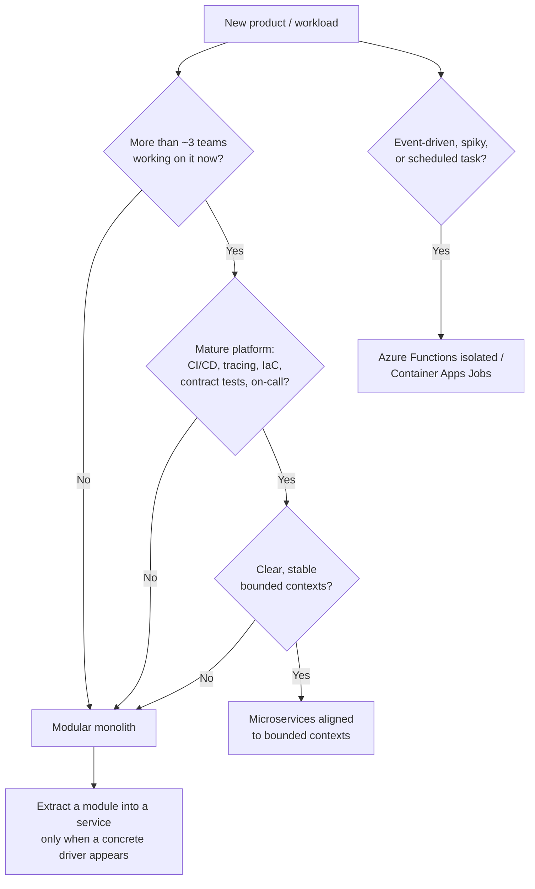
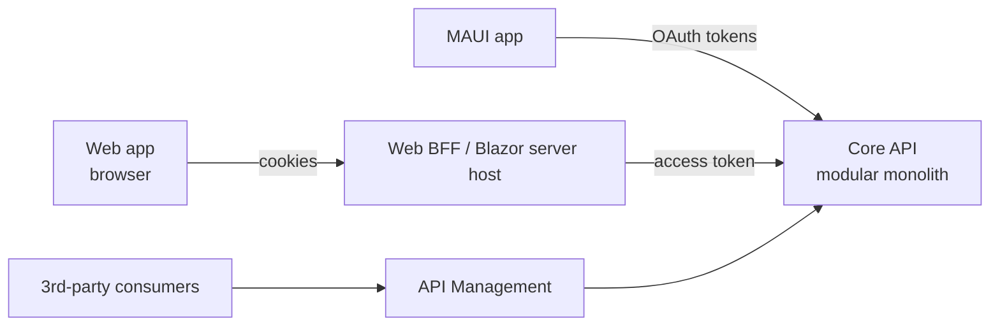
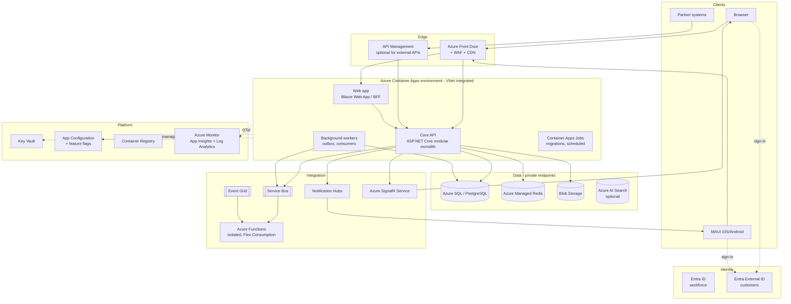

# 01 — Architecture Overview

> Foundational architectural guidance for .NET applications (API + web + mobile) on Azure.
> Read this first; the other documents elaborate on each area.

---

## Contents

1. [Purpose and scope](#1-purpose-and-scope)
2. [Architectural principles and quality attributes](#2-architectural-principles-and-quality-attributes)
3. [Choosing an architectural style](#3-choosing-an-architectural-style)
4. [Inside a service: code organisation](#4-inside-a-service-code-organisation)
5. [Domain-Driven Design (DDD)](#5-domain-driven-design-ddd)
6. [CQRS and request handling](#6-cqrs-and-request-handling)
7. [Event-driven architecture](#7-event-driven-architecture)
8. [Multi-client architecture: API-first and BFF](#8-multi-client-architecture-api-first-and-bff)
9. [Cloud-native and Twelve-Factor](#9-cloud-native-and-twelve-factor)
10. [Reference architecture on Azure](#10-reference-architecture-on-azure)
11. [Multi-tenancy](#11-multi-tenancy)
12. [Modern paradigms to embrace](#12-modern-paradigms-to-embrace)
13. [Evolution path](#13-evolution-path)
14. [Documenting architecture](#14-documenting-architecture)
15. [Anti-patterns to avoid](#15-anti-patterns-to-avoid)
16. [References](#16-references)

---

## 1. Purpose and scope

This document defines **how we think about architecture** before any code is written. It covers:

- the qualities we optimise for and how we trade them off,
- how to choose between monoliths, modular monoliths, microservices and serverless,
- how code is organised inside a deployable unit,
- the patterns (DDD, CQRS, events, BFF) we reach for and when,
- a reference topology on Azure for API + web + mobile.

Architecture is the set of decisions that are **expensive to change later**. The goal is to make as few of those as possible early, make them deliberately, and keep the rest cheap to change.

---

## 2. Architectural principles and quality attributes

### 2.1 Azure Well-Architected Framework (WAF)

We adopt the [Azure Well-Architected Framework](https://learn.microsoft.com/azure/well-architected/) as the umbrella for quality attributes. Its five pillars:

| Pillar | What it means for us | Key practices |
|---|---|---|
| **Reliability** | The system does what users expect, when they expect it, and recovers from failure. | Health checks, retries with backoff, idempotency, zone redundancy, backups tested by restore, defined RTO/RPO. |
| **Security** | Protect confidentiality, integrity and availability of data and systems. | Zero trust, managed identity, least privilege, encryption, threat modelling, supply chain hygiene. |
| **Cost Optimization** | Deliver value at the lowest sustainable cost. | Right-sizing, scale-to-zero, reservations/savings plans, budgets and alerts, tagging for showback. |
| **Operational Excellence** | Run and evolve the system safely and efficiently. | IaC, CI/CD, observability, runbooks, blameless post-incident reviews, feature flags. |
| **Performance Efficiency** | Meet demand efficiently as load changes. | Caching, async I/O, horizontal scale, load testing, performance budgets. |

Run the [WAF assessment](https://learn.microsoft.com/assessments/azure-architecture-review/) for each workload before go-live and annually thereafter.

### 2.2 Our core architectural principles

1. **Optimise for change.** Most cost in software is in modification, not creation. Favour loose coupling, high cohesion, explicit boundaries, and automated tests that make change safe.
2. **Boundaries before distribution.** Get module/context boundaries right in-process first. A well-modularised monolith can be split; a "distributed monolith" is the worst of both worlds.
3. **Make dependencies point inward.** Business rules must not depend on frameworks, databases, or UI. Infrastructure depends on the domain, never the reverse.
4. **Explicit over implicit.** Prefer explicit wiring, explicit contracts, explicit configuration. Magic (reflection-heavy conventions, hidden global state) makes systems hard to reason about and hostile to trimming/AOT.
5. **Stateless compute, stateful services.** Application instances hold no durable state; state lives in managed data services. This enables horizontal scale and painless restarts.
6. **Asynchronous where it decouples, synchronous where it simplifies.** Use messaging to decouple lifecycles and absorb load spikes; use direct calls when you need an immediate answer and the coupling is acceptable.
7. **Secure by default.** Deny by default, authenticate everything, authorise at every boundary, encrypt everywhere.
8. **Backward compatibility is a contract.** Especially with mobile clients in the field, assume old clients exist for months or years.
9. **Use managed services.** Prefer PaaS over IaaS; let Azure patch, scale and back up what it can.
10. **Every decision has a trade-off — write it down.** Use ADRs.

### 2.3 Quality attribute scenarios

Vague goals ("it must be fast") are useless. Capture quality attributes as **measurable scenarios** early:

| Attribute | Example scenario |
|---|---|
| Performance | 95% of `GET /orders/{id}` requests complete in < 200 ms at 500 RPS. |
| Availability | API availability ≥ 99.9% per calendar month (≈ 43 min downtime). |
| Recoverability | RPO ≤ 5 minutes, RTO ≤ 1 hour for the primary database. |
| Scalability | Handles 10× normal traffic for 1 hour (marketing event) without manual intervention. |
| Security | All admin operations require MFA and are audit-logged with actor and timestamp. |
| Modifiability | A new payment provider can be added without changing the Orders module. |
| Mobile compatibility | API supports the current and previous two mobile app major versions. |

These scenarios drive design decisions, SLOs ([09](09-observability-and-operations.md)), and load tests ([10](10-testing-strategy.md)).

---

## 3. Choosing an architectural style

### 3.1 The options

| Style | Description | Strengths | Weaknesses |
|---|---|---|---|
| **Traditional monolith** | One deployable, little internal structure. | Simple to build, deploy, debug. | Degrades into a "big ball of mud"; hard to scale teams. |
| **Modular monolith** | One deployable, strongly enforced internal module boundaries; modules own their data. | Simplicity of a monolith + structure of services. Cheap refactoring across modules. Single transaction scope available. | Requires discipline (and tooling) to keep boundaries clean. Scales as one unit. |
| **Microservices** | Many independently deployable services, each owning its data. | Independent deployment/scaling, team autonomy, tech heterogeneity, fault isolation. | Massive operational and cognitive overhead: distributed transactions, network failures, versioning, observability, platform engineering. |
| **Serverless / event-driven functions** | Small functions triggered by events, platform-managed scaling. | Pay-per-use, zero idle cost, great for glue and spiky workloads. | Cold starts, execution limits, harder local dev, vendor coupling, can fragment logic. |

### 3.2 Default: start with a modular monolith

For a new product with one team (or a few small teams), **start with a modular monolith**:

- one API deployable (plus the web front-end and mobile apps as separate clients),
- internally divided into **modules aligned to bounded contexts** (e.g., `Catalog`, `Ordering`, `Billing`, `Identity`),
- each module owns its own schema/tables and exposes a narrow public contract,
- modules communicate in-process via interfaces or in-process events, never by reaching into each other's tables.

This is the pattern Microsoft, Shopify, and many others recommend: **monolith first, but modular**. You keep the option to extract a module into a service later — usually because of a concrete need (independent scaling, a separate team, a different release cadence, regulatory isolation).

### 3.3 When to choose microservices (or extract one)

Extract a service only when **at least one** of these is true and the benefit clearly outweighs the operational cost:

- A module has **radically different scaling needs** (e.g., image processing vs. CRUD).
- A module needs a **different release cadence** and coordinating releases is a real bottleneck.
- **Separate teams** own the modules and are blocked by each other (Conway's Law).
- **Fault isolation**: a failure in one area must not take down another.
- **Compliance or security isolation** (e.g., PCI-scoped payment handling).
- A **different technology** is genuinely required.

Prerequisites before going distributed: mature CI/CD, centralised observability with distributed tracing, automated infrastructure, contract testing, and an on-call culture. If you don't have these, you're not ready.

### 3.4 Where serverless fits

Use **Azure Functions (isolated worker)** or **Container Apps Jobs** *alongside* the main application for:

- scheduled jobs (nightly reports, clean-up),
- event handlers (blob uploaded → generate thumbnail; Service Bus message → send email),
- integration glue and webhooks,
- long-running orchestrations (Durable Functions / Durable Task Scheduler).

Do not build the core transactional API as a sprawling set of HTTP-triggered functions — you lose cohesion, and ASP.NET Core in a container gives you the same scale-to-zero via Container Apps.

### 3.5 Decision summary



---

## 4. Inside a service: code organisation

There are two dominant, complementary ways to organise code inside a deployable: **layered/Clean Architecture** (organise by technical concern, enforce dependency direction) and **Vertical Slice Architecture** (organise by feature/use case). Our default is a **pragmatic hybrid**.

### 4.1 Clean Architecture (a.k.a. Onion / Hexagonal / Ports & Adapters)

```
┌───────────────────────────────────────────────┐
│  Presentation / Host (API endpoints, UI)      │
│  ┌─────────────────────────────────────────┐  │
│  │  Infrastructure (EF Core, HTTP clients, │  │
│  │  messaging, file storage, email)        │  │
│  │  ┌───────────────────────────────────┐  │  │
│  │  │  Application (use cases, ports,   │  │  │
│  │  │  DTOs, validation, orchestration) │  │  │
│  │  │  ┌─────────────────────────────┐  │  │  │
│  │  │  │  Domain (entities, value    │  │  │  │
│  │  │  │  objects, domain events,    │  │  │  │
│  │  │  │  business rules)            │  │  │  │
│  │  │  └─────────────────────────────┘  │  │  │
│  │  └───────────────────────────────────┘  │  │
│  └─────────────────────────────────────────┘  │
└───────────────────────────────────────────────┘
        Dependencies point INWARD only.
```

- **Domain**: pure C#; no references to EF Core, ASP.NET Core, or Azure SDKs.
- **Application**: use cases; defines interfaces ("ports") for things it needs (e.g., `IEmailSender`, `IPaymentGateway`).
- **Infrastructure**: implements ports ("adapters").
- **Host**: composition root (DI wiring), endpoints, middleware.

**Strength:** strong protection of business logic from technical churn. **Risk:** ceremony — many projects, mapping layers, and interfaces with a single implementation.

### 4.2 Vertical Slice Architecture

Each feature (use case) is a self-contained slice containing its endpoint, request/response types, validation, handler and data access:

```
Features/
  Orders/
    PlaceOrder.cs        // endpoint + request + validator + handler
    GetOrderById.cs
    CancelOrder.cs
  Customers/
    RegisterCustomer.cs
```

**Strength:** high cohesion — everything about a feature is in one place; adding a feature touches few files; each slice can choose its own complexity (a simple query can use EF Core directly; a complex command can use a rich domain model). **Risk:** duplication and inconsistency if shared domain concepts aren't factored out.

### 4.3 Our default: modules × slices, with a rich domain where it pays off

```
src/
  MyApp.Api/                         # Host: Program.cs, composition root, cross-cutting middleware
  Modules/
    Ordering/
      MyApp.Ordering/                # One project per module (or folders, for small apps)
        Domain/                      # Aggregates, value objects, domain events (when logic warrants)
        Features/
          PlaceOrder/
            PlaceOrderEndpoint.cs
            PlaceOrderCommand.cs
            PlaceOrderHandler.cs
            PlaceOrderValidator.cs
          GetOrder/
            ...
        Infrastructure/
          OrderingDbContext.cs       # Module-owned DbContext / schema
          Configurations/
        OrderingModule.cs            # services.AddOrderingModule(); app.MapOrderingEndpoints();
      MyApp.Ordering.Contracts/      # Public integration events / interfaces other modules may use
    Catalog/
      ...
  Shared/
    MyApp.SharedKernel/              # Tiny: base types (Entity, ValueObject, Result), no business logic
    MyApp.ServiceDefaults/           # Aspire service defaults: OTel, health checks, resilience
```

Rules:

1. **Modules may only reference another module's `*.Contracts` project**, never its internals. Enforce with architecture tests ([10](10-testing-strategy.md#7-architecture-tests)).
2. **Each module owns its data** — its own `DbContext` and database schema (e.g., `ordering.*`). No cross-module joins; no shared tables.
3. **Inside a module, organise by feature (slice).** Put a rich domain model in `Domain/` only where business rules are complex enough to justify it. CRUD-ish features can go straight to EF Core.
4. **The SharedKernel stays tiny.** It is the most coupled code in the system; resist adding to it.
5. **Cross-cutting concerns** (auth, logging, validation pipeline, exception handling) live in the host or ServiceDefaults, not in every slice.

### 4.4 The Result pattern vs. exceptions

- Use **exceptions for exceptional, unexpected conditions** (infrastructure failure, programming errors).
- Use a **Result type** (`Result<T>` / discriminated outcomes) for **expected business failures** (validation failed, order already shipped, insufficient stock). This makes failure paths explicit in signatures and avoids using exceptions for control flow.
- Map results to HTTP responses at the edge (e.g., `Result.NotFound` → 404 Problem Details). See [03](03-api-design-and-development.md#7-error-handling).

---

## 5. Domain-Driven Design (DDD)

DDD is a toolkit, not a religion. Apply **strategic DDD everywhere** and **tactical DDD selectively**.

### 5.1 Strategic DDD (always)

- **Ubiquitous language**: use the same terms in code, conversations, and documentation. If the business says "policy holder", the class is `PolicyHolder`, not `Customer`.
- **Bounded contexts**: explicit boundaries within which a model is consistent. "Product" in the Catalog context (description, images) differs from "Product" in the Inventory context (SKU, quantity on hand). Don't force one model to serve both.
- **Context mapping**: document how contexts relate — *shared kernel*, *customer/supplier*, *conformist*, *anti-corruption layer (ACL)*, *open host service / published language*. Use an ACL when integrating with legacy or third-party systems so their model doesn't leak into yours.
- **Core vs supporting vs generic subdomains**: invest design effort in the **core** domain (your competitive advantage). Buy or use simple solutions for generic subdomains (identity, email, payments).

Bounded contexts map naturally to **modules** in a modular monolith and to **services** if you later distribute.

**Event Storming** is the recommended workshop technique to discover contexts, aggregates, commands, and events with domain experts.

### 5.2 Tactical DDD (where complexity warrants)

| Building block | Purpose | .NET guidance |
|---|---|---|
| **Entity** | Object with identity and lifecycle. | Strongly-typed IDs (`readonly record struct OrderId(Guid Value)`) avoid primitive obsession. |
| **Value object** | Immutable, equality by value, self-validating. | `record` / `readonly record struct`; validate in the constructor/factory. Map with EF Core complex types or owned types. |
| **Aggregate** | Consistency boundary; external code only references the aggregate root. | Keep aggregates **small**. One transaction modifies one aggregate. Reference other aggregates by ID. |
| **Domain event** | Something meaningful that happened in the domain. | Raise inside the aggregate; dispatch after `SaveChanges` (or within the same transaction for in-process handlers). |
| **Domain service** | Domain logic that doesn't belong to one entity. | Stateless; lives in the Domain layer. |
| **Repository** | Collection-like access to aggregates. | Optional with EF Core — `DbContext` already is a Unit of Work + repository. Add repositories for aggregate roots when it clarifies intent or aids testing. See [04](04-data-and-persistence.md#4-repositories-and-the-unit-of-work). |
| **Specification** | Encapsulated query/business rule. | Useful for complex reusable criteria; otherwise use LINQ directly. |

**When NOT to use tactical DDD:** CRUD screens, reporting, simple admin features, integration glue. A rich domain model around trivial logic is pure overhead.

### 5.3 Encapsulation example

```csharp
public sealed class Order : AggregateRoot<OrderId>
{
    private readonly List<OrderLine> _lines = [];
    public IReadOnlyList<OrderLine> Lines => _lines;
    public OrderStatus Status { get; private set; } = OrderStatus.Draft;
    public CustomerId CustomerId { get; private set; }

    private Order() { } // EF Core

    public static Order Create(CustomerId customerId) => new() { Id = OrderId.New(), CustomerId = customerId };

    public Result AddLine(ProductId productId, Quantity quantity, Money unitPrice)
    {
        if (Status != OrderStatus.Draft)
            return OrderErrors.CannotModifySubmittedOrder;

        _lines.Add(new OrderLine(productId, quantity, unitPrice));
        return Result.Success();
    }

    public Result Submit()
    {
        if (_lines.Count == 0) return OrderErrors.EmptyOrder;
        Status = OrderStatus.Submitted;
        Raise(new OrderSubmitted(Id, CustomerId, Total));
        return Result.Success();
    }

    public Money Total => _lines.Aggregate(Money.Zero, (sum, l) => sum + l.LineTotal);
}
```

Invariants are enforced by the aggregate; callers can't put it into an invalid state.

---

## 6. CQRS and request handling

### 6.1 CQRS — lightweight by default

**Command Query Responsibility Segregation** separates operations that change state (commands) from those that read state (queries).

- **Lightweight CQRS (default):** same database; commands go through the domain model and `DbContext` with change tracking; queries use projections (`Select` into DTOs) with `AsNoTracking()`, or raw SQL/Dapper for heavy reads. This alone gives most of the benefit.
- **Full CQRS (selectively):** separate read store (e.g., denormalised tables, Cosmos DB, Azure AI Search) updated from events. Only when read and write workloads differ enormously in shape or scale. Accept eventual consistency.

**Event Sourcing** (storing state as a sequence of events) is powerful for audit-heavy domains (finance, ledger) but adds significant complexity. Don't adopt it by default; evaluate per bounded context via ADR. If adopted, consider a dedicated library (e.g., Marten on PostgreSQL) rather than building your own.

### 6.2 The mediator pattern — optional, not mandatory

Mediator libraries (MediatR and similar) decouple endpoint from handler and provide a pipeline for cross-cutting behaviours. Considerations:

- **MediatR became commercially licensed in 2025.** Evaluate licence cost or alternatives.
- With **Minimal APIs and vertical slices**, you often don't need a mediator: the endpoint can call a handler directly (injected via DI). Cross-cutting concerns can use **endpoint filters**, middleware, or decorators (e.g., via Scrutor).
- Source-generated mediators (e.g., `Mediator` by martinothamar, MIT) are an AOT-friendly, faster alternative if you want the pattern.

Our default: **direct handler injection + endpoint filters**; adopt a mediator only if the team values the pipeline abstraction and the licence is acceptable.

```csharp
// Endpoint calls the handler directly — explicit and easy to navigate.
group.MapPost("/", async (PlaceOrderCommand cmd, PlaceOrderHandler handler, CancellationToken ct) =>
{
    var result = await handler.HandleAsync(cmd, ct);
    return result.ToHttpResult(); // maps Result → TypedResults / ProblemDetails
})
.AddEndpointFilter<ValidationFilter<PlaceOrderCommand>>();
```

---

## 7. Event-driven architecture

### 7.1 Events vs commands vs messages

| Kind | Intent | Coupling | Example | Azure transport |
|---|---|---|---|---|
| **Command** | "Do this." One handler. | Sender knows receiver's capability. | `ChargeCustomer` | Service Bus **queue** |
| **Domain event** | "This happened" within a bounded context. | In-process. | `OrderSubmitted` (inside Ordering) | In-memory dispatcher |
| **Integration event** | "This happened" published to other contexts/services. | Publisher doesn't know subscribers. | `OrderSubmittedIntegrationEvent` | Service Bus **topic**, Event Grid |
| **Event stream / telemetry** | High-volume, ordered, replayable. | Consumers manage offsets. | Clickstream, IoT | Event Hubs |

Choose transport by need: **Service Bus** for reliable business messaging (sessions/ordering, dead-lettering, transactions, duplicate detection); **Event Grid** for lightweight reactive notifications (resource events, fan-out to webhooks/functions); **Event Hubs** for streaming at scale.

### 7.2 Reliability patterns (non-negotiable)

- **Transactional Outbox**: write the integration event to an `outbox` table **in the same database transaction** as the state change; a background worker publishes it to the broker. This prevents "saved the order but lost the event" (dual-write problem). See [04](04-data-and-persistence.md#6-consistency-transactions-and-the-outbox).
- **Idempotent consumers / Inbox**: messages *will* be delivered more than once. Consumers record processed message IDs (or use naturally idempotent operations).
- **Dead-letter handling**: poison messages go to a DLQ; alert on DLQ depth; have a replay process.
- **Schema evolution**: integration events are contracts. Add fields, don't remove or rename; version event types when breaking (`OrderSubmittedV2`). Consider CloudEvents as the envelope format.

### 7.3 Long-running processes: sagas

When a business process spans multiple aggregates/services (e.g., place order → reserve stock → take payment → ship), there's no distributed transaction. Use a **saga**:

- **Choreography**: each participant reacts to events and emits new ones. Simple for 2–3 steps; becomes hard to follow beyond that.
- **Orchestration**: a central coordinator (process manager) tells participants what to do and tracks state, including **compensating actions** on failure. Better visibility for complex flows.

On Azure, **Durable Functions** / the **Durable Task Scheduler** provide durable orchestration with code-first workflows. Messaging libraries (Wolverine, NServiceBus, MassTransit — check licences) provide saga support on top of Service Bus.

### 7.4 Eventual consistency and UX

Event-driven designs are eventually consistent. Design the UX for it: optimistic UI updates, "processing" states, notifications (SignalR / push) when work completes, and `202 Accepted` + status endpoints for long operations ([03](03-api-design-and-development.md#11-long-running-operations)).

---

## 8. Multi-client architecture: API-first and BFF

### 8.1 API-first

The API is the product's backbone; web and mobile are clients of it.

- **Design the contract before implementing** (or at least review the generated OpenAPI document as a first-class artefact in PRs).
- Publish **OpenAPI 3.1** documents; generate typed clients for web/mobile (Kiota, NSwag, Refit) rather than hand-writing HTTP calls.
- Treat breaking changes as a big deal: versioning strategy and deprecation policy are defined in [03](03-api-design-and-development.md#5-versioning).

### 8.2 Backend for Frontend (BFF)

Different clients have different needs: the web app wants server-side session cookies and aggregated page data; mobile wants compact payloads, offline sync, and push. A **BFF** is a thin, client-specific backend that sits between a client and the core API.



Guidance:

- **Web**: the Blazor Web App server (or an ASP.NET Core host serving a SPA) *is* the BFF — it handles the OIDC login, keeps tokens server-side, and gives the browser an HTTP-only cookie. **Never store access tokens in browser storage.** See [05](05-web-application.md#6-authentication-and-the-bff-pattern).
- **Mobile**: native apps are public clients that can securely hold tokens in the OS keychain, so they usually call the core API directly. Add a mobile BFF only if payload shaping/aggregation becomes significant.
- **Partners/public API**: expose via **Azure API Management** for keys, quotas, developer portal, and versioning.
- Keep BFFs **thin** — presentation-shaped aggregation only, no business rules.

### 8.3 Real-time

For server-to-client push to web: **SignalR** (use **Azure SignalR Service** when scaled out). For mobile: native push via **Azure Notification Hubs** (APNs/FCM), plus SignalR while the app is foregrounded if needed.

---

## 9. Cloud-native and Twelve-Factor

Our services follow the [Twelve-Factor App](https://12factor.net/) principles, adapted for .NET on Azure:

| Factor | Practice |
|---|---|
| I. Codebase | One repo per product (monorepo for API + web + mobile is fine), many deploys. |
| II. Dependencies | Explicit via NuGet with Central Package Management and lock files. |
| III. Config | In the environment (App Configuration, Key Vault references, env vars) — never in code. `IOptions<T>` with validation. |
| IV. Backing services | Databases, caches, brokers are attached resources, addressed by configuration. Aspire models these explicitly. |
| V. Build, release, run | Build once → immutable artefact (container image) → promote through environments with config. |
| VI. Processes | Stateless; no in-memory session that can't be lost; no local file storage for durable data. |
| VII. Port binding | Kestrel self-hosts; containers expose a port. |
| VIII. Concurrency | Scale out via instances (Container Apps replicas, KEDA scalers). |
| IX. Disposability | Fast startup (consider ReadyToRun/AOT), graceful shutdown (honour `CancellationToken`, `IHostApplicationLifetime`). |
| X. Dev/prod parity | Aspire + containers locally; same images across environments. |
| XI. Logs | Treat logs as event streams → OpenTelemetry → Azure Monitor. Never write to local files in production. |
| XII. Admin processes | One-off tasks (migrations, data fixes) as Container Apps Jobs or pipeline steps, versioned with the app. |

Beyond 12-factor, cloud-native also means: **health probes** (liveness/readiness/startup), **graceful degradation**, **horizontal autoscaling**, **immutable infrastructure**, and **declarative everything**.

---

## 10. Reference architecture on Azure

### 10.1 Logical topology



### 10.2 Key characteristics

- **Single ingress path** through Front Door (WAF, TLS, global routing, caching of static assets). Container Apps ingress is restricted to Front Door (private link or access restrictions).
- **Network isolation**: Container Apps environment in a VNet; data services reachable only via **private endpoints**; public network access disabled on data services.
- **Identity everywhere**: apps use **user-assigned managed identities** to reach SQL, Storage, Service Bus, Key Vault, App Configuration — no connection-string secrets.
- **Async backbone**: Service Bus for commands/integration events; outbox ensures reliable publishing.
- **Observability**: all components emit OpenTelemetry to Application Insights / Log Analytics, correlated end to end — including from mobile and browser clients.
- **Environments**: dev / test / prod (optionally staging) in **separate subscriptions** or at minimum separate resource groups with separate identities ([08](08-azure-hosting-and-infrastructure.md#4-environments-and-subscriptions)).

### 10.3 Request flow example: mobile user places an order

1. MAUI app obtains an access token from Entra External ID (MSAL, auth code + PKCE) and calls `POST /v1/orders` with an `Idempotency-Key` header.
2. Front Door applies WAF rules and routes to the API in Container Apps.
3. API validates the JWT (issuer, audience, signature, lifetime), authorises via policy, validates the payload.
4. `PlaceOrderHandler` loads/creates the `Order` aggregate, enforces invariants, saves the order **and** an `OrderPlaced` outbox row in one transaction.
5. API returns `201 Created` with `Location` header. Trace ID is returned in the response for support.
6. Outbox worker publishes `OrderPlaced` to a Service Bus topic.
7. Subscribers react: Billing takes payment; a Function sends confirmation email; Notifications sends a push via Notification Hubs.
8. The whole flow is visible as one distributed trace in Application Insights.

---

## 11. Multi-tenancy

If the product serves multiple organisations (B2B SaaS), decide the tenancy model **up front** — it's very expensive to retrofit.

| Model | Isolation | Cost | Ops complexity | Use when |
|---|---|---|---|---|
| **Shared everything** (tenant ID column) | Logical | Lowest | Low | Many small tenants, low regulatory needs. |
| **Schema / database per tenant** | Stronger | Medium | Medium–high (migrations × N) | Medium number of tenants, noisy-neighbour or data-residency concerns. Azure SQL elastic pools help. |
| **Stamp per tenant** (full deployment) | Strongest | Highest | Highest | Few large/enterprise tenants with strict isolation or residency requirements. |

Practices:

- Resolve the tenant early in the pipeline (from token claim, subdomain, or header) into a scoped `ITenantContext`.
- Enforce tenant filtering centrally — EF Core **global query filters** — and test it. Never rely on developers remembering `.Where(x => x.TenantId == ...)`.
- Consider Azure SQL **Row-Level Security** as defence-in-depth.
- Include tenant ID in logs/traces (as a dimension), cache keys, and blob paths.
- Use the **Deployment Stamps** pattern to scale out by groups of tenants.

See Microsoft's [Architect multitenant solutions on Azure](https://learn.microsoft.com/azure/architecture/guide/multitenant/overview).

---

## 12. Modern paradigms to embrace

| Paradigm | What it means | How we apply it |
|---|---|---|
| **Cloud-native .NET with Aspire** | Code-first app model describing services and their dependencies; one-command local run with dashboard; deploy manifests. | Every solution has an AppHost and ServiceDefaults ([08](08-azure-hosting-and-infrastructure.md#9-aspire-local-development-and-deployment)). |
| **Zero Trust** | Never trust, always verify; assume breach; least privilege. | Managed identity, private endpoints, Conditional Access, short-lived tokens, no standing admin access (PIM). |
| **Platform engineering / golden paths** | Self-service, paved roads that make the right thing the easy thing. | This handbook + templates + reusable pipelines and Bicep modules. |
| **Everything as code / GitOps** | Infra, config, policy, dashboards declared in Git; changes via PR. | Bicep/AVM, pipeline-as-code, alerts and workbooks in IaC. |
| **Shift-left security (DevSecOps)** | Security checks early and automated. | Analyzers, secret scanning, dependency audit, SAST (CodeQL), container scanning, IaC scanning in CI. |
| **Observability-driven development** | Design telemetry as part of the feature; use it to verify behaviour in production. | OTel instrumentation reviewed in PRs; SLOs per user journey. |
| **Progressive delivery** | Decouple deploy from release; expose features gradually. | Feature flags (App Configuration), canary via Container Apps revisions/traffic split. |
| **Serverless containers** | Containers with scale-to-zero and event-driven scaling, no cluster management. | Azure Container Apps with KEDA scalers. |
| **Native AOT & trimming** | Ahead-of-time compiled apps: fast startup, small footprint. | Consider for functions, workers, and small APIs; design new code to be trim/AOT-friendly (source generators over reflection). |
| **FinOps** | Cost as an engineering metric. | Tagging, budgets, cost alerts, cost reviews in sprint/quarterly cadence. |
| **AI-native features** | LLMs and agents as product capabilities, built with guardrails. | Microsoft.Extensions.AI + Microsoft Foundry; evaluation and safety built in ([13](13-ai-integration.md)). |
| **AI-assisted engineering** | Coding agents and assistants in the development workflow. | Encouraged, with the same review, test, and security bars as human-written code. Keep repo instructions (e.g., `CLAUDE.md`, `.github/copilot-instructions.md`) aligned with this handbook. |
| **Sustainability** | Efficient use of compute reduces cost and carbon. | Right-size, scale-to-zero, efficient code, region choice. |

---

## 13. Evolution path

Plan for growth without building for it prematurely.

**Phase 1 — Foundation (MVP)**
- Modular monolith API + Blazor web + MAUI app.
- Single region, zone-redundant where cheap (SQL, Redis, Container Apps environment).
- One relational database (schema per module), Redis cache, Blob Storage, Service Bus.
- Full CI/CD, IaC, observability, and security baseline from day one — these are *not* "later" items.

**Phase 2 — Scale and harden**
- Introduce read models / caching for hot paths based on telemetry.
- Add API Management if partners consume the API.
- Extract a module into its own service if a concrete driver emerges (scaling, team, isolation).
- Formal SLOs, error budgets, load testing in the pipeline.
- Disaster recovery to a paired/secondary region (warm standby or pilot light) based on RTO/RPO.

**Phase 3 — Global / enterprise**
- Active-active multi-region (Front Door + geo-replicated data, Cosmos DB multi-region writes where appropriate).
- Deployment stamps for tenant isolation and scale.
- Dedicated platform team, internal developer portal.

---

## 14. Documenting architecture

- **C4 model** for diagrams: *Context* (system + users + external systems), *Containers* (deployables and data stores), *Components* (modules within a container). Code-level diagrams rarely needed. Keep diagrams as code (Mermaid, Structurizr DSL, or PlantUML) in the repo.
- **Architecture Decision Records** in `docs/adr/NNNN-title.md`, using [the template](templates/adr-template.md). Record context, options considered, decision, and consequences. ADRs are immutable once accepted; supersede rather than edit.
- **A lightweight architecture document** per product (arc42-lite): goals & constraints, context, containers, key scenarios, cross-cutting concepts, risks, glossary.
- **Runbooks** for operational procedures (`docs/runbooks/`).
- Keep docs **next to the code** so they're versioned and reviewed together.

---

## 15. Anti-patterns to avoid

| Anti-pattern | Why it hurts | Instead |
|---|---|---|
| **Distributed monolith** | Services that must be deployed together and share databases: all the cost of microservices, none of the benefits. | Modular monolith, or truly independent services with owned data. |
| **Shared database across modules/services** | Hidden coupling; schema change breaks unknown consumers. | Each module/service owns its data; integrate via APIs/events. |
| **Anaemic domain model everywhere** *or* **rich domain model everywhere** | One under-engineers complex logic; the other over-engineers simple CRUD. | Match model richness to the complexity of each feature. |
| **Generic repository over EF Core** (`IRepository<T>` with `GetAll`, `Find(Expression)`) | Leaky abstraction that hides EF Core's power and adds no value. | Use `DbContext` directly or aggregate-specific repositories. |
| **Chatty synchronous calls between services** | Latency multiplication and cascading failures. | Coarser-grained APIs, caching, async messaging, data replication via events. |
| **Dual writes** (DB + broker without outbox) | Inconsistency on partial failure. | Transactional outbox. |
| **Business logic in controllers/endpoints or in the UI** | Untestable, duplicated across clients. | Handlers/domain in the API; clients stay thin. |
| **Secrets in config files / source control** | Credential leaks. | Managed identity, Key Vault, secret scanning. |
| **"We'll add observability/security/tests later"** | Later never comes; retrofitting is 10× the cost. | Baseline from day one via templates. |
| **Resume-driven architecture** | Kubernetes + microservices + event sourcing for a 3-person team. | Simplest thing that meets the quality scenarios. |
| **Premature abstraction** | Interfaces and layers "in case we need them". | YAGNI; abstract when a second real use case appears (except at true architectural seams). |

---

## 16. References

- [Azure Architecture Center](https://learn.microsoft.com/azure/architecture/)
- [Azure Well-Architected Framework](https://learn.microsoft.com/azure/well-architected/)
- [Cloud design patterns](https://learn.microsoft.com/azure/architecture/patterns/)
- [.NET Microservices: Architecture for Containerized .NET Applications (eBook)](https://learn.microsoft.com/dotnet/architecture/microservices/)
- [Architect modern web applications with ASP.NET Core and Azure (eBook)](https://learn.microsoft.com/dotnet/architecture/modern-web-apps-azure/)
- [Aspire documentation](https://aspire.dev/)
- [Multitenant solutions on Azure](https://learn.microsoft.com/azure/architecture/guide/multitenant/overview)
- Eric Evans, *Domain-Driven Design*; Vaughn Vernon, *Implementing Domain-Driven Design*
- Sam Newman, *Building Microservices* (2nd ed.) and *Monolith to Microservices*
- Mark Richards & Neal Ford, *Fundamentals of Software Architecture*
- [C4 model](https://c4model.com/) · [ADR GitHub organisation](https://adr.github.io/) · [The Twelve-Factor App](https://12factor.net/)
