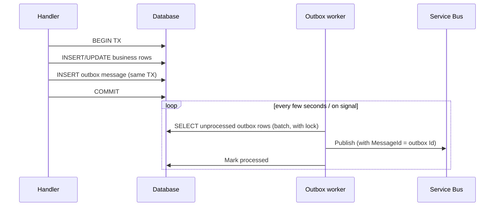

# 04 — Data & Persistence

> Choosing data stores, using EF Core well, keeping data consistent, caching, and protecting data.

---

## Contents

1. [Choosing a data store](#1-choosing-a-data-store)
2. [EF Core best practices](#2-ef-core-best-practices)
3. [Schema management and migrations](#3-schema-management-and-migrations)
4. [Repositories and the unit of work](#4-repositories-and-the-unit-of-work)
5. [When to use Dapper or raw SQL](#5-when-to-use-dapper-or-raw-sql)
6. [Consistency, transactions and the outbox](#6-consistency-transactions-and-the-outbox)
7. [Caching](#7-caching)
8. [Azure Cosmos DB guidance](#8-azure-cosmos-db-guidance)
9. [Files and Blob Storage](#9-files-and-blob-storage)
10. [Search](#10-search)
11. [Data security, privacy and auditing](#11-data-security-privacy-and-auditing)
12. [Backup, restore and disaster recovery](#12-backup-restore-and-disaster-recovery)
13. [Database performance](#13-database-performance)
14. [References](#14-references)

---

## 1. Choosing a data store

Use the right store for each job (**polyglot persistence**), but don't add stores without need — each one adds operational cost.

| Store | Best for | Avoid when |
|---|---|---|
| **Azure SQL Database** | Relational, transactional data; complex queries/reporting; strong consistency; mature tooling; Microsoft-centric teams. Serverless tier for dev/spiky loads; Hyperscale for large DBs. | Massive global write scale; highly variable schemas. |
| **Azure Database for PostgreSQL – Flexible Server** | Same as above, with open-source ecosystem; excellent JSONB; extensions (pgvector for embeddings, PostGIS). Often cheaper. | Need SQL Server–specific features (temporal tables are SQL Server; PG has alternatives). |
| **Azure Cosmos DB (NoSQL API)** | Globally distributed, low-latency, elastic scale; schema-flexible documents; known access patterns by key; multi-region writes; vector search. | Ad-hoc relational queries, joins, reporting; teams unfamiliar with partitioning; small apps (cost floor). |
| **Azure Blob Storage** | Files, images, documents, backups, exports, static content. | Structured queryable data. |
| **Azure Managed Redis** (successor to Azure Cache for Redis) | Caching, sessions, rate-limit counters, distributed locks, pub/sub, leaderboards. | Primary durable store. |
| **Azure AI Search** | Full-text search, faceting, vector/hybrid search for RAG. | Primary store (it's an index). |
| **Azure Table Storage** | Cheap, simple key-value at scale (logs, IoT state). | Anything needing secondary indexes or queries. |
| **SQLite** | On-device storage in mobile apps; tests. | Server-side shared data. |

**Default for new products:** one relational database (Azure SQL or PostgreSQL), **schema per module**, plus Blob Storage and Redis. Add Cosmos DB or AI Search when a concrete requirement appears.

⚠ Verify: Azure Cache for Redis is being superseded by **Azure Managed Redis**; use Managed Redis for new deployments.

---

## 2. EF Core best practices

EF Core 10 is the default data access technology.

### 2.1 Context configuration

```csharp
// Via Aspire client integration (adds health check, retries, OTel tracing):
builder.AddSqlServerDbContext<OrderingDbContext>("ordering-db", configureDbContextOptions: o =>
    o.UseQueryTrackingBehavior(QueryTrackingBehavior.NoTracking));

// Or manually:
builder.Services.AddDbContextPool<OrderingDbContext>(o =>
    o.UseSqlServer(builder.Configuration.GetConnectionString("ordering-db"), sql =>
    {
        sql.EnableRetryOnFailure(maxRetryCount: 5);
        sql.MigrationsHistoryTable("__EFMigrationsHistory", "ordering");
    }));
```

- **Lifetime**: scoped (one per request). `DbContext` is **not thread-safe** — never share across concurrent operations.
- **Pooling** (`AddDbContextPool`) reduces allocation overhead for high-throughput APIs; contexts must not hold per-request state in fields.
- **`IDbContextFactory<T>`** for Blazor Server components, background services, and anywhere the scope doesn't match a request.
- **Connection with managed identity** (no password): `Server=tcp:myserver.database.windows.net;Database=orders;Authentication=Active Directory Default;Encrypt=True;`
- **Connection resiliency**: `EnableRetryOnFailure` for transient Azure SQL faults. Note: with retries on, user-initiated transactions must use the execution strategy (`db.Database.CreateExecutionStrategy().ExecuteAsync(...)`).
- Set `MaxBatchSize`/command timeout deliberately for bulk operations.

### 2.2 Querying

| Do | Don't |
|---|---|
| **Project** to DTOs with `Select` for reads | Load full entity graphs to return 3 fields |
| `AsNoTracking()` (or no-tracking default) for read-only queries | Track entities you won't modify |
| Paginate every collection query (`Take`) | Return unbounded result sets |
| Use `AsSplitQuery()` for multiple collection `Include`s (avoid cartesian explosion) | Chain many `Include`s into one huge join |
| Eager-load deliberately with `Include` | Rely on **lazy loading** (disabled by default — keep it that way; it causes N+1 queries) |
| `ExecuteUpdateAsync` / `ExecuteDeleteAsync` for set-based changes | Load 10,000 rows to update a column |
| `AnyAsync` for existence checks | `CountAsync() > 0` or loading entities |
| Compiled queries (`EF.CompileAsyncQuery`) for very hot paths | Premature micro-optimisation everywhere |
| Inspect generated SQL (`ToQueryString()`, logging in dev) | Assume LINQ translates efficiently |
| Async methods with `CancellationToken` | Sync methods (`ToList()`) in request paths |

```csharp
var orders = await db.Orders
    .Where(o => o.CustomerId == customerId && o.Status == OrderStatus.Submitted)
    .OrderByDescending(o => o.CreatedAt).ThenByDescending(o => o.Id)
    .Select(o => new OrderSummary(o.Id.Value, o.CreatedAt, o.Lines.Count, o.Total.Amount))
    .Take(50)
    .ToListAsync(ct);
```

### 2.3 Modelling

- **Configuration in `IEntityTypeConfiguration<T>` classes**, not attributes on domain types (keeps the domain persistence-ignorant). Apply with `modelBuilder.ApplyConfigurationsFromAssembly(...)`.
- **Strongly-typed IDs** via value converters (`HasConversion(id => id.Value, v => new OrderId(v))`) or conventions in `ConfigureConventions`.
- **Value objects**: **complex types** (`ComplexProperty`) — EF Core 10 supports optional complex types and JSON mapping for complex types; owned types where identity-less ownership with separate tables is needed.
- **JSON columns** (`ToJson()`) for semi-structured data that's always loaded with its owner.
- **Backing fields** for encapsulated collections (`_lines`) — EF Core maps them by convention.
- **Explicit column types and lengths**: `HasMaxLength`, `HasPrecision(18, 2)` for money. Avoid `nvarchar(max)` by default.
- **Indexes** for every foreign key and common filter/sort combination; unique indexes for natural keys.
- **Concurrency tokens**: `rowversion` (SQL Server) / `xmin` (PostgreSQL).
- **Sequential GUIDs**: `Guid.CreateVersion7()` for primary keys reduces index fragmentation.
- **Global query filters** for soft delete and multi-tenancy. EF Core 10 adds **named query filters** so you can disable one (e.g., soft delete) without disabling all (e.g., tenant).

```csharp
internal sealed class OrderConfiguration : IEntityTypeConfiguration<Order>
{
    public void Configure(EntityTypeBuilder<Order> b)
    {
        b.ToTable("Orders", "ordering");
        b.HasKey(o => o.Id);
        b.Property(o => o.Id).HasConversion(id => id.Value, v => new OrderId(v));
        b.Property(o => o.Status).HasConversion<string>().HasMaxLength(32);
        b.ComplexProperty(o => o.ShippingAddress);
        b.HasMany(o => o.Lines).WithOne().HasForeignKey("OrderId");
        b.Navigation(o => o.Lines).UsePropertyAccessMode(PropertyAccessMode.Field);
        b.Property<byte[]>("RowVersion").IsRowVersion();
        b.HasQueryFilter("SoftDelete", o => !o.IsDeleted);
        b.HasIndex(o => new { o.CustomerId, o.CreatedAt });
    }
}
```

### 2.4 Cross-cutting with interceptors

Use `SaveChangesInterceptor` for:
- **Audit fields** (`CreatedAt/By`, `ModifiedAt/By`) from `TimeProvider` and current user.
- **Soft delete** (convert `Deleted` state to `Modified` + `IsDeleted = true`).
- **Domain event dispatch** / **outbox** insertion (§6).

---

## 3. Schema management and migrations

### 3.1 Approach

- **Code-first migrations** with EF Core, **one migrations set per module/DbContext**, each in its own schema.
- Review generated migrations like code — check for data loss, locking operations, and index builds on large tables.
- Keep migrations **small and frequent**.

### 3.2 Applying migrations

**Never call `Database.Migrate()` at application startup in production.** With multiple replicas it races, it requires DDL permissions for the app identity, and failures leave the app half-started.

Instead:

| Option | How |
|---|---|
| **Migration bundles** (recommended) | `dotnet ef migrations bundle --self-contained -o efbundle` in CI; run the bundle as a pipeline step or **Container Apps Job** before deploying the new app version. |
| **Idempotent SQL scripts** | `dotnet ef migrations script --idempotent`; apply with `sqlcmd`/`psql` or a DACPAC-style tool; easier for DBA review. |
| **Aspire** | In dev, a dedicated "migration service" worker project applies migrations and seeds data before the API starts (`WaitForCompletion`). |

The migration identity has DDL rights; the **application identity has only DML** (read/write data) rights — least privilege.

### 3.3 Zero-downtime changes: expand/contract

Because old and new app versions run side by side during deployment (and old mobile clients persist), schema changes must be backward compatible:

1. **Expand**: add new column/table (nullable or with default). Deploy app that writes both old and new, reads new with fallback.
2. **Migrate**: backfill data (batched job).
3. **Contract**: once no running code uses the old structure, drop it in a later release.

Renames = add new + copy + drop old across releases. Never rename/drop in a single deploy.

### 3.4 Seed and reference data

- Reference data (countries, statuses) via `HasData` in migrations or idempotent seed scripts.
- Test/demo data via a separate seeding tool or Aspire migration service — never in production migrations.

---

## 4. Repositories and the unit of work

`DbContext` already implements **Unit of Work** (change tracking + `SaveChanges`) and **Repository** (`DbSet<T>`).

Guidance:
- **Don't build a generic repository** (`IRepository<T>` with `GetAll`, `Find(Expression<Func<T,bool>>)`, `Update`). It hides EF Core's capabilities, leaks `IQueryable` anyway, and adds no value.
- **Using `DbContext` directly in handlers is fine**, especially for queries and simple commands in vertical slices.
- **Aggregate-specific repositories** are worthwhile when using a rich domain model: they express intent (`GetWithLinesAsync(orderId)`), guarantee aggregates load fully, and give a seam for testing domain logic.

```csharp
public interface IOrderRepository
{
    Task<Order?> GetAsync(OrderId id, CancellationToken ct);
    void Add(Order order);
}

internal sealed class OrderRepository(OrderingDbContext db) : IOrderRepository
{
    public Task<Order?> GetAsync(OrderId id, CancellationToken ct) =>
        db.Orders.AsTracking().Include(o => o.Lines).SingleOrDefaultAsync(o => o.Id == id, ct);

    public void Add(Order order) => db.Orders.Add(order);
}
// The handler (or a unit-of-work abstraction) calls db.SaveChangesAsync once per command.
```

- **Test data access against a real database** (Testcontainers), not EF Core's in-memory provider — the in-memory provider doesn't behave like a relational database (no transactions, constraints, or SQL translation). See [10](10-testing-strategy.md#5-integration-tests).

---

## 5. When to use Dapper or raw SQL

EF Core covers most needs, and supports raw SQL (`SqlQuery<T>`, `FromSql`) safely with parameterisation. Consider **Dapper** (or EF Core raw SQL) for:

- Complex reporting queries, CTEs, window functions that LINQ expresses poorly.
- Very hot read paths where profiling shows EF Core overhead matters.
- Bulk operations (or use `SqlBulkCopy` / EF Core bulk extensions — check licences).

Rules:
- **Always parameterise.** Never concatenate user input into SQL. `FromSql($"... {param}")` is safe (interpolation is parameterised); `FromSqlRaw` with concatenation is not.
- Keep raw SQL inside the module's infrastructure; it still respects module schema boundaries.
- Cover with integration tests against a real database engine.

---

## 6. Consistency, transactions and the outbox

### 6.1 Transaction boundaries

- **One command = one transaction = (ideally) one aggregate.** `SaveChangesAsync` is atomic by default.
- Cross-aggregate consistency within a module may use a single transaction when pragmatic; across modules/services use **eventual consistency** via events.
- Use explicit transactions (`BeginTransactionAsync`) only when combining multiple `SaveChanges` or raw SQL; wrap in the execution strategy if retries are enabled.
- Choose isolation levels deliberately. Consider **READ_COMMITTED_SNAPSHOT** (default on Azure SQL Database) to reduce blocking.

### 6.2 The transactional outbox

Problem: saving to the DB and publishing to Service Bus are two separate operations. If the process crashes between them, you lose the event (or publish an event for data that was rolled back).

Solution:



Implementation notes:
- Outbox row: `Id`, `Type`, `Payload (JSON)`, `OccurredAt`, `ProcessedAt`, `Attempts`, `Error`, plus trace context (`traceparent`) to keep distributed traces connected.
- Insert outbox rows from a `SaveChangesInterceptor` that collects domain events from tracked aggregates and converts them into integration events.
- Worker uses row locking (`UPDLOCK, READPAST` on SQL Server; `FOR UPDATE SKIP LOCKED` on PostgreSQL) so multiple instances can run safely.
- Set Service Bus `MessageId` = outbox ID and enable **duplicate detection** for extra safety.
- Clean up processed rows after a retention period.
- Libraries that implement outbox/inbox for you: Wolverine (MIT), NServiceBus (commercial), MassTransit (v8 Apache-2.0; v9 commercial). Rolling your own is ~200 lines and fine for many apps.

### 6.3 The inbox (idempotent consumer)

Consumers record processed message IDs in an `inbox` table **in the same transaction** as their state changes. On redelivery, they skip already-processed messages. Alternatively, design operations to be naturally idempotent (upserts, "set status to X").

---

## 7. Caching

### 7.1 HybridCache — the default

`HybridCache` (Microsoft.Extensions.Caching.Hybrid, GA since .NET 9) combines an in-process L1 cache with an optional distributed L2 (Redis), and adds **stampede protection** (only one caller computes a missing value), **tag-based invalidation**, and serialization.

```csharp
builder.AddRedisDistributedCache("cache");   // L2 (Aspire integration)
builder.Services.AddHybridCache(o =>
{
    o.DefaultEntryOptions = new() { Expiration = TimeSpan.FromMinutes(10), LocalCacheExpiration = TimeSpan.FromMinutes(1) };
});

public sealed class ProductQueries(HybridCache cache, CatalogDbContext db)
{
    public ValueTask<ProductDto?> GetAsync(Guid id, CancellationToken ct) =>
        cache.GetOrCreateAsync(
            $"catalog:product:{id}",
            async token => await db.Products.Where(p => p.Id == id).Select(p => new ProductDto(/*...*/)).SingleOrDefaultAsync(token),
            tags: ["catalog:products"],
            cancellationToken: ct);

    public ValueTask InvalidateAllAsync(CancellationToken ct) => cache.RemoveByTagAsync("catalog:products", ct);
}
```

### 7.2 Caching rules

- **Cache-aside** is the default pattern. Cache **reads that are expensive and frequent**, guided by telemetry — not everything.
- **Every entry has a TTL.** Shorter local (L1) TTL than distributed (L2) TTL to limit staleness across instances.
- **Key naming**: `{module}:{entity}:{id}[:{variant}]`; include tenant ID for multi-tenant data; include version prefix to invalidate on schema change (`v2:catalog:product:...`).
- **Invalidate on write** (remove or tag-evict) — and accept short staleness windows elsewhere.
- **Never cache** secrets or authorization decisions without careful scoping; never cache per-user data under a shared key.
- **Cache failures must not break the app** — treat Redis as optional; fall back to source (HybridCache does this).
- Size limits on L1 to prevent memory exhaustion.
- Monitor hit ratio, latency, memory, evictions.

### 7.3 Redis usage

- Use managed identity (Entra auth) for Redis connections.
- One `ConnectionMultiplexer` per app (singleton) — Aspire integration handles this.
- Avoid large values (> 100 KB) and `KEYS *`; use `SCAN`.
- Use Redis for distributed locks only with care (RedLock caveats); prefer database leases or blob leases for critical sections.

---

## 8. Azure Cosmos DB guidance

If you choose Cosmos DB:

- **Partition key is the most important decision.** Choose a high-cardinality key that evenly distributes writes and appears in most queries (e.g., `/tenantId`, `/customerId`). Use **hierarchical partition keys** for multi-level distribution. Changing it later means migrating data.
- **Model for access patterns**, not normalisation: embed data read together; denormalise; reference when unbounded or independently updated.
- **Point reads** (`ReadItemAsync(id, partitionKey)`) are cheapest (1 RU for 1 KB). Cross-partition queries are expensive.
- **Throughput**: autoscale for variable loads; serverless for dev/low traffic; monitor RU consumption and 429s.
- **SDK**: use a **singleton `CosmosClient`**, direct mode, `System.Text.Json` serializer; handle 429 with SDK built-in retries.
- **Consistency**: Session (default) is right for most apps.
- **Change feed** to build read models, trigger workflows, or sync to search — a natural fit for event-driven designs.
- **EF Core Cosmos provider** exists, but the native SDK gives more control over RUs, partitioning, and bulk operations; prefer the SDK for performance-sensitive workloads.
- Use **Entra RBAC** (data-plane role assignments) instead of account keys; disable key-based auth.

---

## 9. Files and Blob Storage

- **Never store files in the database** or on the container's local disk.
- **Direct client uploads**: API issues a short-lived **user delegation SAS** (signed with Entra credentials, not account keys) scoped to a single blob with write-only permission; client uploads directly to Blob Storage. The API records metadata after an Event Grid "BlobCreated" event or a client callback. This keeps large payloads off the API.
- **Downloads**: short-lived read SAS or stream via the API when authorization is complex.
- **Malware scanning**: enable **Microsoft Defender for Storage** malware scanning on upload containers; process files only after a clean scan result.
- **Validate** file type by content (magic bytes), not extension; enforce size limits; never trust client-provided file names for storage paths.
- Disable public blob access at the account level; use private endpoints.
- **Lifecycle management** policies to move old blobs to cool/cold/archive tiers and delete per retention rules.
- Enable **soft delete** and **versioning** for recoverability.
- Serve public static assets via Front Door/CDN.

---

## 10. Search

- Simple filtering: database indexes and `LIKE`/full-text search (SQL Server full-text, PostgreSQL `tsvector`).
- Rich search (relevance, facets, typo tolerance, synonyms, vector/hybrid search): **Azure AI Search**, fed by an indexer (from SQL/Cosmos/Blob) or pushed via events from the outbox.
- Treat the search index as a **read model** — rebuildable from the source of truth.

---

## 11. Data security, privacy and auditing

### 11.1 Protection

- **Encryption at rest** is on by default (TDE for Azure SQL, SSE for Storage, Cosmos). Use **customer-managed keys** (Key Vault) if compliance requires.
- **Encryption in transit**: TLS 1.2+ enforced (`Encrypt=True` in connection strings, minimum TLS on resources).
- **Always Encrypted** (Azure SQL) or application-level encryption for highly sensitive columns (national IDs, health data) so even DBAs can't read them.
- **Dynamic data masking** for support/reporting access paths.
- **Network**: public network access disabled; private endpoints only.
- **Identity**: Entra-only authentication on Azure SQL (disable SQL auth); app identity has least-privilege roles (`db_datareader`/`db_datawriter` or custom), migration identity separate.

### 11.2 Privacy (GDPR and similar)

- **Classify data** (public / internal / confidential / restricted / PII). Use `Microsoft.Extensions.Compliance.Classification` attributes so logs redact automatically.
- **Data minimisation**: don't collect what you don't need.
- **Right to erasure**: design for deleting or anonymising a user's data across all stores, including backups policy, search indexes, caches, logs (retention), and analytics.
- **Data residency**: choose regions consistent with requirements; be aware of geo-replication targets.
- **Retention policies**: define per data category; automate deletion.

### 11.3 Auditing

- Audit fields on entities (created/modified by/at) via interceptors.
- **Temporal tables** (SQL Server/Azure SQL) for full row history — EF Core supports them natively (`IsTemporal()`), and queries like `TemporalAsOf`.
- Separate, append-only **audit log** for security-relevant actions (login, permission changes, data exports), retained per policy and protected from tampering.
- Enable **Azure SQL Auditing** to Log Analytics for database-level access auditing.

---

## 12. Backup, restore and disaster recovery

- Azure SQL / PostgreSQL Flexible: automated backups with **point-in-time restore (PITR)**; configure retention (7–35 days) and **long-term retention** for compliance.
- Enable **zone redundancy** for production databases.
- For regional DR: **failover groups** (Azure SQL) or **geo-replicas / read replicas** (PostgreSQL); Cosmos DB multi-region.
- Define **RPO/RTO** per data store and validate the configuration meets them.
- **Test restores regularly** (at least quarterly) — a backup you've never restored is a hope, not a plan. Automate a restore drill into a non-prod environment.
- Blob Storage: soft delete, versioning, point-in-time restore for block blobs; GRS/GZRS for regional redundancy where needed.

---

## 13. Database performance

- Enable **Query Store** (Azure SQL; on by default) and **Query Performance Insight** / `pg_stat_statements` on PostgreSQL. Review top queries regularly.
- Enable **automatic tuning** (Azure SQL) to at least *recommend* index changes.
- EF Core logs slow queries in development; OpenTelemetry traces include DB spans with duration (and SQL text in non-prod).
- Watch for: N+1 queries, missing indexes, implicit conversions (e.g., `nvarchar` vs `varchar` parameter mismatches), parameter sniffing, large `IN` lists, and table scans.
- Use **read replicas** for reporting workloads to protect the primary.
- Scale up first (simple), scale out (replicas, sharding/elastic pools) when needed.

---

## 14. References

- [EF Core documentation](https://learn.microsoft.com/ef/core/)
- [What's new in EF Core 10](https://learn.microsoft.com/ef/core/what-is-new/ef-core-10.0/whatsnew)
- [EF Core performance](https://learn.microsoft.com/ef/core/performance/)
- [Migration bundles](https://learn.microsoft.com/ef/core/managing-schemas/migrations/applying#bundles)
- [HybridCache library](https://learn.microsoft.com/aspnet/core/performance/caching/hybrid)
- [Transactional outbox pattern with Azure Cosmos DB](https://learn.microsoft.com/azure/architecture/databases/guide/transactional-outbox-cosmos)
- [Azure Cosmos DB data modelling](https://learn.microsoft.com/azure/cosmos-db/nosql/modeling-data)
- [Azure SQL security best practices](https://learn.microsoft.com/azure/azure-sql/database/security-best-practice)
- [User delegation SAS](https://learn.microsoft.com/azure/storage/blobs/storage-blob-user-delegation-sas-create-dotnet)
- [Choose a data store](https://learn.microsoft.com/azure/architecture/guide/technology-choices/data-store-overview)
