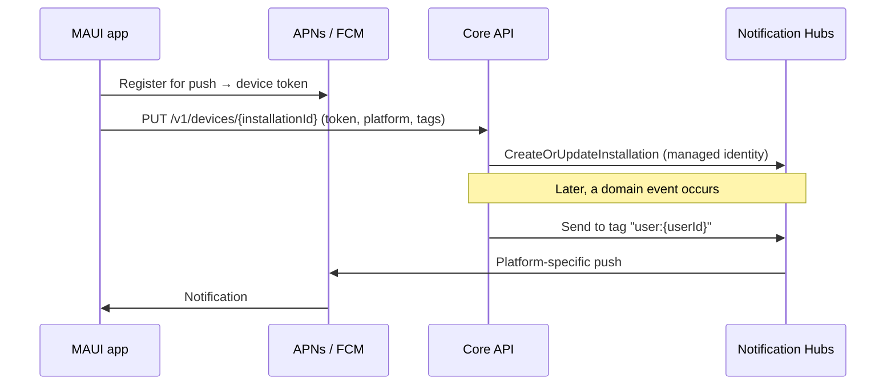
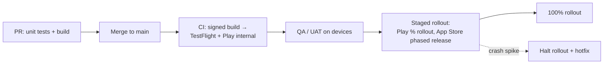

# 06 — Mobile Applications

> Building iOS and Android apps with .NET MAUI that consume the API, work well offline, and ship reliably to the stores.

---

## Contents

1. [Choosing the mobile stack](#1-choosing-the-mobile-stack)
2. [Project structure](#2-project-structure)
3. [App architecture: MVVM](#3-app-architecture-mvvm)
4. [UI best practices](#4-ui-best-practices)
5. [Networking and API integration](#5-networking-and-api-integration)
6. [Offline-first and local data](#6-offline-first-and-local-data)
7. [Authentication](#7-authentication)
8. [Secure storage and device security](#8-secure-storage-and-device-security)
9. [Push notifications](#9-push-notifications)
10. [Deep links](#10-deep-links)
11. [App versioning and forced upgrades](#11-app-versioning-and-forced-upgrades)
12. [Build, signing and distribution](#12-build-signing-and-distribution)
13. [Performance](#13-performance)
14. [Observability and crash reporting](#14-observability-and-crash-reporting)
15. [Accessibility and localization](#15-accessibility-and-localization)
16. [Testing mobile apps](#16-testing-mobile-apps)
17. [Store compliance and privacy](#17-store-compliance-and-privacy)
18. [References](#18-references)

---

## 1. Choosing the mobile stack

| Option | Choose when | Trade-offs |
|---|---|---|
| **.NET MAUI (XAML/C#)** — default | .NET team; native UI controls; share C# models, validation, API client with the backend; iOS + Android (+ optionally Windows/macOS). | Smaller ecosystem than native/Flutter/React Native; occasional platform-specific bugs; need macOS for iOS builds. |
| **.NET MAUI Blazor Hybrid** | Maximum code reuse with the Blazor web app (shared Razor Class Library); content-heavy or form-heavy apps. | Web-view-rendered UI — less "native" feel; still has full device API access via C#. |
| **Native (Swift/Kotlin)** | Platform-flagship UX, heavy use of new OS features, very high performance graphics. | Two codebases, two skill sets. |
| **Avalonia / Uno Platform** | Pixel-perfect identical UI across platforms (including desktop and web); skia-rendered. | Different ecosystem from MAUI; evaluate maturity for mobile needs. |

**Default:** **.NET MAUI** with XAML (or C# Markup) and **MVVM**. Use **Blazor Hybrid** pages selectively where sharing UI with the web pays off — the two approaches can coexist in one app.

**Status notes:**
- Xamarin.Forms/Xamarin.iOS/Android support ended **May 2024** — migrate any legacy apps.
- .NET MAUI is part of .NET and follows the same support lifecycle; MAUI 10 targets **.NET 10 LTS**. Stay on the latest service release — mobile platforms (new iOS/Xcode versions, Android API levels required by Google Play) force regular updates.

---

## 2. Project structure

```
src/
  Mobile/
    Mobile.App/                       # .NET MAUI single project (net10.0-android; net10.0-ios)
      Platforms/
        Android/
        iOS/
      Resources/
        AppIcon/ Fonts/ Images/ Splash/ Raw/ Styles/
      Features/
        Orders/
          OrderListPage.xaml(.cs)
          OrderListViewModel.cs
          OrderDetailPage.xaml(.cs)
          OrderDetailViewModel.cs
        Account/ ...
      Services/                       # Platform-agnostic service interfaces + MAUI implementations
      AppShell.xaml
      MauiProgram.cs
    Mobile.Core/                      # net10.0 class library: view models, services, domain logic (no MAUI refs ideally)
  Shared/
    Api.Client/                       # Generated API client shared with web
    Contracts/                        # DTOs shared with API (if not generated)
tests/
  Mobile.Core.UnitTests/              # Fast tests run on any OS — no device needed
  Mobile.UITests/                     # Appium tests
```

- Keep **as much logic as possible in a plain `net10.0` class library** (`Mobile.Core`) — view models, validation, sync logic, API orchestration. This is unit-testable on any CI agent without emulators.
- The MAUI project contains views, platform code, and DI wiring.
- Use **platform folders** and **partial classes/conditional compilation** sparingly for platform-specific code; prefer **interfaces** with platform implementations registered in DI.
- Use a **solution filter** (`Mobile.slnf`) so backend developers aren't forced to load MAUI workloads.

---

## 3. App architecture: MVVM

### 3.1 CommunityToolkit.Mvvm

Use **CommunityToolkit.Mvvm** (MIT, Microsoft-maintained) — source generators eliminate boilerplate and are AOT/trim-friendly.

```csharp
public sealed partial class OrderListViewModel(IOrdersService orders, INavigationService navigation, ILogger<OrderListViewModel> logger)
    : ObservableObject
{
    [ObservableProperty]
    public partial bool IsBusy { get; set; }

    [ObservableProperty]
    public partial string? ErrorMessage { get; set; }

    public ObservableCollection<OrderSummaryItem> Orders { get; } = [];

    [RelayCommand]
    private async Task LoadAsync(CancellationToken ct)
    {
        if (IsBusy) return;
        try
        {
            IsBusy = true;
            ErrorMessage = null;
            var page = await orders.GetRecentAsync(ct);
            Orders.Clear();
            foreach (var o in page) Orders.Add(o);
        }
        catch (Exception ex) when (ex is HttpRequestException or TimeoutException)
        {
            logger.LogWarning(ex, "Failed to load orders");
            ErrorMessage = AppResources.OrdersLoadFailed;
        }
        finally { IsBusy = false; }
    }

    [RelayCommand]
    private Task OpenAsync(OrderSummaryItem item) =>
        navigation.GoToAsync("orders/detail", new Dictionary<string, object> { ["id"] = item.Id });
}
```

(Partial properties with `[ObservableProperty]` require CommunityToolkit.Mvvm 8.4+ and C# 13+.)

Rules:
- **View models don't reference MAUI UI types** (`Page`, `Color`, `Shell`) — use abstractions (`INavigationService`, `IDialogService`). This keeps them testable in `Mobile.Core`.
- **No logic in code-behind** beyond view-only concerns (animations, focus).
- **Async commands** (`[RelayCommand]` on `Task` methods) with cancellation and busy-state handling; catch exceptions — an unhandled exception in a command crashes the app.
- **Messaging** between view models with `WeakReferenceMessenger` (MessagingCenter is internal in .NET 10).

### 3.2 Dependency injection

Register everything in `MauiProgram.CreateMauiApp()`:

```csharp
builder.Services.AddSingleton<IConnectivity>(Connectivity.Current);
builder.Services.AddSingleton<ISecureStorage>(SecureStorage.Default);
builder.Services.AddSingleton<IAuthService, MsalAuthService>();
builder.Services.AddTransient<OrderListViewModel>();
builder.Services.AddTransient<OrderListPage>();
builder.Services.AddApiClient(builder.Configuration);   // typed HttpClient + resilience + auth handler
```

Pages receive view models via constructor injection; Shell resolves registered pages from DI.

### 3.3 Navigation

- Use **Shell** for app structure (flyout/tabs) and **URI-based navigation** with registered routes.
- Pass **IDs, not objects**, between pages (the destination loads what it needs) — survives process death and supports deep links.
- Implement `IQueryAttributable` (or `[QueryProperty]`) in view models to receive parameters.
- Wrap Shell behind an `INavigationService` for testability.

---

## 4. UI best practices

- **Compiled bindings everywhere**: set `x:DataType` on pages and data templates. They're faster, validated at compile time, and required for trimming-safe binding. Treat binding warnings as errors.
- **XAML source generation** (`<MauiXamlInflator>SourceGen</MauiXamlInflator>` in .NET 10) for faster startup and better tooling.
- **`CollectionView`**, not `ListView`/`TableView` (deprecated in .NET 10). Use `ItemSizingStrategy="MeasureFirstItem"` when rows are uniform; incremental loading for paging.
- **Flat layouts**: prefer `Grid` over deeply nested `StackLayout`s; avoid `AbsoluteLayout` unless needed. Fewer layout passes = smoother scrolling.
- **`Border`** instead of the legacy `Frame`.
- **Styles and resource dictionaries** for consistency; implicit styles for base controls; **AppThemeBinding** for light/dark mode.
- **Images**: provide appropriately sized assets (SVG → PNG at build via MAUI resources); cache remote images; downscale large images.
- **Safe areas**: use `SafeAreaEdges` (.NET 10) to handle notches and system bars properly.
- **Async pop-ups**: `DisplayAlertAsync` / `DisplayActionSheetAsync` (the non-async versions are deprecated in .NET 10). Community Toolkit for MAUI provides popups, behaviours, converters.
- **C# Markup** (CommunityToolkit.Maui.Markup) is a valid alternative to XAML for teams that prefer code-only UI.
- **Handlers** (not renderers) for customising native controls; keep platform customisations in one place.

---

## 5. Networking and API integration

- Use the **shared generated API client** (Kiota/NSwag/Refit) — same contracts as the web app.
- `IHttpClientFactory` with:
  - **Auth handler** (`DelegatingHandler`) that acquires tokens silently via MSAL and attaches the bearer token; on 401, attempt silent refresh once, then prompt.
  - **Resilience** (`Microsoft.Extensions.Http.Resilience`): retries with backoff for idempotent requests and transient errors; timeouts appropriate for mobile networks (e.g., 15–30 s total); circuit breaker.
  - **Idempotency-Key** header on POSTs that may be retried ([03](03-api-design-and-development.md#10-concurrency-and-idempotency)).
  - Headers identifying app version and platform (`X-App-Version: 2.4.0 (20417)`, `X-Platform: ios`) — used for compatibility checks and telemetry.
- Use **platform-native HTTP handlers** (default in MAUI — `NSUrlSessionHandler` on iOS, `AndroidMessageHandler` on Android) for better performance, HTTP/2, and OS proxy/certificate behaviour.
- Check **connectivity** (`IConnectivity`) to adapt UI — but don't rely on it as truth; requests can still fail on "connected" networks.
- Request **compressed responses** (gzip/brotli) and keep payloads small (mobile-shaped DTOs, pagination with cursors).
- **Certificate pinning**: only if your threat model requires it — it creates operational risk (certificate rotation can brick old app versions). If used, pin to the public key of an intermediate/your CA, ship backup pins, and have a remote kill switch.
- **Local development**: Android emulator reaches the host via `10.0.2.2`; use dev tunnels (`devtunnel`) or Aspire's dev tunnel integration for physical devices.

---

## 6. Offline-first and local data

Mobile networks are unreliable. Decide early how the app behaves offline:

| Level | Behaviour | Implementation |
|---|---|---|
| **Online-only** | Show clear offline state; disable actions. | Connectivity checks + friendly errors. |
| **Read cache** | Show last-known data offline. | Cache API responses in SQLite or files with timestamps; "last updated" indicator. |
| **Offline writes (queue)** | Users can create/edit offline; changes sync later. | Local **outbox** queue of pending operations with idempotency keys; background sync on reconnect. |
| **Full sync** | Bi-directional sync of a data subset with conflict resolution. | Sync framework (e.g., **Community Toolkit Datasync** — successor to Azure Mobile Apps) or custom delta sync APIs. |

Practices:
- **SQLite** for structured local data (`sqlite-net-pcl` or **EF Core SQLite** — EF Core is heavier at startup; measure). Use encrypted SQLite (SQLCipher via `SQLitePCLRaw.bundle_e_sqlcipher`) if storing sensitive data.
- **Delta sync**: API supports `?updatedSince=` or change tokens; soft deletes so clients learn about deletions.
- **Conflict resolution** strategy defined per entity: last-writer-wins (simple), server-wins, or merge with user prompt. Use ETags / version numbers.
- **Idempotent server operations** so retries from the offline queue don't duplicate data.
- **Background sync**: platform background task APIs (WorkManager on Android, BGTaskScheduler on iOS) are constrained — design sync to be resumable and quick. Trigger sync on app resume and connectivity regained.
- Store files in `FileSystem.AppDataDirectory` (persistent) vs `CacheDirectory` (OS may purge).

---

## 7. Authentication

### 7.1 Approach

- Mobile apps are **public clients**: they cannot keep a client secret. Use **OAuth 2.0 authorization code flow with PKCE**.
- Use **MSAL.NET** (`Microsoft.Identity.Client`) with **Entra External ID** (customers) or **Entra ID** (workforce).
- Use the **system browser** (ASWebAuthenticationSession on iOS, Custom Tabs on Android) — **never embedded web views** for sign-in (insecure and blocked by many IdPs like Google).
- For workforce apps, enable **brokered authentication** (Microsoft Authenticator / Company Portal) for SSO and device-based Conditional Access.
- Consider Entra External ID **native authentication** if you need fully in-app branded sign-in UI — weigh against the security benefits of the browser-based flow. ⚠ Verify .NET/MAUI support status.

```csharp
var pca = PublicClientApplicationBuilder
    .Create(clientId)
    .WithAuthority("https://contosoext.ciamlogin.com/")        // External ID authority
    .WithRedirectUri($"msal{clientId}://auth")
    .WithIosKeychainSecurityGroup("com.contoso.shop")          // iOS keychain sharing
    .WithParentActivityOrWindow(() => Platform.CurrentActivity) // Android
    .Build();

// Silent first, interactive on MsalUiRequiredException
try
{
    var account = (await pca.GetAccountsAsync()).FirstOrDefault();
    result = await pca.AcquireTokenSilent(scopes, account).ExecuteAsync(ct);
}
catch (MsalUiRequiredException)
{
    result = await pca.AcquireTokenInteractive(scopes).WithUseEmbeddedWebView(false).ExecuteAsync(ct);
}
```

### 7.2 Token handling

- MSAL caches tokens in the **iOS Keychain** / **Android Keystore-backed storage** — don't build your own token storage.
- Request only needed **scopes** for the API (`api://contoso-shop-api/Orders.ReadWrite`).
- Access tokens are short-lived (~1 h); MSAL refreshes silently with refresh tokens.
- **Biometric unlock** (Face ID / fingerprint) is a *local* gate to the app/session — it doesn't replace server authentication. Use it to protect re-entry into an already signed-in app.
- Sign-out: remove accounts from MSAL cache, clear local user data, unregister push installation.

---

## 8. Secure storage and device security

- **No secrets in the app binary.** Anything shipped in the app (API keys, connection strings) can be extracted. Mobile apps should only hold user tokens. If a third-party SDK needs a key, ensure it's a restricted, client-safe key.
- **`SecureStorage`** (Keychain/Keystore) for small sensitive values; `Preferences` only for non-sensitive settings.
- **Transport security**: HTTPS only. iOS App Transport Security enabled (no arbitrary loads); Android `network_security_config.xml` with `cleartextTrafficPermitted="false"`.
- **Exclude sensitive data from backups** (Android `android:allowBackup`/`dataExtractionRules`; iOS file protection and `isExcludedFromBackup`).
- **Screen protection** for sensitive screens (prevent screenshots on Android with `FLAG_SECURE`; blur on iOS app switcher).
- **Jailbreak/root detection and app attestation** (Apple App Attest, Google Play Integrity API) for high-risk apps (finance, health) — verify attestation **server-side**.
- **Obfuscation**: .NET AOT/trimming helps; dedicated obfuscators exist, but treat client code as public regardless.
- **Logging**: never log tokens or PII on device; strip debug logging in Release.
- Follow the **OWASP Mobile Application Security Verification Standard (MASVS)** and **Mobile Top 10**.

---

## 9. Push notifications

**Default: Azure Notification Hubs** in front of APNs (iOS) and FCM v1 (Android).



Practices:
- **Register installations through your API** (backend-managed registration), not directly from the device with a hub connection string — the client never sees Notification Hubs credentials, and the API controls which tags a user may subscribe to (prevent subscribing to another user's tag).
- Use the **installation model** with a stable `installationId` (GUID generated per app install, stored in SecureStorage).
- **Tags**: `user:{id}`, `tenant:{id}`, topic interests. Avoid PII in tags.
- **Payloads**: no sensitive data in push content (lock screens show it). Send an ID and let the app fetch details securely.
- Android: **FCM v1 API** (legacy FCM APIs were shut down in 2024); notification channels; request `POST_NOTIFICATIONS` permission (Android 13+).
- iOS: request permission at a contextually sensible moment (not on first launch); handle provisional authorization; configure APNs token-based (p8) auth in Notification Hubs.
- Handle **notification taps** with deep links into the right page.
- Re-register tokens on app start (tokens change); remove installations on sign-out.

---

## 10. Deep links

- **Universal Links (iOS)** and **Android App Links** with verified domains (`apple-app-site-association`, `assetlinks.json` served by the web app over HTTPS).
- Map link paths to Shell routes; validate and sanitize parameters; require authentication before showing protected content.
- Same URLs work on the web — a shared link opens the app if installed, the website otherwise.

---

## 11. App versioning and forced upgrades

Mobile clients **can't be upgraded instantly**; users skip updates for months. Plan for it:

1. **Versioning**: `ApplicationDisplayVersion` (SemVer, user-facing, e.g., `2.4.0`) and `ApplicationVersion` (monotonic integer build number) — both set by CI.
2. **API compatibility**: the API supports all app versions above the **minimum supported version** (see [03 §5](03-api-design-and-development.md#5-versioning)).
3. **Version check endpoint / remote config**: on launch (and resume), the app calls e.g. `GET /v1/app-config?platform=ios&version=2.4.0` returning:
   ```json
   { "minimumVersion": "2.2.0", "latestVersion": "2.5.1", "updateUrl": "https://apps.apple.com/...", "features": { "newCheckout": true } }
   ```
   - Below minimum → blocking "Please update" screen.
   - Below latest → dismissible nudge.
   - Feature flags for remote enablement/kill switches (backed by Azure App Configuration).
4. **Telemetry by app version** to know when it's safe to drop support for old versions.
5. Android: consider the **Play In-App Updates API** for smoother update flows.

---

## 12. Build, signing and distribution

### 12.1 CI builds

- **Visual Studio App Center was retired on 31 March 2025.** Builds, distribution, and crash reporting need replacements:
  - **Builds**: **GitHub Actions** (macOS runners for iOS; Linux/Windows for Android) or **Azure Pipelines** (Microsoft-hosted macOS agents).
  - **Beta distribution**: **TestFlight** (iOS) and **Google Play internal/closed testing** tracks; Firebase App Distribution as an alternative.
  - **Crash/analytics**: see §14.
- Pin **Xcode** and **.NET workload** versions in CI (`dotnet workload restore`, `sudo xcode-select -s /Applications/Xcode_XX.app`). Apple periodically raises the minimum Xcode/SDK for App Store submissions — track this.
- Build **Release** configuration with AOT (iOS) and trimming; run unit tests (`Mobile.Core.UnitTests`) on every PR.

### 12.2 Signing

- **Android**: upload keystore stored as an encrypted CI secret (base64) or in Key Vault; use **Play App Signing** (Google holds the app signing key; you hold the upload key — losing the upload key is recoverable).
- **iOS**: distribution certificate + provisioning profiles. Use **App Store Connect API keys** and automate with **fastlane match** or the Apple-provided GitHub Actions/Azure Pipelines tasks to install certs in ephemeral keychains.
- Secrets never in the repo; CI secrets scoped to protected branches/environments.

### 12.3 Release flow



- Use **phased release** (App Store, 7-day) and **staged rollout** (Play, e.g., 1% → 10% → 50% → 100%), monitoring crash-free rate before expanding.
- Automate store metadata/screenshots with fastlane where practical.
- Tag releases in Git; keep release notes generated from Conventional Commits.

---

## 13. Performance

### 13.1 Startup

- iOS is fully AOT-compiled; **Native AOT for iOS/Mac Catalyst** is available for further startup and size improvements (requires trim-safe code — test thoroughly).
- Android: **profiled AOT** (default in Release) / startup tracing; consider full AOT if startup is critical (larger APK).
- **Trimming** on (Release default); fix trim warnings rather than suppressing.
- Defer work: don't load everything in `App` constructor/`MauiProgram`; lazy-register heavy services; load data after first frame.
- Use XAML source generation and compiled bindings.
- Measure with `dotnet-trace` / `dotnet-counters` (via `dotnet-dsrouter`), Android Studio profiler, Xcode Instruments.

### 13.2 Runtime

- `CollectionView` with simple, flat item templates; avoid `Grid` with many auto rows inside items.
- Avoid excessive bindings and converters in hot templates.
- Image downsampling and caching.
- Avoid blocking the UI thread — `await` I/O; `Task.Run` for CPU-heavy work; update UI on the main thread (`MainThread.BeginInvokeOnMainThread` when needed).
- Watch memory: unsubscribe events, dispose resources, avoid page leaks (MAUI has improved leak diagnostics; test navigation loops).
- **App size**: trimming, remove unused fonts/images, Android App Bundles (AAB) with per-ABI splits.

---

## 14. Observability and crash reporting

App Center's retirement means choosing a replacement:

| Option | Notes |
|---|---|
| **Sentry** (`Sentry.Maui`) | First-class MAUI support: crashes (managed + native), breadcrumbs, performance tracing, release health. SaaS or self-hosted. |
| **Firebase Crashlytics** | Free, popular; .NET bindings available (community) — check maintenance. |
| **Azure Monitor / Application Insights via OpenTelemetry** | Unified with backend telemetry; good for traces/events/metrics; crash reporting of native crashes is limited — usually combined with Sentry/Crashlytics. |

Practices:
- Global unhandled exception hooks (`AppDomain.CurrentDomain.UnhandledException`, `TaskScheduler.UnobservedTaskException`, platform-specific handlers) → log + report.
- **Propagate W3C trace context** on API calls so a mobile action and its backend processing appear as one trace.
- Track key metrics: **crash-free sessions/users** (target ≥ 99.5%), app start time, API latency/error rate by app version, screen load times.
- .NET 10 MAUI emits layout metrics/traces (`Microsoft.Maui` ActivitySource/Meter) usable with OpenTelemetry.
- Respect user consent and privacy settings for analytics; no PII in telemetry.

---

## 15. Accessibility and localization

### Accessibility
- `SemanticProperties.Description`, `.Hint`, `.HeadingLevel` on meaningful elements; test with **VoiceOver** and **TalkBack**.
- Support **dynamic font sizes** (`FontAutoScalingEnabled`, avoid fixed heights that clip text).
- Touch targets ≥ 44×44 pt (iOS) / 48×48 dp (Android).
- Sufficient contrast; don't rely on colour alone; support dark mode.
- Logical focus order; announce changes (`SemanticScreenReader.Announce`).

### Localization
- `.resx` resources (`AppResources.resx`, `AppResources.fr.resx`); strongly-typed access.
- Localize platform metadata too (iOS `InfoPlist.strings` for permission prompts; Android `strings.xml` for app name).
- Support RTL layouts (`FlowDirection`) if targeting RTL languages.

---

## 16. Testing mobile apps

| Level | Tooling | Scope |
|---|---|---|
| **Unit** | xUnit v3 on `Mobile.Core` | View models, services, sync logic — mocked dependencies; fast; run on every PR. |
| **Integration** | xUnit + test API (WireMock.Net / Testcontainers) | API client, offline queue, serialization. |
| **UI automation** | **Appium** (with `Appium.WebDriver`) + NUnit/xUnit | Critical user journeys on emulators/simulators and real devices. Use `AutomationId` on controls. |
| **Device farms** | BrowserStack, Sauce Labs, AWS Device Farm, Firebase Test Lab | Real-device coverage across OS versions and screen sizes. |
| **Manual / exploratory** | TestFlight / Play testing tracks | UX, accessibility, edge cases (network loss, backgrounding, low memory). |

Test matrix: minimum supported OS versions + latest, small and large screens, light/dark mode, large font, slow/offline network.

---

## 17. Store compliance and privacy

- **Apple**: privacy nutrition labels; **privacy manifest** (`PrivacyInfo.xcprivacy`) declaring required-reason APIs and tracking domains (including those used by .NET and third-party SDKs); App Tracking Transparency if tracking; **in-app account deletion** required if the app supports account creation.
- **Google Play**: **Data safety** form; target API level requirements (Play requires targeting a recent Android API level each year — plan upgrades); account deletion requirements (in-app and web).
- **Permissions**: request only what's needed, at the moment it's needed, with clear rationale strings; handle denial gracefully.
- **Third-party SDKs**: audit what data they collect; it's your responsibility in store disclosures.
- Comply with GDPR/CCPA: consent for analytics/marketing, privacy policy link, data export/deletion paths.

---

## 18. References

- [.NET MAUI documentation](https://learn.microsoft.com/dotnet/maui/)
- [What's new in .NET MAUI for .NET 10](https://learn.microsoft.com/dotnet/maui/whats-new/dotnet-10)
- [MVVM Toolkit](https://learn.microsoft.com/dotnet/communitytoolkit/mvvm/)
- [.NET MAUI Community Toolkit](https://learn.microsoft.com/dotnet/communitytoolkit/maui/)
- [Improve .NET MAUI app performance](https://learn.microsoft.com/dotnet/maui/deployment/performance)
- [MSAL.NET for mobile](https://learn.microsoft.com/entra/msal/dotnet/acquiring-tokens/desktop-mobile/)
- [Azure Notification Hubs](https://learn.microsoft.com/azure/notification-hubs/)
- [Send push notifications to .NET MAUI apps using Notification Hubs via a backend service](https://learn.microsoft.com/dotnet/maui/data-cloud/push-notifications)
- [Community Toolkit Datasync](https://communitytoolkit.github.io/Datasync/)
- [App Center retirement](https://learn.microsoft.com/appcenter/retirement)
- [OWASP MASVS](https://mas.owasp.org/MASVS/)
