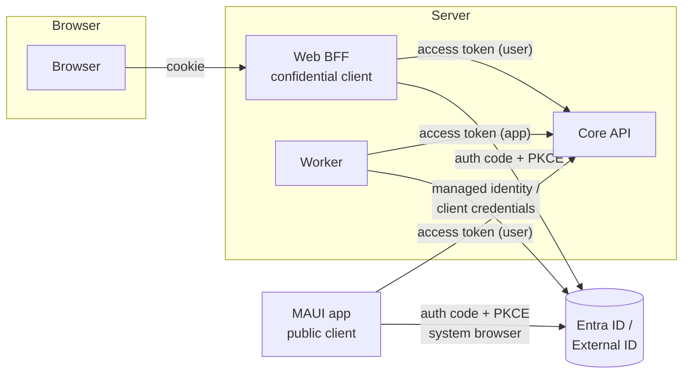
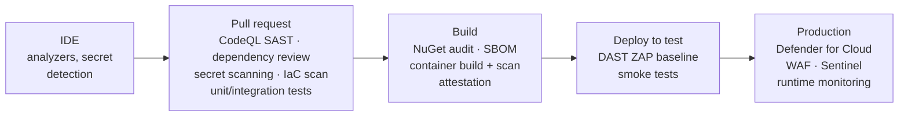

# 07 — Security & Identity

> Identity, authorization, secrets, network security, application security, supply chain, and secure delivery for .NET apps on Azure.
> **Everyone on the team should read this document.**

---

## Contents

1. [Security principles](#1-security-principles)
2. [Threat modelling](#2-threat-modelling)
3. [Identity architecture](#3-identity-architecture)
4. [Authentication in ASP.NET Core](#4-authentication-in-aspnet-core)
5. [Authorization](#5-authorization)
6. [Workload identity: service-to-service and Azure resources](#6-workload-identity-service-to-service-and-azure-resources)
7. [Secrets, keys and certificates](#7-secrets-keys-and-certificates)
8. [Network security](#8-network-security)
9. [Application security: OWASP Top 10 mapped to .NET](#9-application-security-owasp-top-10-mapped-to-net)
10. [API security: OWASP API Top 10](#10-api-security-owasp-api-top-10)
11. [Software supply chain security](#11-software-supply-chain-security)
12. [DevSecOps: security in the pipeline](#12-devsecops-security-in-the-pipeline)
13. [Azure platform security and governance](#13-azure-platform-security-and-governance)
14. [Security logging, detection and incident response](#14-security-logging-detection-and-incident-response)
15. [Compliance and privacy](#15-compliance-and-privacy)
16. [References](#16-references)

---

## 1. Security principles

1. **Zero Trust** — *verify explicitly* (authenticate and authorise every request, using all available signals), *use least-privilege access* (just-in-time, just-enough), *assume breach* (segment, encrypt, monitor, minimise blast radius).
2. **Defence in depth** — multiple independent controls (WAF + app validation + parameterised queries + least-privilege DB user).
3. **Secure by default** — deny by default; opt-in to anonymous access; secure configuration in templates.
4. **Identity is the perimeter** — prefer identity-based access (Entra ID, managed identity) to network location or shared secrets.
5. **No secrets where identity will do** — and where secrets are unavoidable, they live in Key Vault, rotate, and are never in source control.
6. **Shift left** — security checks automated in the IDE and CI, not just pen tests before launch.
7. **Least functionality** — disable what you don't use (endpoints, features, ports, public network access).
8. **Fail securely** — errors don't leak information; failures default to deny.
9. **Auditability** — security-relevant actions are logged, attributable, and tamper-resistant.

Baseline framework: [Microsoft Cloud Security Benchmark (MCSB)](https://learn.microsoft.com/security/benchmark/azure/) and the WAF Security pillar.

---

## 2. Threat modelling

**Threat model every new system and every significant feature** (new data flows, new external integrations, auth changes, handling of sensitive data).

Process (lightweight, ~1–2 hours per feature):

1. **Diagram** the data flow: actors, processes, data stores, trust boundaries (browser ↔ Front Door ↔ API ↔ DB; mobile ↔ API; API ↔ third party).
2. **Identify threats** with **STRIDE** per element:

   | Threat | Property violated | Example | Typical mitigation |
   |---|---|---|---|
   | **S**poofing | Authentication | Forged JWT; stolen token | Signature/issuer/audience validation; short-lived tokens; MFA |
   | **T**ampering | Integrity | Modified request changes another user's order | Authorization checks; ETags; signed payloads |
   | **R**epudiation | Non-repudiation | User denies issuing a refund | Audit logs with actor, time, correlation |
   | **I**nformation disclosure | Confidentiality | Stack trace in error; IDOR exposing data | Problem Details without internals; object-level authz; encryption |
   | **D**enial of service | Availability | Unbounded queries; huge uploads | Rate limiting; pagination; size limits; autoscale; WAF |
   | **E**levation of privilege | Authorization | User calls admin endpoint | Policy-based authz; separate admin app/roles |

3. **Mitigate**: decide per threat — mitigate, accept (documented), transfer, or eliminate.
4. **Validate**: mitigations become backlog items/tests; revisit the model when the design changes.

Tools: [Microsoft Threat Modeling Tool](https://learn.microsoft.com/azure/security/develop/threat-modeling-tool), [OWASP Threat Dragon](https://owasp.org/www-project-threat-dragon/), or simply a Mermaid diagram + table in the repo (`docs/security/threat-model.md`).

---

## 3. Identity architecture

### 3.1 Identity providers

| Users | Provider | Notes |
|---|---|---|
| **Employees / internal users / admins** | **Microsoft Entra ID** (workforce tenant) | Conditional Access, MFA, PIM, groups/app roles. |
| **Customers / consumers / external business users** | **Microsoft Entra External ID** (external tenant) | Self-service sign-up, social IdPs (Google, Apple, Facebook), email OTP, custom branding, MFA. |
| **Partners' employees (B2B)** | Entra ID **B2B collaboration** (guests) | Partner users sign in with their own org credentials. |

**Azure AD B2C is no longer sold to new customers (since 1 May 2025)** and is supported until at least May 2030 for existing customers. New projects use **External ID**.

Never build your own password storage/login system. If you must self-host an IdP (rare: on-prem/offline/regulatory), use OpenIddict or Duende IdentityServer (commercial) — and be prepared for the security burden.

### 3.2 App registrations

Create a separate app registration per client and per API:

| Registration | Type | Flow | Notes |
|---|---|---|---|
| **Core API** | Web API (resource) | — | Exposes **scopes** (delegated permissions: `Orders.Read`, `Orders.ReadWrite`) and **app roles** (application permissions for daemons, and user roles: `Admin`, `Support`). Application ID URI `api://contoso-shop-api`. |
| **Web app (BFF)** | Web, confidential | Authorization code + PKCE; OBO/token acquisition to call API | Uses **certificate or federated credential (managed identity)** — avoid client secrets. |
| **Mobile app** | Public client (mobile) | Authorization code + PKCE via MSAL, system browser/broker | Redirect URI `msal{clientId}://auth`; no secret. |
| **SPA (if not using BFF)** | SPA | Auth code + PKCE | Discouraged; prefer BFF. |
| **Daemon / worker** | Confidential | Client credentials | Prefer **managed identity** when calling Azure-hosted APIs. |
| **CI/CD** | Workload identity | OIDC federation | No secrets in pipelines ([11](11-devops-and-delivery.md#5-secure-deployments-with-workload-identity-federation)). |

Separate registrations per **environment** (dev/test/prod), ideally in separate tenants for External ID dev vs prod.

### 3.3 Flows by client



**Never use**: implicit flow, resource owner password credentials (ROPC), or long-lived API keys for user authentication.

### 3.4 Token hygiene

- Access tokens are **short-lived** (default ~60–90 min); use refresh tokens via MSAL; don't extend lifetimes to "fix" UX.
- APIs accept only tokens **issued for their audience** (`aud` = API's client ID or App ID URI).
- Use **v2.0 tokens** (`accessTokenAcceptedVersion: 2` in the API manifest).
- Don't put sensitive data in tokens (they're only signed, not encrypted).
- Consider **Continuous Access Evaluation (CAE)** for near-real-time revocation in workforce scenarios.
- Validate `scp` (scopes) for delegated calls and `roles` for app calls — a token with neither should be rejected.

---

## 4. Authentication in ASP.NET Core

### 4.1 API (JWT bearer)

```csharp
builder.Services.AddAuthentication(JwtBearerDefaults.AuthenticationScheme)
    .AddMicrosoftIdentityWebApi(builder.Configuration.GetSection("EntraId"));
```

```json
"EntraId": {
  "Instance": "https://login.microsoftonline.com/",
  "TenantId": "<tenant-guid>",
  "ClientId": "<api-client-id>",
  "Audience": "api://contoso-shop-api"
}
```

(For External ID, the authority is `https://<tenant-subdomain>.ciamlogin.com/`.)

`Microsoft.Identity.Web` validates signature (keys from OIDC metadata, auto-rotated), issuer, audience, and lifetime. If using raw `AddJwtBearer`, ensure **all of these are validated** — never disable `ValidateIssuer`/`ValidateAudience`.

**Multi-tenant APIs**: validate the issuer against an allow-list of tenant IDs. Accepting "any Entra tenant" means *anyone with a Microsoft account* can call you.

### 4.2 Web (OIDC + cookies)

See [05 §6](05-web-application.md#6-authentication-and-the-bff-pattern). Key points: confidential client using certificate/federated credential, tokens stored server-side (distributed token cache), HTTP-only secure cookies, Data Protection keys persisted and protected.

### 4.3 Mobile

See [06 §7](06-mobile-applications.md#7-authentication): MSAL, system browser, PKCE, tokens in OS secure storage.

### 4.4 MFA and Conditional Access

- **MFA for all users** where the product allows; **phishing-resistant MFA** (passkeys/FIDO2, Windows Hello, certificate-based) for admins and privileged users.
- **Passkeys** are supported in Entra ID and increasingly in External ID — prefer passwordless where possible.
- Conditional Access policies for workforce: require compliant device for admin apps, block legacy auth, risk-based sign-in policies.

---

## 5. Authorization

### 5.1 Principles

- **Deny by default**: fallback policy requires an authenticated user; anonymous endpoints are explicit and reviewed.
- **Authorize at every layer**: endpoint (coarse: role/scope), handler/domain (fine: resource ownership/state).
- **Centralise policies** — named policies in one place, not ad hoc `User.IsInRole` checks scattered through code.
- **UI hiding is not authorization.** The API always enforces.
- **Test authorization explicitly** — negative tests that a user *cannot* access another user's resources.

### 5.2 Models

| Model | Use for | ASP.NET Core |
|---|---|---|
| **Scopes** | What the *client app* may do on the user's behalf. | `RequireScope("Orders.ReadWrite")` (Microsoft.Identity.Web) |
| **App roles (RBAC)** | What the *user* (or daemon app) may do. Assigned in Entra (users/groups → roles). | `RequireRole("Admin")`; roles appear in the `roles` claim. Prefer app roles over group claims (group overage issues). |
| **Resource-based** | Access to a *specific* resource (ownership, tenant, sharing). | `IAuthorizationService.AuthorizeAsync(user, resource, requirement)` with `AuthorizationHandler<TRequirement, TResource>`. |
| **Attribute-based (ABAC)** | Rules on attributes (department, region, classification, time). | Custom requirements/handlers; or an external policy engine (OPA, Cedar) for complex domains. |
| **Permissions in the app's own DB** | Fine-grained, frequently changing, tenant-admin-managed permissions. | Load permissions per user (cached) and evaluate in handlers. |

### 5.3 Resource-based example

```csharp
public sealed class OrderOwnerRequirement : IAuthorizationRequirement;

internal sealed class OrderOwnerHandler : AuthorizationHandler<OrderOwnerRequirement, Order>
{
    protected override Task HandleRequirementAsync(AuthorizationHandlerContext ctx, OrderOwnerRequirement req, Order order)
    {
        var userId = ctx.User.FindFirstValue("oid");   // object ID — stable, unique per tenant
        if (order.CustomerId.Value.ToString() == userId || ctx.User.IsInRole("Support"))
            ctx.Succeed(req);
        return Task.CompletedTask;
    }
}

// In handler:
var auth = await authorizationService.AuthorizeAsync(user, order, new OrderOwnerRequirement());
if (!auth.Succeeded) return Errors.NotFound;   // 404 rather than 403 avoids confirming existence
```

- Identify users by **`oid` (object ID)** + **`tid` (tenant ID)** — not by email or name (mutable, not unique).
- Better still: **scope queries by the current user/tenant** so unauthorized data is never loaded (`Where(o => o.CustomerId == currentUser.Id)`) — plus global query filters for tenancy.

### 5.4 Administrative access

- Separate admin functionality into a **separate app/endpoint group** with stricter policies (workforce identity, MFA, compliant device, IP restrictions).
- Audit-log every admin action.
- Use **Privileged Identity Management (PIM)** for just-in-time elevation to admin roles.

---

## 6. Workload identity: service-to-service and Azure resources

### 6.1 Managed identity everywhere

Every Azure-hosted workload (Container Apps, App Service, Functions) uses a **managed identity** to access Azure resources and other APIs:

- Prefer **user-assigned managed identities** — lifecycle independent of the app, can be pre-provisioned with role assignments in IaC, shared across revisions/slots.
- Grant **data-plane RBAC roles** with least privilege, scoped to the specific resource:

  | Resource | Role (example) |
  |---|---|
  | Key Vault | Key Vault Secrets User |
  | App Configuration | App Configuration Data Reader |
  | Storage (blobs) | Storage Blob Data Contributor (scoped to container) |
  | Service Bus | Azure Service Bus Data Sender / Data Receiver |
  | Azure SQL | Contained DB user `CREATE USER [app-identity] FROM EXTERNAL PROVIDER` + `db_datareader`/`db_datawriter` |
  | Cosmos DB | Cosmos DB Built-in Data Contributor (data-plane role) |
  | Redis | Data access policy assignment (Entra auth) |
  | Container Registry | AcrPull |

- **Disable key/password-based auth** on resources where supported (Storage shared keys, Service Bus SAS, Cosmos keys, SQL auth) — enforce with Azure Policy.

### 6.2 Credentials in code

```csharp
// Production: be explicit about the credential to avoid slow/unexpected fallbacks.
TokenCredential credential = builder.Environment.IsDevelopment()
    ? new DefaultAzureCredential()                                  // dev: Azure CLI / VS / azd login
    : new ManagedIdentityCredential(ManagedIdentityId.FromUserAssignedClientId(builder.Configuration["AZURE_CLIENT_ID"]));

builder.Services.AddAzureClients(clients =>
{
    clients.UseCredential(credential);
    clients.AddBlobServiceClient(new Uri(builder.Configuration["Storage:BlobEndpoint"]!));
    clients.AddServiceBusClientWithNamespace(builder.Configuration["ServiceBus:Namespace"]!);
});
```

- `DefaultAzureCredential` is convenient but probes multiple credential sources; in production prefer `ManagedIdentityCredential` (or set `AZURE_TOKEN_CREDENTIALS` to restrict the chain — ⚠ verify availability in your Azure.Identity version).
- Aspire client integrations use `DefaultAzureCredential` by default and handle this wiring.

### 6.3 Calling your own APIs service-to-service

- Caller obtains a token for the callee's App ID URI using its managed identity (app-only token with `roles` claim).
- Callee validates the token and checks for the expected **app role** (e.g., `Orders.Process.All`), and optionally an allow-list of caller app IDs (`azp`/`appid` claim).
- Use **On-Behalf-Of** only when the downstream must act as the user.

### 6.4 Workload identity federation

For workloads **outside Azure** (GitHub Actions, other clouds, Kubernetes), use **federated identity credentials** on an app registration or user-assigned managed identity — exchange the external OIDC token for an Entra token. **No client secrets.**

---

## 7. Secrets, keys and certificates

### 7.1 Rules

- **Zero secrets in source control** — including `appsettings.Development.json`, test files, Bicep parameter files, and pipeline YAML. Enforced by **secret scanning with push protection**.
- Prefer **no secret at all** (managed identity / federation).
- Unavoidable secrets (third-party API keys, webhook signing secrets) live in **Azure Key Vault**:
  - One vault per application per environment (limits blast radius).
  - **RBAC authorization model** (not access policies).
  - **Soft delete + purge protection** enabled.
  - **Private endpoint**, public network access disabled.
  - Access via managed identity with **Key Vault Secrets User** on the vault (or individual secrets).
- Reference secrets from **App Configuration Key Vault references** or the Key Vault configuration provider; reload on rotation (`IOptionsMonitor`).
- **Rotate** secrets on a schedule and on suspected compromise; automate rotation where the provider supports it (Event Grid `SecretNearExpiry` events → rotation function).
- **Certificates**: Key Vault–managed with auto-renewal; Container Apps/App Service managed certificates for custom domains; Front Door managed certificates.
- **Local development**: `dotnet user-secrets` or Aspire parameters; developers use their own Entra identity against dev resources rather than shared secrets.

### 7.2 Cryptography

- Don't invent crypto. Use platform APIs: `System.Security.Cryptography` (AES-GCM, SHA-256+, RSA/ECDSA), ASP.NET Core **Data Protection** for app-level protect/unprotect, Key Vault keys for HSM-backed signing/wrapping.
- Passwords (if you ever store them — avoid): `PasswordHasher<T>` (PBKDF2) or Argon2.
- TLS 1.2 minimum (1.3 preferred) on all endpoints and resources.
- Random tokens: `RandomNumberGenerator.GetBytes` — never `Random`.

---

## 8. Network security

Identity is the primary perimeter, but network controls add defence in depth:

- **Single public entry point**: Azure Front Door (Premium for Private Link origins and managed WAF rule sets) with **WAF** in **Prevention** mode (OWASP/DRS managed rules + bot protection + custom rate-limit rules). Tune false positives in Detection mode first.
- **Lock origins to Front Door**: Private Link from Front Door to Container Apps/App Service, or access restrictions using the `AzureFrontDoor.Backend` service tag **plus** validation of the `X-Azure-FDID` header.
- **VNet integration** for Container Apps environments / App Service.
- **Private endpoints** for PaaS data services (SQL, Storage, Key Vault, Service Bus, Redis, Cosmos, App Configuration, ACR); **disable public network access** on them.
- **Private DNS zones** linked to the VNet for private endpoint resolution.
- **NSGs** on subnets; deny by default; **egress control** via Azure Firewall/NAT Gateway with allow-listed destinations for sensitive workloads.
- **DDoS protection**: Front Door includes L3/L4 protection at the edge; Azure DDoS Network Protection for VNets with public IPs if required.
- **No public management ports** (RDP/SSH); there should be no VMs in a PaaS design — if there are, use Azure Bastion.
- Developer access to private resources via VPN/Bastion/jump box or **dev environments with public access restricted to IP allow-lists** — never by permanently opening production.

---

## 9. Application security: OWASP Top 10 mapped to .NET

The [OWASP Top 10:2025](https://owasp.org/Top10/) (⚠ verify against the final published list):

| # | Risk | .NET / Azure mitigations |
|---|---|---|
| A01 | **Broken Access Control** | Fallback auth policy; resource-based authorization; query scoping by user/tenant; global query filters; deny by default; tests for IDOR; CORS allow-list. |
| A02 | **Security Misconfiguration** | IaC with secure defaults; Azure Policy; no dev exception pages in prod; disable unused features; security headers; remove default/sample endpoints; Defender for Cloud recommendations. |
| A03 | **Software Supply Chain Failures** | NuGet Audit; lock files; package source mapping; Dependabot; SBOM; signed artefacts; pinned GitHub Actions; trusted base images (§11). |
| A04 | **Cryptographic Failures** | TLS everywhere; encryption at rest (default); Key Vault; no custom crypto; Data Protection API; no sensitive data in URLs/logs/tokens. |
| A05 | **Injection** | EF Core/parameterised queries; never concatenate SQL; Razor auto-encoding; avoid `MarkupString` with untrusted input; validate and allow-list inputs; safe deserialization (System.Text.Json; never `BinaryFormatter` — removed in .NET 9). |
| A06 | **Insecure Design** | Threat modelling; secure design patterns; rate limits; business-logic abuse cases in tests; limits on resource consumption. |
| A07 | **Authentication Failures** | Entra ID/External ID; MFA/passkeys; no custom password storage; proper token validation; secure cookie settings; session timeout. |
| A08 | **Software or Data Integrity Failures** | Signed builds/containers; CI/CD with protected branches and environments; verify webhook signatures; integrity of deserialized data; SRI for third-party scripts. |
| A09 | **Security Logging & Alerting Failures** | Structured security/audit logs to Log Analytics; Defender alerts; Sentinel analytics; alert on auth failures/anomalies; protect logs from tampering. |
| A10 | **Mishandling of Exceptional Conditions** | Global exception handler with Problem Details (no internals leaked); fail closed; consistent error handling; resilience patterns; test failure paths. |

Additional .NET-specific guidance:
- **SSRF**: validate/allow-list outbound URLs derived from user input; block internal/metadata addresses (`169.254.169.254`); use named `HttpClient`s with fixed base addresses.
- **Path traversal**: never build file paths from user input; use `Path.GetFileName` + generated names.
- **Open redirect**: validate return URLs (`Url.IsLocalUrl`).
- **XML**: `XmlReaderSettings { DtdProcessing = Prohibit }` to prevent XXE (defaults are safe in modern .NET, keep them).
- **Regex DoS**: use timeouts (`new Regex(pattern, options, TimeSpan.FromMilliseconds(100))`) or `RegexOptions.NonBacktracking` for user-supplied input; prefer source-generated regex.
- **Mass assignment**: dedicated request DTOs.
- **Sensitive data exposure in errors**: `UseDeveloperExceptionPage` only in Development.

---

## 10. API security: OWASP API Top 10

[OWASP API Security Top 10 (2023)](https://owasp.org/API-Security/editions/2023/en/0x11-t10/):

| # | Risk | Mitigation |
|---|---|---|
| API1 | Broken Object Level Authorization | Check ownership on every object access; scope queries; non-sequential IDs (defence in depth, not a fix). |
| API2 | Broken Authentication | Entra tokens; strict validation; no API keys for users; rate-limit auth endpoints. |
| API3 | Broken Object Property Level Authorization | Response DTOs expose only permitted fields; request DTOs accept only permitted fields. |
| API4 | Unrestricted Resource Consumption | Rate limiting; pagination with max size; request size limits; timeouts; query complexity limits; cost-aware quotas (APIM). |
| API5 | Broken Function Level Authorization | Policy per endpoint group; admin endpoints separated; fallback policy. |
| API6 | Unrestricted Access to Sensitive Business Flows | Bot protection (WAF), CAPTCHA/attestation on abuse-prone flows, velocity checks, device attestation for mobile. |
| API7 | Server-Side Request Forgery | Allow-list outbound destinations; no user-controlled URLs to internal resources. |
| API8 | Security Misconfiguration | Secure defaults in templates; headers; CORS; TLS; disable OpenAPI UI in prod or protect it. |
| API9 | Improper Inventory Management | Versioning and deprecation policy; APIM inventory; decommission old versions; no forgotten test endpoints. |
| API10 | Unsafe Consumption of APIs | Validate data from third-party APIs; timeouts; TLS; treat as untrusted input. |

---

## 11. Software supply chain security

| Control | How |
|---|---|
| **Known-vulnerable packages** | `NuGetAudit` (transitive, fail on findings in CI); `dotnet list package --vulnerable`; Dependabot security updates; GitHub dependency review on PRs. |
| **Reproducible restores** | `packages.lock.json` + `RestoreLockedMode` in CI; Central Package Management. |
| **Dependency confusion** | `nuget.config` with `<clear/>` and **package source mapping**; reserved ID prefixes for internal packages. |
| **Package trust** | Prefer signed packages from verified publishers; review new dependencies ([02 §9](02-solution-structure-and-coding-standards.md#9-dependency-and-library-policy)). |
| **SBOM** | Generate an SPDX/CycloneDX SBOM per build (`Microsoft.Sbom.Tool`, or `sbom-tool` in CI; Syft for container images); store with artefacts. |
| **Build provenance** | GitHub **artifact attestations** (`actions/attest-build-provenance`) for container images and packages; aim for SLSA Build Level 2–3. |
| **Container images** | Official Microsoft base images (`mcr.microsoft.com/dotnet/aspnet`), ideally **chiseled/distroless** Ubuntu variants (smaller, no shell, non-root by default). Pin by digest; rebuild regularly for patches; scan with Defender for Containers / Trivy. Use `dotnet publish /t:PublishContainer` (SDK container support) — no Dockerfile needed for most apps. |
| **CI/CD integrity** | Pin third-party GitHub Actions to **commit SHAs**; minimal `permissions:` per workflow; protected branches and environments; required reviews; OIDC instead of secrets. |
| **Commit integrity** | Signed commits (optional but recommended); branch protection preventing force pushes. |
| **Runtime images** | Run as non-root (`USER $APP_UID` — default in .NET 8+ images); read-only root filesystem where possible. |

---

## 12. DevSecOps: security in the pipeline



| Stage | Tooling |
|---|---|
| IDE | .NET analyzers, SonarLint, GitHub Copilot/Claude code review hints, pre-commit secret detection (gitleaks) |
| PR | **GitHub Advanced Security** (CodeQL, secret scanning + push protection, dependency review) or **GitHub Advanced Security for Azure DevOps**; IaC scanning (**PSRule for Azure**, Checkov, Microsoft Security DevOps action); required reviewers for security-sensitive paths (CODEOWNERS) |
| Build | NuGet audit, SBOM, container scan, provenance attestation |
| Test environment | **DAST**: OWASP ZAP baseline/API scan against the deployed OpenAPI; authenticated scans for key flows |
| Production | **Microsoft Defender for Cloud** (CSPM + workload protections: Containers, App Service, SQL, Storage, Key Vault, Resource Manager), **Defender for Cloud DevOps security** connecting repos for code-to-cloud insights |
| Periodic | Penetration tests before major launches and annually; bug bounty for mature public products |

Security findings are triaged like bugs with SLAs (e.g., Critical: 7 days, High: 30 days, Medium: 90 days).

---

## 13. Azure platform security and governance

- **Landing zone**: deploy into an Azure landing zone with management groups, policy, and centralised logging ([08 §3](08-azure-hosting-and-infrastructure.md#3-azure-landing-zone-and-governance)).
- **Azure Policy**: enforce guardrails — allowed regions, required tags, deny public network access on data services, require TLS 1.2, deny storage shared-key auth, require diagnostic settings, Defender plans enabled. Start in *Audit*, move to *Deny*.
- **RBAC**: least privilege; assign to groups not individuals; no standing Owner/Contributor in production — use **PIM** for just-in-time elevation with approval; separate break-glass accounts (excluded from Conditional Access, monitored).
- **Production access**: deployments only via pipelines; humans have Reader by default; elevated access audited.
- **Resource locks** (`CanNotDelete`) on critical production resources (databases, Key Vaults, DNS zones).
- **Microsoft Defender for Cloud**: enable CSPM and relevant workload protection plans; track Secure Score; remediate recommendations.
- **Diagnostic settings** on all resources → Log Analytics (and Sentinel workspace).

---

## 14. Security logging, detection and incident response

### 14.1 What to log (security events)

- Authentication successes/failures (from Entra sign-in logs — no need to duplicate), token validation failures at the API.
- Authorization failures (403s/denied resource access) with user ID, resource, endpoint.
- Admin and privileged actions; permission/role changes.
- Data exports, bulk operations, and access to highly sensitive records.
- Security configuration changes (Azure Activity Log).
- Input validation failures that suggest attack patterns (rate-limited/aggregated).

### 14.2 How

- Structured logs with consistent fields (`UserId`, `TenantId`, `ClientIp`, `Action`, `Resource`, `Outcome`, `TraceId`) — never tokens, passwords, or raw PII.
- Route to **Log Analytics**; for organisations with a SOC, connect to **Microsoft Sentinel** with analytics rules (impossible travel, brute-force, mass data access, privilege escalation).
- Immutable/retention-locked storage for audit logs where compliance requires.

### 14.3 Incident response

- Documented **security incident runbook**: detection → triage → containment (revoke sessions/tokens, rotate secrets, block IPs at WAF, disable accounts) → eradication → recovery → post-incident review.
- Know how to: revoke a user's sessions in Entra; rotate every secret in Key Vault; roll back a deployment; restore data to a point in time.
- Contact paths: security team, Microsoft support, legal/privacy (breach notification obligations — GDPR requires notifying the authority within 72 hours).
- Practice with tabletop exercises.

---

## 15. Compliance and privacy

- Identify applicable regimes early: **GDPR/UK GDPR**, **CCPA/CPRA**, **HIPAA**, **PCI DSS**, **SOC 2**, **ISO 27001**, sector-specific rules, accessibility law (EAA).
- Use **Microsoft Purview Compliance Manager** and **Defender for Cloud regulatory compliance** dashboards to map controls.
- **PCI**: never handle raw card data — use a payment provider's hosted fields/checkout so you stay out of (most of) PCI scope.
- **Privacy by design**: data minimisation, purpose limitation, retention limits, consent management, data subject request processes (access, rectification, erasure, portability).
- Record **data processing activities** and data flows (the threat model diagram helps).
- Data residency: choose Azure regions and replication targets consistent with obligations.

---

## 16. References

- [Microsoft Cloud Security Benchmark](https://learn.microsoft.com/security/benchmark/azure/)
- [WAF Security pillar](https://learn.microsoft.com/azure/well-architected/security/)
- [Zero Trust guidance](https://learn.microsoft.com/security/zero-trust/)
- [Microsoft identity platform](https://learn.microsoft.com/entra/identity-platform/)
- [Microsoft Entra External ID](https://learn.microsoft.com/entra/external-id/)
- [Microsoft.Identity.Web](https://learn.microsoft.com/entra/msal/dotnet/microsoft-identity-web/)
- [ASP.NET Core security](https://learn.microsoft.com/aspnet/core/security/)
- [Managed identities for Azure resources](https://learn.microsoft.com/entra/identity/managed-identities-azure-resources/overview)
- [Azure Key Vault best practices](https://learn.microsoft.com/azure/key-vault/general/best-practices)
- [OWASP Top 10](https://owasp.org/Top10/) · [OWASP API Security Top 10](https://owasp.org/API-Security/) · [OWASP ASVS](https://owasp.org/www-project-application-security-verification-standard/) · [OWASP Cheat Sheets](https://cheatsheetseries.owasp.org/)
- [SLSA framework](https://slsa.dev/)
- [Microsoft Security Development Lifecycle](https://www.microsoft.com/securityengineering/sdl)
