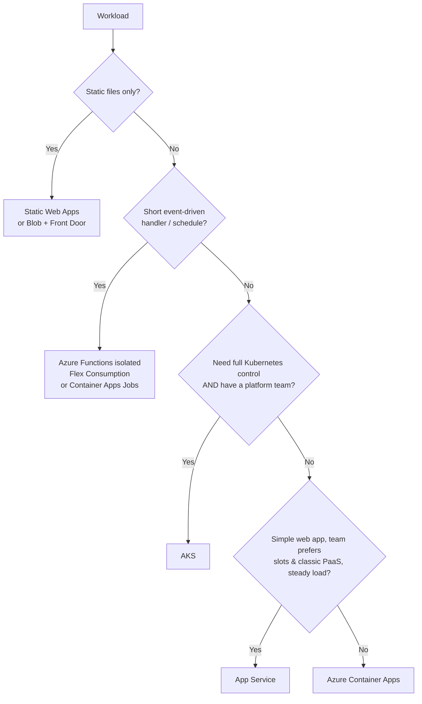

# 08 — Azure Hosting & Infrastructure

> Choosing Azure services, structuring environments, infrastructure as code, Aspire, networking, reliability, scaling, and cost.

---

## Contents

1. [Principles](#1-principles)
2. [Choosing compute](#2-choosing-compute)
3. [Azure landing zone and governance](#3-azure-landing-zone-and-governance)
4. [Environments and subscriptions](#4-environments-and-subscriptions)
5. [Infrastructure as Code](#5-infrastructure-as-code)
6. [Networking topology](#6-networking-topology)
7. [Configuration and feature flags](#7-configuration-and-feature-flags)
8. [Messaging and integration services](#8-messaging-and-integration-services)
9. [Aspire: local development and deployment](#9-aspire-local-development-and-deployment)
10. [Containers](#10-containers)
11. [Reliability and disaster recovery](#11-reliability-and-disaster-recovery)
12. [Scaling](#12-scaling)
13. [Cost management (FinOps)](#13-cost-management-finops)
14. [Naming and tagging](#14-naming-and-tagging)
15. [References](#15-references)

---

## 1. Principles

- **PaaS first.** Use managed services; avoid VMs unless there's no alternative.
- **Everything as code.** No portal-created production resources ("ClickOps"). The portal is for reading and emergencies only; any emergency change is back-ported to IaC immediately.
- **Immutable deployments.** Build an artefact (container image) once; promote it through environments with environment-specific configuration.
- **Identity-based access** between all components (managed identity), private networking for data.
- **Environment parity.** Dev, test, and prod are built from the same templates with different parameters (SKU sizes, replica counts, redundancy).
- **Cost-aware by design.** Scale to zero in non-prod; right-size; tag everything.

---

## 2. Choosing compute

### 2.1 Options

| Service | What it is | Best for | Limitations |
|---|---|---|---|
| **Azure Container Apps (ACA)** — default | Serverless containers on managed Kubernetes (KEDA, Envoy) without cluster management. | APIs, web apps, background workers, event-driven processing, microservices, jobs. Scale to zero. Revisions + traffic splitting. | No direct Kubernetes API access; some advanced networking/scheduling not available. |
| **Azure App Service** (Linux) | Mature PaaS web hosting (code or containers). | Simple web apps/APIs; teams wanting deployment slots, built-in auth, easy ops. | Always-on cost per plan (no scale to zero); less suited to event-driven workers. |
| **Azure Functions** (isolated worker) | Event-driven serverless functions with bindings/triggers. | Event handlers, scheduled tasks, integration glue, Durable orchestrations. **Flex Consumption** plan for serverless with VNet support. | Execution model constraints; avoid for the core transactional API. **In-process model support ends 10 Nov 2026** — isolated only. |
| **Azure Kubernetes Service (AKS)** | Managed Kubernetes. | Large microservice estates, a dedicated platform team, need for full Kubernetes control/ecosystem. | Significant operational overhead; you own upgrades, node pools, networking, security hardening. |
| **Azure Static Web Apps** | Global static hosting + optional managed Functions API. | Standalone Blazor WASM / JS SPAs, marketing sites, docs. | Not for server-rendered Blazor. |

### 2.2 Decision guide



### 2.3 Azure Container Apps essentials

- **Environment**: a secure boundary (shared VNet, Log Analytics) for related apps. One environment per product per stage is typical.
- **Workload profiles**: *Consumption* (serverless, scale to zero) and *Dedicated* (reserved compute, GPU, larger sizes). Use the **workload profiles environment** type (supports both, plus UDR/NAT gateway egress control).
- **Ingress**: external (via Front Door) for web/API; **internal** for workers and internal services.
- **Revisions**: each deployment creates a revision. Use **multiple-revision mode** for blue/green and canary with **traffic splitting** and revision labels.
- **Scaling**: HTTP concurrency, CPU/memory, or **KEDA scalers** (Service Bus queue length, Event Hubs, cron, etc.). Set `minReplicas` ≥ 1 (or ≥ 2 across zones) for latency-sensitive production APIs to avoid cold starts; 0 for workers and non-prod.
- **Jobs**: Container Apps Jobs for scheduled, event-triggered, or manual tasks (migrations, batch processing).
- **Health probes**: configure liveness, readiness, startup probes to match the app's health endpoints.
- **Secrets**: reference Key Vault secrets via managed identity (not inline secrets).
- **Dapr** integration is available — optional; adopt only if its building blocks (pub/sub, state, bindings abstractions) clearly simplify your design.
- **Zone redundancy**: enable on the environment in production (requires VNet).

---

## 3. Azure landing zone and governance

Deploy workloads into an **Azure landing zone** following the [Cloud Adoption Framework (CAF)](https://learn.microsoft.com/azure/cloud-adoption-framework/ready/landing-zone/):

```
Tenant Root Group
└── Contoso (intermediate root)
    ├── Platform
    │   ├── Identity            (subscription)
    │   ├── Management          (Log Analytics, Automation)
    │   └── Connectivity        (hub VNet, firewall, DNS, Front Door optional)
    ├── Landing Zones
    │   ├── Corp                (internal apps connected to hub)
    │   └── Online              (internet-facing apps)
    │       ├── shop-prod       (subscription)
    │       └── shop-nonprod    (subscription)
    ├── Sandbox                 (experimentation, isolated, budget-capped)
    └── Decommissioned
```

- **Azure Policy** assigned at management group level for guardrails (regions, tags, security baselines, diagnostics).
- **Centralised logging**: platform Log Analytics workspace for activity/security logs; workload workspaces for app telemetry (or a shared workspace with resource-context RBAC).
- Small organisations can start with a **simplified landing zone** (a few subscriptions + policy) and grow — but don't skip governance entirely.
- Use [Azure Landing Zone accelerators](https://learn.microsoft.com/azure/cloud-adoption-framework/ready/landing-zone/deploy-landing-zones-with-terraform) (Bicep/Terraform) to bootstrap.

---

## 4. Environments and subscriptions

### 4.1 Recommended environments

| Environment | Purpose | Characteristics |
|---|---|---|
| **Local** | Developer inner loop | Aspire AppHost; containers for SQL/Redis/emulators (Azurite, Service Bus emulator, Cosmos emulator) or personal Azure resources. |
| **Dev** | Integration of merged changes; continuous deployment from `main` | Smallest SKUs, scale to zero, relaxed (but not absent) network restrictions. |
| **Test / QA** | Automated E2E tests, manual QA, demos | Production-like topology, smaller scale; synthetic data only. |
| **Staging** (optional) | Pre-production validation, load tests, release rehearsal | Same SKUs/topology as prod; may be ephemeral. |
| **Production** | Live | Zone-redundant, private networking, alerts, PIM-guarded access. |
| **Ephemeral PR environments** (optional) | Per-PR preview | Container Apps revisions/labels or short-lived resource groups via azd; auto-destroyed on merge. |

### 4.2 Subscription strategy

- **Separate production and non-production subscriptions** at minimum. This gives clean RBAC boundaries, separate quotas, separate policies, and clear cost reporting.
- Within a subscription, **one resource group per environment per workload** (and optionally per lifecycle: e.g., `rg-shop-prod-data` separate from `rg-shop-prod-app` so data isn't deleted with app redeploys).
- **Separate managed identities, Key Vaults, and app registrations per environment.** Non-prod must never have credentials or network paths to prod data.
- **No production data in non-production.** Use synthetic or properly anonymised data.

---

## 5. Infrastructure as Code

### 5.1 Tool choice

| Tool | Use when |
|---|---|
| **Bicep** — default | Azure-only. First-class Azure support, day-0 resource types, no state file to manage, `what-if` previews, deployment stacks. |
| **Terraform** (AzureRM/AzAPI) | Multi-cloud or org-wide Terraform standard; strong module ecosystem; requires remote state management (Azure Storage backend with locking). |
| **Aspire-generated infra** | Aspire can generate Bicep from the AppHost model (`aspire publish`) — a great starting point; customise via `ConfigureInfrastructure` or eject and own the Bicep. |
| **azd (Azure Developer CLI)** | Orchestrates provisioning (Bicep/Terraform) + deployment with environment management; integrates with Aspire. Good for dev/test and simpler prod pipelines. |

### 5.2 Bicep practices

- Use **[Azure Verified Modules (AVM)](https://aka.ms/avm)** — Microsoft-maintained, WAF-aligned modules — rather than writing every resource from scratch.
- Structure: `main.bicep` (composition) + `modules/` + `.bicepparam` files per environment.
- **Parameterise** SKUs, capacity, redundancy; **never** put secrets in parameter files (use Key Vault references or `@secure()` params supplied by pipeline from Key Vault).
- **Linting** (`bicepconfig.json` with rules as errors) and **PSRule for Azure** for WAF/security rules in CI.
- **`what-if`** on every PR touching infra; post the diff as a PR comment.
- **Deployment stacks** to manage resource lifecycle and prevent orphaned resources/deletion of protected resources (`denySettings`).
- Assign **RBAC roles and diagnostic settings in IaC** alongside resources.
- Outputs only non-secret values (endpoints, resource IDs).

```bicep
// Example: Container App with user-assigned identity using AVM
module api 'br/public:avm/res/app/container-app:<version>' = {
  name: 'api'
  params: {
    name: 'ca-shop-api-${env}'
    environmentResourceId: acaEnv.outputs.resourceId
    managedIdentities: { userAssignedResourceIds: [ apiIdentity.outputs.resourceId ] }
    containers: [
      {
        name: 'api'
        image: '${acr.outputs.loginServer}/shop-api:${imageTag}'
        resources: { cpu: json('0.5'), memory: '1Gi' }
        probes: [ /* liveness/readiness on /health/live, /health/ready */ ]
        env: [
          { name: 'AZURE_CLIENT_ID', value: apiIdentity.outputs.clientId }
          { name: 'ConnectionStrings__ordering-db', value: sqlConnectionString } // passwordless
        ]
      }
    ]
    scaleSettings: { minReplicas: env == 'prod' ? 2 : 0, maxReplicas: 10 }
    ingressExternal: true
    ingressTargetPort: 8080
  }
}
```

### 5.3 Pipeline for infra

Infra changes flow through the same PR → plan (what-if) → approve → apply process as app code ([11](11-devops-and-delivery.md)). Detect drift periodically (scheduled what-if) and alert.

---

## 6. Networking topology

```mermaid
flowchart TB
    Internet((Internet)) --> FD[Azure Front Door Premium<br/>WAF · TLS · CDN]
    subgraph Spoke VNet - shop-prod
        subgraph snet-aca [snet-aca - delegated]
            ACAENV[Container Apps environment<br/>internal load balancer]
        end
        subgraph snet-pe [snet-private-endpoints]
            PE1[PE: SQL]
            PE2[PE: Key Vault]
            PE3[PE: Storage]
            PE4[PE: Service Bus]
            PE5[PE: Redis]
            PE6[PE: App Config / ACR]
        end
    end
    FD -- Private Link --> ACAENV
    ACAENV --> PE1 & PE2 & PE3 & PE4 & PE5 & PE6
    Hub[Hub VNet<br/>Firewall · DNS resolver · VPN/ER] <-- peering --> Spoke VNet - shop-prod
```

- **Hub-and-spoke** (or Azure Virtual WAN) when you have multiple workloads or on-premises connectivity; a standalone spoke VNet is fine for a single product initially.
- Subnets sized for growth (Container Apps workload profiles environment needs at least a /27; plan /23–/24 for headroom).
- **Private DNS zones** (`privatelink.database.windows.net`, etc.) linked to VNets; centralised in the hub for multi-spoke.
- **Egress**: route through Azure Firewall or NAT Gateway for a stable outbound IP (partners often allow-list it) and egress filtering.
- Front Door → Container Apps via **Private Link** (internal environment) keeps origins off the public internet.

---

## 7. Configuration and feature flags

**Azure App Configuration** is the central store for non-secret configuration and feature flags:

- **Labels** per environment (or separate stores per environment — preferred for prod isolation).
- **Key Vault references** for secrets (App Configuration stores the reference; the app resolves via managed identity).
- **Dynamic refresh**: sentinel key pattern with `IOptionsMonitor`; refresh interval tuned (e.g., 30 s–5 min).
- **Feature management** (`Microsoft.FeatureManagement`): boolean flags, percentage rollouts, targeting (users/groups), time windows, and **variant feature flags** for experiments. Use in the API (`[FeatureGate]`, `IFeatureManager`), web, and expose relevant flags to mobile via the app-config endpoint.
- **Snapshots** to version configuration with releases.
- Use managed identity with **App Configuration Data Reader**; disable access keys.

Feature flag hygiene: every flag has an owner and an expiry/removal ticket; remove flags within a few weeks of full rollout. Long-lived "ops toggles" (kill switches) are documented separately.

---

## 8. Messaging and integration services

| Service | Use | Guidance |
|---|---|---|
| **Azure Service Bus** | Reliable business messaging: queues (commands), topics/subscriptions (integration events), sessions (ordered processing), scheduled messages, dead-lettering, duplicate detection, transactions. | **Standard** for most; **Premium** for VNet/private endpoints, predictable performance, large messages, geo-replication. Use managed identity (disable SAS). Set max delivery count; monitor DLQ. |
| **Azure Event Grid** | Reactive, push-based event routing: Azure resource events (blob created), custom topics, fan-out to webhooks/Functions/queues. | CloudEvents schema; dead-letter destination; retry policies; **Event Grid namespaces** for MQTT and pull delivery. |
| **Azure Event Hubs** | High-throughput streaming/telemetry ingestion, Kafka-compatible. | Partitions sized for throughput; capture to storage; checkpointing in consumers. |
| **Azure Functions** | Event handlers on the above. | Isolated worker on .NET 10; **Flex Consumption** plan (VNet, fast scale, always-ready instances); one function app per bounded context. |
| **Durable Functions / Durable Task Scheduler** | Stateful orchestrations, sagas, fan-out/fan-in, human-in-the-loop workflows. | Durable Task Scheduler as the managed backend for better performance and observability. |
| **Logic Apps** | Low-code integration with SaaS connectors (Office 365, Salesforce, SAP). | For integration-heavy flows owned by integration teams; keep business logic in code. |
| **Azure SignalR Service** | Scaled-out real-time messaging for web clients. | Serverless or default mode; managed identity. |
| **Azure Notification Hubs** | Mobile push to APNs/FCM. | Backend-managed installations ([06 §9](06-mobile-applications.md#9-push-notifications)). |
| **Azure Communication Services** | Email, SMS, chat, voice/video. | Use for transactional email/SMS; managed identity. |

---

## 9. Aspire: local development and deployment

**Aspire** (formerly .NET Aspire; v13+) is the default way to describe, run, and deploy the application's distributed topology.

### 9.1 What it gives you

- **AppHost**: a C# (or TypeScript) program that declares the app model — projects, containers, cloud resources, and their relationships.
- **ServiceDefaults**: shared project wiring OpenTelemetry (logs, traces, metrics), health checks, service discovery, and HTTP resilience into every service.
- **Integrations**: client libraries (`Aspire.Microsoft.EntityFrameworkCore.SqlServer`, `Aspire.Azure.Messaging.ServiceBus`, `Aspire.StackExchange.Redis`, …) that configure SDK clients with health checks, telemetry, and retries; hosting integrations that run emulators/containers locally and provision Azure resources in deployment.
- **Dashboard**: local (and standalone) OpenTelemetry dashboard with structured logs, traces, metrics, and resource status.
- **Testing**: `Aspire.Hosting.Testing` to spin up the whole app model in integration tests.
- **Deployment**: `aspire publish`/`aspire deploy` and **azd** integration to generate Bicep and deploy to Azure Container Apps (and App Service — preview).
- **CLI**: `aspire run`, `aspire new`, `aspire update`, `aspire add`.

### 9.2 Example AppHost

```csharp
var builder = DistributedApplication.CreateBuilder(args);

var sql = builder.AddAzureSqlServer("sql")
                 .RunAsContainer()                       // local: SQL Server container; Azure: Azure SQL
                 .AddDatabase("ordering-db");

var cache = builder.AddAzureManagedRedis("cache").RunAsContainer();   // ⚠ verify integration name for your version
var messaging = builder.AddAzureServiceBus("messaging").RunAsEmulator();
messaging.AddServiceBusTopic("order-events");

var migrations = builder.AddProject<Projects.MigrationService>("migrations")
                        .WithReference(sql).WaitFor(sql);

var api = builder.AddProject<Projects.Api>("api")
                 .WithReference(sql).WithReference(cache).WithReference(messaging)
                 .WaitForCompletion(migrations)
                 .WithExternalHttpEndpoints();

builder.AddProject<Projects.Web>("web")
       .WithReference(api).WithReference(cache)
       .WithExternalHttpEndpoints();

builder.AddProject<Projects.Worker>("worker")
       .WithReference(messaging).WithReference(sql);

builder.Build().Run();
```

### 9.3 Guidance

- Every solution has `AppHost` and `ServiceDefaults` projects; `README` says "run `aspire run`" (or `dotnet run --project src/AppHost`).
- Use **emulators/containers locally** (SQL Server/PostgreSQL containers, Azurite, Service Bus emulator, Cosmos DB emulator, Redis) so the inner loop works offline and without cloud cost; use real Azure resources for shared dev/test.
- The **mobile app** isn't hosted by Aspire, but Aspire can expose the API via **dev tunnels** for physical devices.
- For production, decide via ADR whether to **deploy with Aspire/azd** (fast, convention-driven) or **own the Bicep** generated from Aspire (more control, fits enterprise pipelines). Many teams generate once, then maintain Bicep with AVM.
- Keep resource names in the AppHost consistent with configuration keys (`ConnectionStrings__ordering-db`).

---

## 10. Containers

- **Build images with the .NET SDK** (`dotnet publish -t:PublishContainer`) — no Dockerfile needed for standard apps; produces small, secure, non-root images. Use a Dockerfile only for special requirements.
- **Base images**: `mcr.microsoft.com/dotnet/aspnet:10.0` → prefer **`-noble-chiseled`** (Ubuntu chiseled: no shell/package manager, non-root) or `-noble-chiseled-extra` (with ICU/tzdata if needed). For Native AOT apps, `runtime-deps` chiseled images.
- Expose port **8080** (default non-root port in .NET 8+ images).
- **Tags**: immutable tags (Git SHA or SemVer + SHA); never deploy `latest`. Optionally pin by digest in deployment.
- **Azure Container Registry**: Premium SKU for private endpoints/geo-replication in prod; **AcrPull** via managed identity; disable admin user; enable Defender for Containers scanning; retention policies for untagged manifests.
- Rebuild images regularly (weekly) to pick up base image patches even without code changes.
- Set **resource requests/limits** appropriately; configure .NET GC for containers (Server GC with `DOTNET_GCHeapHardLimit` awareness — .NET respects container limits automatically; consider `DOTNET_GCHeapAffinitizeMask`/DATAS defaults in .NET 9+ which adapt heap size to load).

---

## 11. Reliability and disaster recovery

### 11.1 Availability zones

Enable **zone redundancy** in production for: Container Apps environment, Azure SQL / PostgreSQL (zone-redundant HA), Redis, Service Bus Premium, Storage (ZRS/GZRS), Key Vault (automatic), App Configuration, ACR Premium. This protects against datacentre failure within a region at modest cost.

### 11.2 Multi-region strategy

Choose based on RTO/RPO and budget:

| Strategy | RTO | RPO | Cost | Description |
|---|---|---|---|---|
| **Backup & restore** | Hours–days | Hours | $ | Geo-redundant backups; redeploy infra via IaC to another region on disaster. |
| **Pilot light** | ~1–4 h | Minutes | $$ | Data replicated (geo-replica/failover group); minimal compute in secondary; scale up on failover. |
| **Warm standby** | Minutes–1 h | Seconds–minutes | $$$ | Scaled-down full stack running in secondary; Front Door fails over. |
| **Active-active** | ~0 | ~0 (data-dependent) | $$$$ | Both regions serve traffic; requires multi-region data (Cosmos multi-write, or careful partitioning). Complex. |

- **Front Door** handles global routing and health-probe-based failover.
- **Azure SQL failover groups** give a single listener endpoint that follows the primary.
- Document and **practise failover** (game days) at least annually; automate as much as possible.
- Remember dependencies: Key Vault, App Configuration, Entra (global), Service Bus geo-DR/geo-replication, Storage GRS failover, container images (ACR geo-replication).

### 11.3 Health modelling

Define what "healthy" means per user flow (e.g., "users can place orders"), map the components each flow depends on, and alert on flow health — not just component metrics. See [09](09-observability-and-operations.md).

---

## 12. Scaling

- **Stateless services scale horizontally** — Container Apps replicas via HTTP concurrency or KEDA rules.
- **Scale rules**: HTTP (concurrent requests per replica, e.g., 50–100 for typical APIs — tune with load tests), CPU/memory, queue length for workers.
- **Data tier** scaling: vertical first (vCores/DTUs), then read replicas, then partitioning/sharding; Azure SQL **serverless** for intermittent dev/test; **Hyperscale** for large or fast-growing DBs.
- **Caching** to offload databases ([04 §7](04-data-and-persistence.md#7-caching)).
- **Queue-based load levelling** for bursty write workloads.
- **Quotas**: check subscription/regional quotas (vCPU, Container Apps cores) before big launches; request increases ahead of time.
- Load test to find limits before customers do ([10](10-testing-strategy.md#10-performance-and-load-testing)).

---

## 13. Cost management (FinOps)

- **Tag everything** (`workload`, `environment`, `owner`, `costCenter`) and enforce with Azure Policy — enables showback/chargeback.
- **Budgets and alerts** per subscription/resource group (alerts at 50/80/100% of forecast).
- **Non-prod**: scale to zero (Container Apps min replicas 0), serverless SQL with auto-pause, smaller SKUs, auto-shutdown schedules, delete ephemeral environments.
- **Prod**: right-size from metrics; **Azure Reservations / Savings Plans** for steady-state compute and databases (1- or 3-year); Dedicated workload profiles if consistently busy.
- **Log costs**: Log Analytics can become a top cost — set sampling, retention tiers (basic/auxiliary logs for verbose data), daily caps in non-prod, and avoid logging high-volume noise ([09](09-observability-and-operations.md#10-telemetry-cost-control)).
- **Data egress** and **Front Door/CDN** charges — cache aggressively, compress.
- Review **Azure Advisor** cost recommendations monthly; include cost in architecture reviews and ADRs.
- Use **Azure Pricing Calculator** estimates in design docs and compare with actuals.

---

## 14. Naming and tagging

Follow [CAF naming conventions](https://learn.microsoft.com/azure/cloud-adoption-framework/ready/azure-best-practices/resource-naming): `<resource-type-abbreviation>-<workload>-<environment>-<region>-<instance>`.

| Resource | Example |
|---|---|
| Resource group | `rg-shop-prod-uks-001` |
| Container Apps environment | `cae-shop-prod-uks` |
| Container App | `ca-shop-api-prod-uks` |
| Azure SQL server / DB | `sql-shop-prod-uks` / `sqldb-ordering` |
| Key Vault (≤ 24 chars, globally unique) | `kv-shop-prod-uks-01` |
| Storage account (lowercase, no dashes, ≤ 24) | `stshopproduks01` |
| Service Bus namespace | `sbns-shop-prod-uks` |
| User-assigned identity | `id-shop-api-prod-uks` |
| Log Analytics | `log-shop-prod-uks` |
| App Insights | `appi-shop-prod-uks` |

Required tags: `workload`, `environment`, `owner`, `costCenter`, `dataClassification`, `createdBy` (IaC/pipeline).

---

## 15. References

- [Azure Container Apps documentation](https://learn.microsoft.com/azure/container-apps/)
- [Choose an Azure compute service](https://learn.microsoft.com/azure/architecture/guide/technology-choices/compute-decision-tree)
- [Azure Functions isolated worker guide](https://learn.microsoft.com/azure/azure-functions/dotnet-isolated-process-guide)
- [Cloud Adoption Framework — landing zones](https://learn.microsoft.com/azure/cloud-adoption-framework/ready/landing-zone/)
- [Bicep documentation](https://learn.microsoft.com/azure/azure-resource-manager/bicep/) · [Azure Verified Modules](https://aka.ms/avm)
- [Azure Developer CLI](https://learn.microsoft.com/azure/developer/azure-developer-cli/)
- [Aspire documentation](https://aspire.dev/) · [Aspire on Microsoft Learn](https://learn.microsoft.com/dotnet/aspire/)
- [Containerize a .NET app with dotnet publish](https://learn.microsoft.com/dotnet/core/docker/publish-as-container)
- [Azure App Configuration best practices](https://learn.microsoft.com/azure/azure-app-configuration/howto-best-practices)
- [Reliability in Azure](https://learn.microsoft.com/azure/reliability/)
- [WAF Cost Optimization](https://learn.microsoft.com/azure/well-architected/cost-optimization/)
