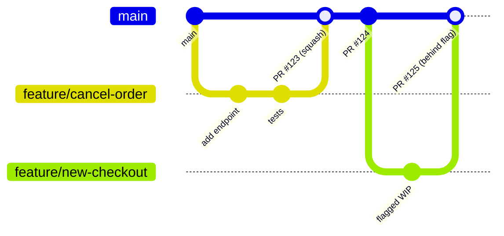
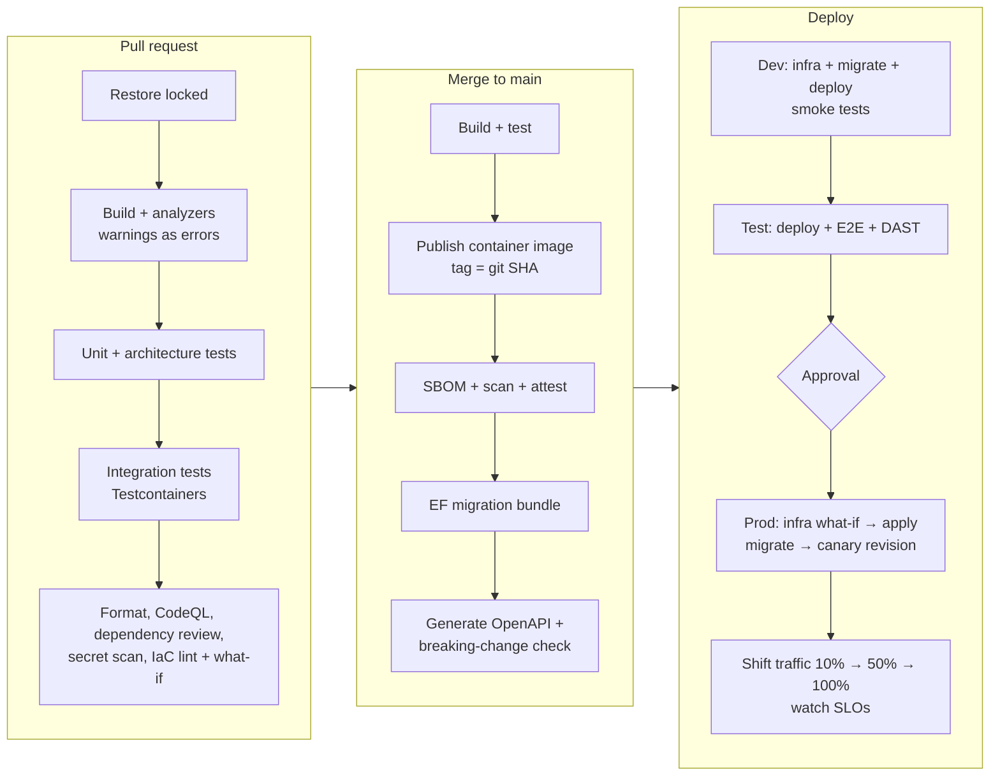

# 11 — DevOps & Delivery

> Branching, CI/CD pipelines, secure deployments, release strategies, database changes, mobile delivery, and measuring delivery performance.

---

## Contents

1. [Principles](#1-principles)
2. [Branching and workflow](#2-branching-and-workflow)
3. [Pipeline platform](#3-pipeline-platform)
4. [Pipeline design](#4-pipeline-design)
5. [Secure deployments with workload identity federation](#5-secure-deployments-with-workload-identity-federation)
6. [Environments, approvals and gates](#6-environments-approvals-and-gates)
7. [Deployment strategies](#7-deployment-strategies)
8. [Database changes in the pipeline](#8-database-changes-in-the-pipeline)
9. [Rollback and roll-forward](#9-rollback-and-roll-forward)
10. [Mobile delivery](#10-mobile-delivery)
11. [Release management](#11-release-management)
12. [Measuring delivery performance](#12-measuring-delivery-performance)
13. [Developer experience](#13-developer-experience)
14. [References](#14-references)

---

## 1. Principles

1. **Every merge to `main` is releasable** and automatically deployed to at least the dev environment.
2. **Build once, deploy many.** One immutable artefact (container image, mobile binary) per commit, promoted through environments with configuration — never rebuilt per environment.
3. **Everything as code**: pipelines, infrastructure, configuration, alerts.
4. **No manual production changes.** Production is changed only by pipelines. Humans approve; machines execute.
5. **No long-lived secrets in pipelines** — OIDC workload identity federation.
6. **Small batches.** Frequent, small deployments are lower risk than infrequent big-bang releases.
7. **Decouple deploy from release** with feature flags and progressive exposure.
8. **Fast feedback**: PR checks in minutes; problems detected in production within minutes via SLO alerts.

---

## 2. Branching and workflow

### 2.1 Trunk-based development (default)



- **`main`** is the trunk: protected, always green, always deployable.
- **Short-lived branches** (hours to ~2 days), one logical change each; rebase/merge `main` frequently.
- **Squash merge** (clean history, one commit per PR with a Conventional Commit message) or rebase merge — pick one per repo.
- **Incomplete work** ships behind **feature flags** rather than living on long branches.
- **Branch protection**: required PR review(s), required status checks, linear history, no force pushes, CODEOWNERS for sensitive paths, signed commits (optional).
- **Hotfixes** go through `main` like any other change (fast-tracked review); avoid separate hotfix branches unless supporting multiple released versions.
- **Release branches** only where you must support multiple versions concurrently (e.g., mobile app versions under store review needing a patch) — cut from `main`, cherry-pick fixes, short-lived.

### 2.2 Why not GitFlow?

GitFlow's long-lived `develop`/`release` branches increase merge pain, delay integration, and slow delivery. It suited boxed-software release cycles; for continuously delivered cloud services, trunk-based development correlates with higher delivery performance (DORA research).

---

## 3. Pipeline platform

| | GitHub Actions — default | Azure Pipelines |
|---|---|---|
| Best when | Code on GitHub; want integrated security (GHAS), Copilot, Dependabot, Codespaces | Code in Azure Repos; existing Azure DevOps investment; Azure Boards/Test Plans |
| Azure auth | OIDC federation (`azure/login`) | Workload identity federation service connections |
| Environments/approvals | Environments with required reviewers, wait timers, branch policies | Environments with approvals and checks |
| Reusable logic | Reusable workflows, composite actions | Templates |
| Hosted macOS for iOS | ✅ | ✅ |

Both are fully capable. Choose based on where the code and team live; don't split one product across both.

---

## 4. Pipeline design

### 4.1 Flow



### 4.2 Practices

- **Path filters**: only build/deploy what changed (`src/Api/**`, `src/Web/**`, `src/Mobile/**`, `infra/**`), but always run shared/contract checks when shared code changes.
- **Caching**: NuGet packages (keyed on lock files), Docker layers, Playwright browsers.
- **Reusable workflows/templates** for common steps (build .NET, publish container, deploy to Container Apps) shared across repos — part of the golden path.
- **Pin action versions by commit SHA** for third-party actions; least-privilege `permissions:` per job.
- **Fail fast** and give clear output: test summaries, coverage, what-if diffs, and OpenAPI diffs posted as PR comments.
- **Artefacts**: container images in ACR; migration bundle, OpenAPI spec, SBOM as pipeline artefacts tied to the commit.
- **Concurrency control**: one deployment per environment at a time (`concurrency:` group); later commits supersede queued ones in dev.

### 4.3 Example: GitHub Actions (API)

```yaml
name: api

on:
  pull_request:
    paths: ["src/Api/**", "src/Modules/**", "src/Shared/**", "tests/**", "Directory.*.props"]
  push:
    branches: [main]
    paths: ["src/Api/**", "src/Modules/**", "src/Shared/**", "Directory.*.props"]

permissions:
  contents: read

env:
  DOTNET_NOLOGO: true
  CI: true

jobs:
  build-test:
    runs-on: ubuntu-latest
    steps:
      - uses: actions/checkout@<sha> # v4
      - uses: actions/setup-dotnet@<sha> # v4
        with:
          global-json-file: global.json
          cache: true
          cache-dependency-path: "**/packages.lock.json"
      - run: dotnet restore --locked-mode
      - run: dotnet build --no-restore -c Release
      - run: dotnet format --verify-no-changes --no-restore
      - run: dotnet test --no-build -c Release --report-trx --coverage
      - uses: actions/upload-artifact@<sha>
        if: always()
        with: { name: test-results, path: "**/TestResults/**" }

  publish:
    if: github.event_name == 'push'
    needs: build-test
    runs-on: ubuntu-latest
    permissions:
      contents: read
      id-token: write          # OIDC
      attestations: write
      packages: write
    environment: build
    outputs:
      image: ${{ steps.meta.outputs.image }}
    steps:
      - uses: actions/checkout@<sha>
      - uses: actions/setup-dotnet@<sha>
        with: { global-json-file: global.json }
      - uses: azure/login@<sha> # v2
        with:
          client-id: ${{ vars.AZURE_CLIENT_ID }}
          tenant-id: ${{ vars.AZURE_TENANT_ID }}
          subscription-id: ${{ vars.AZURE_SUBSCRIPTION_ID }}
      - run: az acr login --name ${{ vars.ACR_NAME }}
      - id: meta
        run: echo "image=${{ vars.ACR_NAME }}.azurecr.io/shop-api:${{ github.sha }}" >> "$GITHUB_OUTPUT"
      - name: Publish container (SDK, no Dockerfile)
        run: >
          dotnet publish src/Api -c Release -t:PublishContainer
          -p:ContainerRegistry=${{ vars.ACR_NAME }}.azurecr.io
          -p:ContainerRepository=shop-api
          -p:ContainerImageTags=${{ github.sha }}
      - name: EF migration bundle
        run: |
          dotnet tool restore
          dotnet ef migrations bundle --project src/Modules/Ordering/Ordering --startup-project src/Api \
            --self-contained -r linux-x64 -o artifacts/efbundle-ordering
      - uses: actions/upload-artifact@<sha>
        with: { name: migrations, path: artifacts/ }
      # + SBOM generation, image scan, and actions/attest-build-provenance

  deploy-dev:
    needs: publish
    uses: ./.github/workflows/_deploy.yml      # reusable: infra what-if/apply, run migrations job, update container app
    with: { environment: dev, image: "${{ needs.publish.outputs.image }}" }
    secrets: inherit

  deploy-test:
    needs: deploy-dev
    uses: ./.github/workflows/_deploy.yml
    with: { environment: test, image: "${{ needs.publish.outputs.image }}", run-e2e: true }
    secrets: inherit

  deploy-prod:
    needs: deploy-test
    uses: ./.github/workflows/_deploy.yml
    with: { environment: prod, image: "${{ needs.publish.outputs.image }}", strategy: canary }
    secrets: inherit
```

(Replace `<sha>` with pinned commit SHAs; Dependabot keeps them current.)

---

## 5. Secure deployments with workload identity federation

**No client secrets or publish profiles in pipelines.** Use OpenID Connect:

1. Create a **user-assigned managed identity** (or app registration) per environment, e.g., `id-shop-deploy-prod`.
2. Add a **federated identity credential** trusting GitHub's OIDC issuer with a subject restricted to the repo **and environment**: `repo:contoso/shop:environment:prod`.
3. Grant that identity **least-privilege RBAC** on the target resource group (e.g., Contributor on `rg-shop-prod-app` + specific data-plane roles; avoid subscription-wide Owner). Role assignments in IaC may need *Role Based Access Control Administrator* with conditions limiting assignable roles.
4. Workflow uses `azure/login` with `id-token: write` permission — tokens are short-lived and scoped to the job.

Because the subject includes the **environment**, only jobs that pass that environment's protection rules (approvals, branch restrictions) can obtain production credentials.

Azure Pipelines equivalent: **workload identity federation service connections** (convert existing secret-based service connections).

---

## 6. Environments, approvals and gates

| Environment | Trigger | Protection |
|---|---|---|
| dev | Every merge to `main` | None (automatic) |
| test | After dev succeeds | Automatic; E2E + DAST gates |
| staging (optional) | After test | Load test gate for release candidates |
| prod | After test/staging | **Required reviewers** (not the author), deployment branch = `main` only, optional wait timer / business-hours window, health checks of prior env |

Gates to consider before prod: all tests green, no critical vulnerabilities, OpenAPI breaking-change check passed, SLOs currently healthy in prod (don't deploy into an incident), change freeze calendar.

Record every deployment (who approved, what commit, when) — GitHub/Azure DevOps keep this audit trail; also emit a deployment annotation to Application Insights.

---

## 7. Deployment strategies

| Strategy | How on Azure | Use |
|---|---|---|
| **Rolling** | Container Apps single-revision mode replaces replicas gradually | Default for dev/test and low-risk changes |
| **Blue/green** | Container Apps multiple-revision mode: deploy new revision with 0% traffic + label (`green`), test via label URL, switch 100%; App Service **deployment slots** with swap | Instant switch and instant rollback |
| **Canary** | Container Apps traffic splitting (e.g., 5% → 25% → 50% → 100%) with automated SLO checks between steps | Production default for API/web |
| **Feature flags** | App Configuration feature management with targeting/percentage | Release features independently of deployment; per-tenant/beta rollout; kill switches |
| **Dark launch** | Deploy code paths that run but don't affect users (shadow traffic, compare results) | High-risk rewrites |
| **Ring-based** | Internal users → beta tenants → everyone (feature flags with targeting) | B2B SaaS rollouts |

**Automated canary analysis**: between traffic steps, query App Insights for the new revision's error rate and latency vs the old; automatically roll back if worse beyond thresholds.

**Backward compatibility during rollout**: old and new versions run simultaneously — APIs, DB schema (expand/contract), message formats, and caches must tolerate both.

---

## 8. Database changes in the pipeline

1. Migrations are generated and reviewed in the PR (check the SQL: `dotnet ef migrations script`).
2. CI builds a **migration bundle** (or idempotent script) as an artefact.
3. CD runs the bundle **before** deploying the new app version, as a **Container Apps Job** (inside the VNet, with the migration identity that has DDL rights) or a pipeline step with network access.
4. Migrations must be **backward compatible** with the currently running app version (expand/contract — [04 §3.3](04-data-and-persistence.md#33-zero-downtime-changes-expandcontract)).
5. Long-running data backfills run as separate, resumable jobs — not inside schema migrations.
6. Destructive "contract" migrations ship in a later release once nothing depends on the old schema.
7. Take note of the PITR restore point before production migrations (automatic backups make this cheap) — rollback of schema is usually roll-forward with a fix, restore is the last resort.

---

## 9. Rollback and roll-forward

- **App rollback**: shift traffic back to the previous Container Apps revision (seconds) or swap slots back. Keep the previous revision active (at 0%) for a period after release.
- **Feature rollback**: turn off the feature flag — fastest and safest.
- **Config rollback**: App Configuration snapshots / revision history.
- **Schema**: prefer roll-forward (expand/contract makes the old app version still work with the new schema, so app rollback is safe).
- **Infra**: re-apply the previous IaC version; deployment stacks help detect drift.
- **Mobile**: you can't roll back installed apps — halt staged rollout, fix forward, use remote config/feature flags to disable problematic features, and server-side compatibility to protect old clients.
- Document rollback steps in the release runbook and **practise them**.

---

## 10. Mobile delivery

Summary (details in [06 §12](06-mobile-applications.md#12-build-signing-and-distribution)):

- PR: build Android + iOS (Release config to catch AOT/trimming issues), run `Mobile.Core` unit tests.
- Main: signed builds with auto-incremented build numbers → TestFlight + Google Play internal track automatically.
- Promotion to production via store tooling (fastlane / App Store Connect API / Google Play Developer API) with **phased/staged rollout**, gated on crash-free metrics.
- Signing material in Key Vault or encrypted CI secrets, scoped to a protected environment.
- macOS runners for iOS (cost: hosted macOS minutes are more expensive — cache aggressively, build iOS only when mobile code changes).

---

## 11. Release management

- **Versioning** from Git (MinVer/Nerdbank.GitVersioning); Conventional Commits drive SemVer bumps and changelogs (release-please, semantic-release, or GitVersion).
- **Release notes** generated from merged PRs, curated for user-facing changes.
- **Tags**: `api/v2.3.0`, `mobile/v2.4.0` (prefixes in a monorepo).
- **Communicate** deprecations and breaking API changes ahead of time (developer portal, changelog, `Deprecation`/`Sunset` headers).
- **Change management**: for regulated environments, the pipeline's audit trail (PR approval + environment approval + automated tests) usually satisfies change control — agree this with compliance rather than adding manual CAB steps.

---

## 12. Measuring delivery performance

Track the **DORA metrics** ([dora.dev](https://dora.dev/)):

| Metric | Definition | Elite benchmark (indicative) |
|---|---|---|
| **Deployment frequency** | How often you deploy to production | On demand (multiple per day) |
| **Lead time for changes** | Commit → running in production | < 1 day |
| **Change failure rate** | % of deployments causing a failure needing remediation | ≤ ~5–15% |
| **Failed deployment recovery time** | Time to restore service after a failed change | < 1 hour |

Plus **reliability** (SLO attainment). Collect from pipeline and incident data (GitHub/Azure DevOps APIs, DORA dashboards). Use them to find bottlenecks, **never** to compare or rank individuals or teams.

---

## 13. Developer experience

A smooth inner loop is a productivity multiplier:

- **One-command local run**: `aspire run` starts API, web, workers, databases, caches, emulators, and the dashboard.
- **Dev Containers / GitHub Codespaces** definition (`.devcontainer/`) with the SDK, workloads, tools, and extensions pinned — new joiners productive in minutes.
- **Project templates**: package the golden path as `dotnet new` templates (solution skeleton with ServiceDefaults, AppHost, module template, test projects, pipelines, Bicep) — keep them in sync with this handbook.
- **Local tools manifest** (`.config/dotnet-tools.json`): `dotnet-ef`, `dotnet-format`, Kiota, etc. — `dotnet tool restore`.
- **Hot reload** for API/Blazor/MAUI; Aspire dashboard for debugging distributed flows.
- **Pre-commit hooks** (optional, e.g., Husky.Net): format, secret scan.
- **AI coding assistants/agents**: keep repository instruction files (e.g., `CLAUDE.md`, `.github/copilot-instructions.md`, `AGENTS.md`) aligned with these guidelines so generated code follows the same conventions; all AI-generated code goes through normal review and CI.
- **Documentation**: `README` with quick start; `CONTRIBUTING.md` with workflow; ADRs and runbooks in `docs/`.

---

## 14. References

- [GitHub Actions: deploying to Azure with OIDC](https://docs.github.com/actions/security-for-github-actions/security-hardening-your-deployments/configuring-openid-connect-in-azure)
- [Workload identity federation](https://learn.microsoft.com/entra/workload-id/workload-identity-federation)
- [Blue-green deployment in Azure Container Apps](https://learn.microsoft.com/azure/container-apps/blue-green-deployment)
- [Traffic splitting in Container Apps](https://learn.microsoft.com/azure/container-apps/traffic-splitting)
- [Feature management in .NET](https://learn.microsoft.com/azure/azure-app-configuration/feature-management-dotnet-reference)
- [EF Core migration bundles](https://learn.microsoft.com/ef/core/managing-schemas/migrations/applying#bundles)
- [Trunk-based development](https://trunkbaseddevelopment.com/)
- [DORA research](https://dora.dev/)
- [Security hardening for GitHub Actions](https://docs.github.com/actions/security-for-github-actions/security-guides/security-hardening-for-github-actions)
