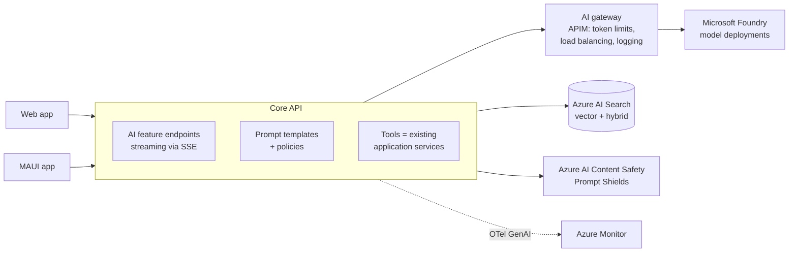

# 13 — AI Integration

> Adding generative AI features (chat, summarisation, extraction, RAG, agents) to .NET applications on Azure — responsibly, observably, and cost-effectively.

---

## Contents

1. [When to use AI — and when not to](#1-when-to-use-ai--and-when-not-to)
2. [Architecture](#2-architecture)
3. [.NET building blocks](#3-net-building-blocks)
4. [Models and hosting on Azure](#4-models-and-hosting-on-azure)
5. [Retrieval-augmented generation (RAG)](#5-retrieval-augmented-generation-rag)
6. [Agents and tool calling](#6-agents-and-tool-calling)
7. [Safety, security and responsible AI](#7-safety-security-and-responsible-ai)
8. [Evaluation](#8-evaluation)
9. [Observability](#9-observability)
10. [Cost and performance](#10-cost-and-performance)
11. [AI in web and mobile clients](#11-ai-in-web-and-mobile-clients)
12. [AI feature checklist](#12-ai-feature-checklist)
13. [References](#13-references)

---

## 1. When to use AI — and when not to

Good fits:
- Understanding or generating **natural language** (summaries, drafting, classification, extraction from unstructured text/documents/images).
- **Search and Q&A** over your own content (RAG).
- **Assistive workflows** where a human reviews the output (support reply drafts, code suggestions, data entry from documents).
- **Agentic automation** of multi-step tasks with well-defined tools and guardrails.

Poor fits:
- Deterministic business rules, calculations, and validations — **write code**. ("If you can write a function to handle the task, do that instead of using an AI agent.")
- Decisions with legal/financial/safety impact **without** human oversight.
- Anything where you cannot tolerate occasional wrong answers and cannot verify outputs.

Treat model output as **untrusted, probabilistic input** — validate it like user input.

---

## 2. Architecture



Principles:
- **AI is a capability behind your API**, not something clients call directly. Clients never hold model keys or endpoints. The API applies authentication, authorization, rate limits, data access rules, and safety checks.
- **Tools are your existing application services**, invoked with the *user's* permissions — the model can never do more than the user could.
- **Abstract the model** behind `IChatClient` so you can switch models/providers, test with fakes, and layer cross-cutting concerns.
- **Stream responses** (Server-Sent Events, `IAsyncEnumerable`) for good UX.
- Consider an **AI gateway** (Azure API Management's AI gateway capabilities) when multiple apps share model deployments: token-based rate limiting, quota per consumer, load balancing/failover across deployments and regions, semantic caching, and central logging.
- **Prompts are code**: versioned in the repo, reviewed, and covered by evaluations.

---

## 3. .NET building blocks

| Library | Purpose |
|---|---|
| **Microsoft.Extensions.AI** (`IChatClient`, `IEmbeddingGenerator<,>`) | Provider-agnostic abstractions for chat and embeddings, with a **middleware pipeline** (function invocation, caching, OpenTelemetry, logging, rate limiting, custom). The foundation for everything else. |
| **Microsoft.Extensions.VectorData** | Abstractions over vector stores (Azure AI Search, Cosmos DB, PostgreSQL pgvector, Redis, Qdrant, in-memory). |
| **Microsoft Agent Framework** (`Microsoft.Agents.AI.*`) | Building agents and multi-agent **workflows** (successor to Semantic Kernel and AutoGen agent capabilities), built on Microsoft.Extensions.AI. ⚠ Verify GA status of packages before production use. |
| **Model Context Protocol (MCP) C# SDK** | Expose your tools/data to MCP-compatible agents, or consume MCP servers as tools. |
| **Microsoft.Extensions.AI.Evaluation** | Evaluate response quality, safety, and groundedness in tests/CI. |
| **Azure.AI.OpenAI / OpenAI SDK, Azure AI Inference** | Provider SDKs that expose `IChatClient` via `AsIChatClient()`. |
| **Aspire integrations** | Model/Foundry resources in the AppHost, local model hosting (e.g., Ollama) for dev. |

### 3.1 Registering a chat client pipeline

```csharp
builder.Services.AddSingleton(sp =>
    new AzureOpenAIClient(new Uri(builder.Configuration["AI:Endpoint"]!), new DefaultAzureCredential()));

builder.Services.AddChatClient(sp => sp.GetRequiredService<AzureOpenAIClient>()
        .GetChatClient(builder.Configuration["AI:ChatDeployment"]!).AsIChatClient())
    .UseDistributedCache()          // cache identical requests (only where appropriate)
    .UseFunctionInvocation()        // automatic tool calling
    .UseOpenTelemetry(configure: o => o.EnableSensitiveData = builder.Environment.IsDevelopment())
    .UseLogging();

builder.Services.AddEmbeddingGenerator(sp => sp.GetRequiredService<AzureOpenAIClient>()
        .GetEmbeddingClient(builder.Configuration["AI:EmbeddingDeployment"]!).AsIEmbeddingGenerator());
```

### 3.2 Structured output

Ask for typed results instead of parsing free text:

```csharp
public sealed record TicketTriage(string Category, Priority Priority, string Summary, bool NeedsHuman);

var response = await chatClient.GetResponseAsync<TicketTriage>(
[
    new(ChatRole.System, Prompts.TicketTriageSystem),
    new(ChatRole.User, ticket.Body)
], cancellationToken: ct);

if (!response.TryGetResult(out var triage)) { /* fallback: route to human */ }
// Still validate: allowed categories, lengths, etc.
```

---

## 4. Models and hosting on Azure

- **Microsoft Foundry** (formerly Azure AI Foundry) is the platform for model deployments (Azure OpenAI models and many others), agents, evaluations, and safety. ⚠ Verify current product naming and SKUs.
- **Model selection**: start with a capable general model to prove value, then **evaluate smaller/cheaper models** for each task (classification and extraction often work well on small models). Keep the model choice configurable per feature.
- **Deployment types**: Standard (pay-per-token, regional), **Global/Data Zone** (higher throughput, routed across regions — check data residency requirements), **Provisioned throughput (PTU)** for predictable high-volume workloads.
- **Security**: **managed identity** (Cognitive Services OpenAI User role) — disable key auth; **private endpoints**; content filtering configured; diagnostic logs to Log Analytics.
- **Quotas and limits**: tokens-per-minute (TPM) and requests-per-minute per deployment; handle **429** with backoff; spread load across deployments/regions via the gateway.
- **Model lifecycle**: models are versioned and retired on a schedule — track retirement dates, pin versions, and re-run evaluations before upgrading.
- **Data handling**: understand and document how prompts/completions are processed and stored (abuse monitoring, opt-outs where eligible) for privacy and compliance reviews.

---

## 5. Retrieval-augmented generation (RAG)

Ground model answers in your data rather than relying on model knowledge.

### 5.1 Pipeline

1. **Ingest**: extract text from sources (documents via **Azure AI Document Intelligence** / Content Understanding, database records, web pages).
2. **Chunk**: split into semantically coherent chunks (e.g., 300–800 tokens with overlap; respect headings/sections).
3. **Enrich**: metadata (source, title, URL, tenant, **access control list**, last updated).
4. **Embed** chunks and **index** in **Azure AI Search** (vector + keyword fields) — or pgvector/Cosmos DB vector search if data already lives there.
5. **Retrieve**: **hybrid search** (BM25 + vector) with **semantic ranker**; filter by tenant and user permissions **at query time**.
6. **Generate**: prompt with retrieved chunks, instructions to answer only from provided context, and to cite sources.
7. **Cite**: return citations to the UI so users can verify.

### 5.2 Practices

- **Security trimming is mandatory**: a user must never get answers derived from documents they can't access. Store ACLs/tenant IDs with chunks and filter on every query (Azure AI Search supports document-level security filtering).
- Keep the index **fresh** (incremental indexing via change feed/events/indexers); track `lastUpdated`.
- Evaluate retrieval quality separately from generation quality (are the right chunks being found?).
- Handle "I don't know" — instruct the model to say so when context is insufficient, and test that it does.
- Consider **agentic retrieval** (multi-query planning) for complex questions, measured against simpler approaches.

---

## 6. Agents and tool calling

- **Start simple**: a single model call with structured output → a model with a few tools → an agent → multi-agent workflow. Move up only when evaluation shows the simpler approach is insufficient.
- **Workflows over autonomy** for business processes: use explicit, deterministic workflow steps (Agent Framework workflows, Durable Functions) with model calls at specific points, rather than an open-ended agent deciding everything.
- **Tool design**:
  - Small, well-named, well-described functions with typed parameters.
  - Tools execute **as the user** with the user's authorization — never with elevated service privileges.
  - **Read-only by default**; write/side-effecting tools require **human confirmation** (human-in-the-loop approval) for anything consequential (sending emails, payments, deleting data).
  - Validate all tool arguments as untrusted input; enforce limits (max items, allowed values).
  - Idempotent where possible; log every tool invocation (who, what, arguments, result) for audit.
- **Bound execution**: max iterations/tool calls, timeouts, token budgets per request.
- **MCP**: expose curated capabilities via an MCP server for internal agent ecosystems; consume third-party MCP servers only from trusted sources, with least privilege, and treat their outputs as untrusted.

---

## 7. Safety, security and responsible AI

### 7.1 Threats specific to LLM apps

Refer to the [OWASP Top 10 for LLM Applications](https://genai.owasp.org/llm-top-10/):

| Threat | Mitigation |
|---|---|
| **Prompt injection** (direct, and *indirect* via retrieved documents, emails, web pages, tool results) | **Azure AI Content Safety Prompt Shields**; clearly delimit untrusted content; never let model output directly trigger privileged actions without validation/approval; least-privilege tools; treat retrieved content as data. |
| **Sensitive information disclosure** | Security trimming in RAG; don't put secrets in prompts; redact PII before sending where not needed; output filtering. |
| **Insecure output handling** | Encode model output in UI (no raw HTML rendering — sanitize Markdown); never execute model-generated code/SQL without sandboxing and validation. |
| **Excessive agency** | Minimal tool set; read-only defaults; human approval for side effects. |
| **Denial of wallet / resource exhaustion** | Per-user token quotas and rate limits; max input sizes; gateway limits. |
| **Training data / model supply chain** | Use vetted models from trusted catalogues; pin versions. |
| **Misinformation / hallucination** | Grounding with citations; groundedness evaluation; UX that signals AI-generated content and invites verification. |

### 7.2 Content safety

- Enable **content filters** on model deployments (hate, sexual, violence, self-harm; jailbreak/prompt attack detection; protected material).
- Use **Azure AI Content Safety** APIs for additional checks on user input and model output where appropriate (e.g., user-generated content features).
- Log and review filter triggers to tune thresholds and detect abuse.

### 7.3 Responsible AI

Follow Microsoft's Responsible AI principles (fairness, reliability & safety, privacy & security, inclusiveness, transparency, accountability):
- **Transparency**: tell users when they're interacting with AI or seeing AI-generated content; explain limitations.
- **Human oversight** for consequential decisions; easy ways to correct or override AI output.
- **Feedback loops**: thumbs up/down and reporting in the UI, feeding evaluation datasets.
- **Impact assessment** for new AI features (who could be harmed, how; mitigations) — the [Microsoft Responsible AI Impact Assessment template](https://www.microsoft.com/ai/tools-practices) is a good starting point.
- **Regulation**: track obligations such as the **EU AI Act** (risk classification, transparency duties for generative AI) relevant to your markets.

---

## 8. Evaluation

You can't unit-test LLM behaviour with exact assertions — you **evaluate** it.

- **Golden datasets**: curated inputs with expected outputs/criteria per feature (start with 30–100 realistic cases including edge cases and adversarial prompts; grow from production feedback).
- **Metrics**: relevance, groundedness, coherence, fluency, completeness, retrieval precision/recall, task success, safety (harmful content, jailbreak susceptibility), and cost/latency.
- **Tooling**: **Microsoft.Extensions.AI.Evaluation** (quality and safety evaluators usable from xUnit, with reporting and response caching) and **Foundry evaluations** (including AI red-teaming agent for adversarial testing).
- **In CI**: run evaluations on prompt/model changes; fail if scores regress beyond thresholds. Cache model responses to keep CI cost and flakiness down.
- **Online evaluation**: sample production traffic (with privacy controls) for continuous quality monitoring; A/B test prompt or model changes behind feature flags.

---

## 9. Observability

- Use `UseOpenTelemetry()` on the `IChatClient` pipeline — emits spans and metrics following the **OpenTelemetry GenAI semantic conventions** (model, operation, token usage, latency, finish reason).
- Track per feature: **token usage (input/output)**, **cost estimate**, latency (time to first token, total), error/429 rate, content filter triggers, tool call counts, user feedback score.
- **Don't log full prompts/completions by default** in production (PII, confidential data). Enable sensitive data capture only in dev or with explicit data-handling approval and short retention.
- Correlate AI calls with the user request trace for debugging.
- Dashboards and budget alerts on token consumption per feature/tenant.

---

## 10. Cost and performance

- **Right-size models per task**; route simple tasks to small models.
- **Prompt economy**: concise system prompts, trim history (chat reducers), retrieve fewer but better chunks.
- **Caching**: exact-match response caching for repeated identical requests (deterministic tasks); semantic caching at the gateway with care (risk of returning wrong cached answers); **prompt caching** offered by models for long static prefixes (structure prompts with static content first).
- **Streaming** for perceived latency; **batch APIs** for offline bulk processing at lower cost.
- **Quotas per user/tenant** to prevent runaway costs; budgets and alerts.
- **PTUs** when steady high volume makes provisioned capacity cheaper and more predictable.
- Asynchronous processing (queue + worker) for non-interactive AI tasks (document processing, enrichment).

---

## 11. AI in web and mobile clients

- **Web**: stream responses to Blazor via SSE or SignalR; render Markdown safely (sanitize); show citations; provide stop/regenerate and feedback controls; accessible live-region announcements for streaming text.
- **Mobile**: call the API (never models directly); handle streaming over flaky networks (resume or graceful fallback); consider **on-device models** for privacy/offline scenarios — .NET MAUI has experimental `Microsoft.Maui.Essentials.AI` integration with platform models (e.g., Apple Intelligence) exposed via `IChatClient` ⚠ experimental, verify platform support.
- Make AI features **optional and degradable**: if the model is unavailable or rate-limited, the core app still works.

---

## 12. AI feature checklist

- [ ] Clear use case where AI beats deterministic code; success metrics defined.
- [ ] Model access only via the API with managed identity; no keys in clients or config.
- [ ] `IChatClient` abstraction with telemetry, logging, and (if used) function invocation middleware.
- [ ] Prompts versioned in repo; evaluation dataset and thresholds in CI.
- [ ] RAG retrieval enforces tenant and user permissions.
- [ ] Prompt Shields / content filters enabled; indirect prompt injection considered.
- [ ] Tools least-privilege, run as the user; side effects require human approval.
- [ ] Model output validated (structured output + checks) and safely rendered.
- [ ] Token quotas/rate limits per user/tenant; budget alerts.
- [ ] Transparency to users (AI-generated labels, limitations) and feedback mechanism.
- [ ] Responsible AI impact assessment completed; privacy review of data sent to models.
- [ ] Fallback behaviour when AI is unavailable.
- [ ] Model version pinned; retirement dates tracked.

---

## 13. References

- [AI for .NET developers](https://learn.microsoft.com/dotnet/ai/)
- [Microsoft.Extensions.AI — IChatClient](https://learn.microsoft.com/dotnet/ai/ichatclient)
- [Microsoft Agent Framework](https://learn.microsoft.com/agent-framework/overview/)
- [Microsoft.Extensions.AI.Evaluation](https://learn.microsoft.com/dotnet/ai/evaluation/libraries)
- [MCP C# SDK](https://github.com/modelcontextprotocol/csharp-sdk)
- [Microsoft Foundry documentation](https://learn.microsoft.com/azure/ai-foundry/)
- [Azure AI Search — RAG overview](https://learn.microsoft.com/azure/search/retrieval-augmented-generation-overview)
- [Azure AI Content Safety](https://learn.microsoft.com/azure/ai-services/content-safety/)
- [AI gateway in Azure API Management](https://learn.microsoft.com/azure/api-management/genai-gateway-capabilities)
- [OWASP Top 10 for LLM Applications](https://genai.owasp.org/llm-top-10/)
- [Microsoft Responsible AI](https://www.microsoft.com/ai/responsible-ai)
